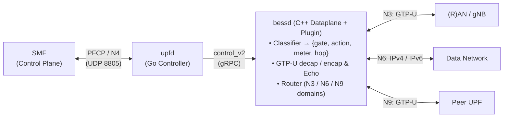

# upf — a 5G UPF on BESS

One Go controller (`upfd`) speaks PFCP/N4 to the SMF and drives one `bessd`
through control_v2: the graph is applied once, and every PFCP session change
becomes one transaction. The UPF-specific datapath is a BESS plugin in
`datapath/`; the rest of the pipeline is BESS's own classifier, meter and
router. A rule's result writes the action id, the meter stack and the next hop
straight into metadata; there is no action table in the chain.



## Pipeline

<p align="center">
  
</p>

## Onboarding

**You need:** Linux, Go 1.27.2+, meson, ninja, pkg-config, python3. For the
datapath, a `bess-dev` stage: this tree reads its own copy under `build/bess/`
(untracked), vendored from a built checkout of the BESS fork
(`github.com/krsna1729/bess`) with `ci/vendor-bess.sh`; the layout and the
`BESS`/`STAGE`/`DPDK_LIB` overrides are in the header of `ci/bess-env.sh`.
No NIC is needed for the lanes below. `ci/veth-port.sh`,
`ci/veth-transport.sh` and `ci/veth-layouts.sh` need root; they create
isolated veth pairs (and, for veth-transport, a network namespace) and delete
only what they created. The other lanes run unprivileged and start their own
daemon on free ports.

### The Go side — no BESS needed

```sh
go build ./cmd/upfd
go test ./cmd/... ./internal/...
```

`./upfd` alone serves N4 and refuses sessions; a session needs the session
layer, which is `-bess <addr>` against a running daemon.

### The datapath

```sh
# one-time, if build/bess is absent: import the fork's built tree
ci/vendor-bess.sh ~/Projects/bess

PKG_CONFIG_PATH=$PWD/build/bess/stage/lib/pkgconfig \
  meson setup datapath/build datapath
ninja -C datapath/build

# first proof: bessd loads the plugin, a G-PDU is decapsulated, an outer
# header is built, and both frames are byte-checked
ci/smoke-gtpu.sh
```

### Run it

```sh
# controller only: N4 is served, session requests are refused (no session layer)
./upfd -n4 0.0.0.0:8805 -node-id 10.0.0.1

# against a daemon that has deploy/upf.yaml applied
./upfd -bess 127.0.0.1:10514 -n4 0.0.0.0:8805 -node-id 10.0.0.1 \
  -fteid-address 'endpoint=1,reference=n3,transport-domain=1,source=access,ipv4=192.0.2.1' \
  -fteid-address 'endpoint=2,reference=n9,transport-domain=2,source=core,ipv4=192.0.2.3' \
  -gtpu-decap decap0 -gtpu-end-markers echo0 -end-marker /tmp/upf-end-marker.sock \
  -urr-interval 1s
```

The sample maps endpoint 1 to N3 and endpoint 2 to N9. Each endpoint binds an
ingress F-TEID identity and a transport route domain; N9 may be omitted when the
deployment does not serve it. The graph's post-encap Router resolves the peer
MAC from ARP/ND. `-gtpu-end-markers`, `-end-marker` and `-urr-interval` let
the report tick relay a received End Marker through the transit or forwarding
tunnel its F-TEID forwards into, within one interval.

`ci/session-path.sh` exercises a PFCP-programmed session on both synthetic
packet chains and checks the End Marker. `ci/veth-port.sh` exercises a
compiler-programmed session and routed egress on a real veth.
`ci/veth-layouts.sh` exercises nine one-to-four-PMD attachment layouts, each as
the production-shaped graph with one compiler holding every permitted
scenario's sessions (Modes 1 to 6 and N19, set up over N4): each scenario's real N3/N9
G-PDUs or N6 traffic on every attachment, endpoint-scoped admission and an
unknown-TEID case.

## The inner loop

```sh
go test ./cmd/... ./internal/...                 # after a Go change
ninja -C datapath/build && ci/smoke-gtpu.sh      # after a datapath change
ci/verify.sh --quick                             # every claim's unit evidence
ci/verify.sh --lanes-only                        # every cited lane
ci/verify.sh                                     # both, then render the register
ci/verify.sh --render                            # markdown only, last results
```

`./...` also walks the untracked lane scratch under `build/run`, so build and
test the two source trees explicitly, as above. `ci/verify.sh --benches` adds
the benchmark lanes.

Run the lane that proves the path you touched:

| lane | what it proves |
|---|---|
| `ci/smoke-gtpu.sh` | decap, encap, echo reply, Error Indication; QFI and DSCP bytes |
| `ci/session-path.sh` | one session programmed over the SDK; both chains and the End Marker byte-checked |
| `ci/route-path.sh` | the same session with the Router in destination mode: the FIB, not the action's hop, picks the exit |
| `ci/n4-path.sh` | PFCP message → compiler → one transaction → packets; restart and checkpoint replay |
| `ci/session-report.sh` | URR reports — period, threshold, quota — over PFCP |
| `ci/buffer-path.sh` | BAR buffering, DDN, and the duration's expiry |
| `ci/iface-path.sh` | every Source/Destination Interface value and the exit it names; a ULCL session's two uplink PDRs take the data network's hop and an N9 tunnel, and its remote PSA's downlink arrives on N9; Mode 4's N9 transit, N19 through a group-level session, and Mode 6's indirect forwarding step by step, End Markers relayed through its tunnels and Mode 4's; Modes 1 to 6 and N19 live together with every stream at once, each session's bytes at its own exit |
| `ci/veth-port.sh` | one PMD port split into N3/N6/N9; the post-encap Router resolves its outer next hop on the veth (needs root) |
| `ci/veth-transport.sh` | the outer transport Router on a veth, byte-checked on the peer: ARP and ND resolution, outer TTL/hop limit decremented once and the inner TTL only by the inner hop (IPv4 and IPv6 tunnels), routed End Markers, a neighbor MAC change followed, an unreachable gateway failing closed (needs root) |
| `ci/veth-layouts.sh` | nine real-veth layouts: all five 1–3-PMD partitions, MAC/VLAN demux, direct per-port tags, four-port fan-in; each the production-shaped graph with Modes 1 to 6 and N19 established together over N4 and driven on every attachment, End Markers relayed through transit and forwarding tunnels to the peer, same N3/N9 local IPv4+TEID, and unknown-TEID handling (needs root) |
| `ci/session-instances.sh` | one subscriber address served by two network instances, each with its own F-TEID and exit |
| `ci/atsss-steer.sh` | a MAR's two accesses, the health table, policy update and erase; every window byte-checked |
| `ci/bench-n4.sh` | the N4 envelope: establish / modify / delete rates |

Every lane starts its own `bessd` on free ports, writes under `build/run/`, and
fails unless the daemon shuts down cleanly. A datapath change that no lane
observes is not proven.

### The rules that keep it honest

- **A claim carries evidence.** `docs/claims.json` is the source; `ci/verify.sh`
  runs every cited test and lane and renders `docs/claims.md`. Never edit the
  markdown by hand. Every claim names its specification, pinned release
  version and clause; the texts are in `docs/spec/`.
- **Fail first where practical.** Write the test that fails on the old code,
  then fix it; the commit that closes a gap says so.
- **A lane that records a number uses its own graph**, so the number does not
  move under unrelated changes. `deploy/*.yaml` is the deployment's
  configuration.
- **Generated files carry no timestamps**, so a rerun with the same verdicts is
  byte-identical.

## Where things are

| path | what |
|---|---|
| `cmd/upfd/` | the controller: PFCP server, session store, flags |
| `internal/n4/` | association, heartbeats, restart detection, reports, the PFCP state machine |
| `internal/session/` | the compiler and model: PFCP objects → one BESS transaction |
| `internal/routing/` | network instances, route domains, per-egress hops, ARP identity |
| `internal/bess/` | the SDK wrapper: resources, transactions, bootstrap, restart handling |
| `datapath/` | the plugin: decap, encap, responder, counters, ARP, the keyed PDR matcher |
| `deploy/` | the deployment graph and the lanes' graphs |
| `ci/` | the lanes, the claims contract, the interop rig |
| `docs/` | design, datapath reference, claims register, interop record |
| `docs/spec/` | the pinned Release 16 3GPP excerpts the claims cite, with source URLs and hashes |

## Status

The last full evidence run: **50 claims — 47 ok, 1 gap, 2 skip, 0 fail**.

- Open: Packet Rate (QER packet caps and their query). MAR/ATSSS-LL is
  implemented for active/standby; the other Steering Modes and MPTCP remain
  open (`status-38`).
- Skipped here: two claims whose lanes need environments this host lacks.
- Real-SMF interop: stock free5GC v4.3.0, unshimmed, through session deletion
  (`docs/interop.md`).
- Competitive mean over twelve compliance blocks: **78**.

`docs/claims.md` is the detail: one line per claim, its proof, and the field
matrix with the per-cell audit.

## Read next

- `docs/engineering-guide.md` — the rules review and the lanes enforce (scale,
  3GPP, the BESS interface, lanes, measurement, pull requests).
- `docs/design.md` — why the deployment is shaped this way: walls, costs,
  milestones.
- `docs/datapath.md` — modules, resources and keys, placement, and the
  processing graphs for both directions.
- `docs/claims.md` — clause-by-clause status, the evidence, and the competitive
  score.
- `docs/interop.md` — a real SMF against this UPF, including the failure record
  that got it there.
