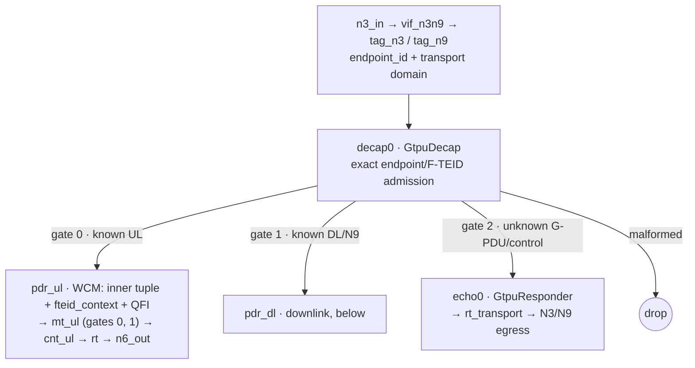
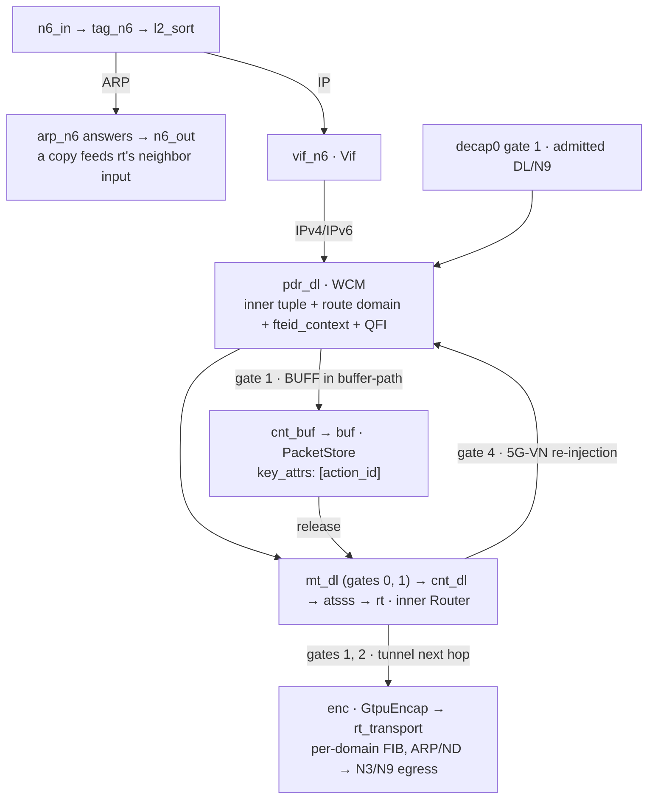
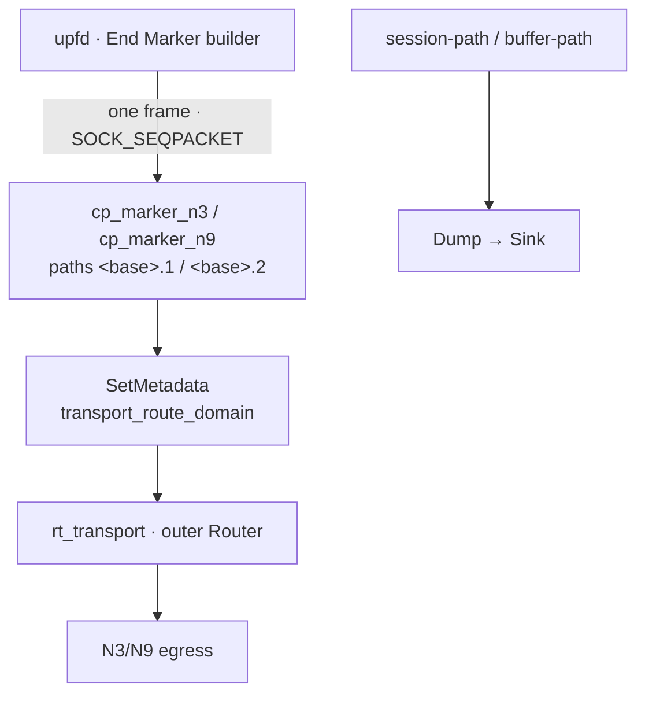

# The datapath: modules, resources and placement

Section references in this document are to the pinned 3GPP Release 16
excerpts in `docs/spec/`; the claims register names the exact version and clause
for every conformance claim.
Claims -- what is verified, and by which evidence -- live in
`docs/claims.md`; this document explains mechanisms, not status.

Engineering reference for `datapath/` (the UPF's BESS plugin) and the graphs it
plugs into. It is deliberately narrower than the other files:

| file | what it owns |
|---|---|
| `docs/design.md` | why the deployment is shaped this way: the walls, the costs, the milestones |
| **`docs/datapath.md`** (this) | what each module is, which resource it owns and under which key, what it takes from BESS, how packets and workers are placed |
| `docs/claims.md` | clause-by-clause status, the evidence that proves each entry, and the competitive scores |
| `docs/interop.md` | the real-SMF interoperability record (free5GC v4.3.0) |
| `README.md` | how to build, run and prove |

## Compiler targets

`upfd -target graph` (the default) preserves the module graph's flags and
`<module>/<table>` resource names. `-target appliance -appliance upf` addresses
one `UpfAppliance` module between input and output port modules, not dummy
modules or a hidden graph. PFCP parsing, session compilation, key/value types
and PDR result records are shared. `internal/session/target.go` owns resource
names, command destinations, the startup reset list and End Marker sockets.
`-target session-major -appliance upf` is the same appliance with the
session-major layout, `UpfSessionAppliance` ("Session-major" below):
`deploy/session-major.yaml`, plus `-max-sessions`, `-session-actions` and
`-session-qers` equal to the module's `session` arguments.

`deploy/appliance.yaml` is the port-only production composition. From the
repository root, create `build/run`, apply that manifest, and run:

```sh
upfd -target appliance -appliance upf -urr-interval 1s \
  -end-marker build/run/upf-end-marker.sock \
  -fteid-address 'endpoint=1,reference=n3,transport-domain=1,source=access,ipv4=192.0.2.1' \
  -fteid-address 'endpoint=2,reference=n9,transport-domain=2,source=core,ipv4=192.0.2.3'
```

The behavioral lanes choose `UPF_TARGET=graph` (default), `UPF_TARGET=appliance`
or `UPF_TARGET=session-major` (`deploy/session-path-session-major.yaml`):
`ci/session-path.sh`, `ci/n4-path.sh`, and `ci/session-report.sh`. `STAGE`,
`PLUG`, `DPDK_LIB`, `GO`, and `TMPDIR` remain overrides. The appliance arm
applies `deploy/session-path-appliance.yaml`, whose Sources, Rewrites, Dumps
and Sinks are external test instrumentation, not appliance internals.
Both arms assert external packet bytes and counters; only the graph exposes
the intermediate pre-routing decap frame. The appliance arm checks the
complete preserved UDP payload at N6 instead. The GBR color-split assertion
reads the owned module's `bess_upf_meter_packets_total` with `direction=ul`
and `color=green|yellow|red`; the graph arm retains its meter gate counters.
Both test manifests include the production outer transport Router. This
intentionally changes the old graph lane's outer IPv4 TTL expectation from
64 to 63; the exact DSCP/header byte assertion is identical for both targets.


| logical table | graph resource | appliance resource (`-appliance upf`) |
|---|---|---|
| F-TEIDs | `<gtpu-decap>/fteids` | `upf/fteids` |
| UL / DL PDRs | `<pdr-table-ul|dl>/rules` | `upf/pdr_ul`, `upf/pdr_dl` |
| UL / DL QER meters | `<meters-ul|dl>/meters` | `upf/meters` |
| UL / DL URR counters | `<counters-ul|dl>/counters` | `upf/counters_ul`, `upf/counters_dl` |
| buffering arrival counters | `<buffer-counter>/counters` | `upf/buffer_counters` |
| UL / DL / MAR tunnels | `<tunnels-ul|tunnels>/tunnels` | `upf/tunnels` |
| ATSSS policies / health | `<atsss>/policies`, `<atsss>/health` | `upf/policies`, `upf/health` |
| subscriber ARP entries | `<instances arp=...>/entries` | `upf/entries` |
| buffering flow configuration | `<buffer-store>/flows` | `upf/flows` |

The action-id pool is shared by UL, DL and MAR tunnel allocations, but **UL
and DL counter cells must remain separate**. A PDR can change direction while
keeping its action id. Counter cells outlive entries; sharing cells would
attribute old-direction totals to the new direction and report usage twice.
The buffering counter is separate too: it deliberately uses the same action
id as the direction counter. Meters safely share a table because the single
meter pool allocates different ids for UL and DL. Tunnel values are
configuration, rewritten in place, and their shared action-id pool prevents
two live PDRs or MAR accesses owning the same key.

All appliance commands go to the real module name (`upf`):

* `get_counts` uses `upf.pb.UrrCountCommandGetCountsArg` with **`string table = 3`**,
  selecting `counters_ul`, `counters_dl` or `buffer_counters`; action ids and
  `restart_window` are unchanged. Graph requests omit `table` entirely, so
  old graph schemas still work. An appliance request against a schema lacking
  the field fails rather than reading another counter table.
* `release`, `drop` and `clear` retain the existing `bess.pb.PacketStoreCommand*Arg`
  types. `drain_errors` and `drain_end_markers` retain the
  `upf.pb.GtpuResponderCommand*Arg` types. These commands have one destination
  table/state each, so need no additional selector field.

Appliance mode ignores graph module-name flags and enables buffering, ATSSS,
error tracking and received End Marker tracking. Set a positive `-urr-interval`
because buffering requires its reporting loop. Nonempty `arp=` still enables
the subscriber ARP proxy per network instance; its graph module name is not
used. ARP has one address-keyed table: conflicting MAC identities for one
address in a session are refused, and another session cannot take an address
already claimed. Startup ARP cleanup combines the enabled interfaces'
subscriber pools while retaining deployment-owned addresses. Buffering rules
use gate 1, forwards gate 0 and drops gate 8192. Outgoing End Markers still use
`<-end-marker>.<transport_route_domain>` sockets.

Routing and health remain deployment-owned and are never swept. The inner
Router owns `upf/next_hops`, `upf/neighbors`, `upf/routes`,
`upf/next_hop_state` and `upf/groups`; the separate transport Router owns the
corresponding flat `upf/transport_*` resources, with its own gateway-id space.
The historical graph reset order/list is retained (including its omission of
ATSSS policies); only target resource names and safe shared-table deduplication
differ in appliance mode.

## `UpfAppliance` — the user plane in one module

`PortInc` → `UpfAppliance` → `PortOut` (plus the End Marker socket ports as
inputs). One module owns every table, compiles against the installed BESS
headers only, and has no fallback and no graph behind it: a frame is fast path,
slow path inside the module, or dropped and counted (`get_drops`, one counter
per reason). Files: `upf_appliance.{h,cc}` (args, interface admission, commands),
`_path.cc` (the burst), `_resources.cc` (tables and codecs), `_slow.cc` (two
routers, resolvers, ARP/ND, transport routing, End Marker inputs), `_buffer.cc`
(`PacketStore`), `_selftest.cc`.

Not ported yet: the End Marker relay `GtpuDecap` performs on gate 3. The
appliance accepts an F-TEID entry's `end_marker_relays` (a refusal would fail a
Mode 4/6 handover's whole Session Modification), counts each one in
`get_drops`' `end_marker_relay_unsupported`, and stores none
(`upf_appliance_fteid.h`; claims status-45).

Per burst: strip one VLAN tag; own ARP/NS is answered before the MAC is matched
(slow path); interface match by (ingress gate, VLAN, destination MAC); N3/N9
frames go through `ParseGtpuAdmission` and **one** F-TEID `LookupBatch`, then
decap (context and QFI stay in `FrameState`, not metadata); one masked-table
`LookupBatch` per direction on the graph's fixed key (IPv4 offsets, UL
`context,qfi`, DL `route_domain,context,qfi`); two-level colour-aware
`MeterSet::CheckBatchColorAware` (id 0 skips a level; unknown or red drops);
the direction's URR counters (`counters_ul`/`counters_dl`, buffering arrivals in
`buffer_counters`); ATSSS (`atsss_select.h`, downlink only); one
`Router::LookupNextHops`; the next-hop class decides `OUTPUT` (N6),
`ENCAP` (`WriteGtpOuterHeaders`, then the transport router grouped per domain
through `route::ResolveFrames`) or `REINJECT_DL` (one bounded re-pass into the
DL PDR with the UL result's route domain; a second reinjection is counted as
`repass_limit`). A PDR whose gate is 1 is held: the frame's whole decision
(`FrameState`) is stored beside it, and `release` continues at the meter stage
with that original decision, whatever the PDR table says by then.

Behaviours the graph drops are counted drops (miss, gate 8192, red meter,
unresolved neighbour, TTL ≤ 1, no tunnel, unknown MAC, malformed GTP-U...).
Evidence: `gtpu_datapath_test` (`upf_appliance_frame_test.cc` key layout,
`packet_helpers_test.cc` shared per-packet helpers), `upf_appliance_selftest.cc`
(table round trip), and `UPF_TARGET=appliance` runs of `ci/session-path.sh`,
`ci/n4-path.sh` and `ci/session-report.sh`, which assert the same external
bytes and counters as the graph arm.

## Session-major (`UpfSessionAppliance`)

The profile for deployments sized by sessions: `UpfAppliance`'s burst with
the masked PDR, F-TEID, counter and tunnel tables driven by **one entry per
PFCP session**, `upf/sessions` (`UpfSessionKey` → `UpfSession`,
`upf_datapath.proto`). Files: `upf_appliance_sessions.{h,cc}` (the store),
the session branches of `_path.cc`, `_resources.cc` and `_selftest.cc`.

| logical table | `-target appliance` | `-target session-major` |
|---|---|---|
| F-TEIDs, UL / DL PDRs, QER meters, URR counters, tunnels | `upf/fteids`, `upf/pdr_*`, `upf/meters`, `upf/counters_*`, `upf/tunnels` | the session's `upf/sessions` entry |
| meters shared across sessions | — | `upf/meters` (referenced by an entry's QER) |
| buffering, ATSSS, ARP, flows, routers | as appliance | as appliance; an ATSSS access `tunnel_id` is the 1-based action position in the session |

upfd compiles exactly as for the appliance, then folds the session's writes
into the entry (`internal/session/sessionmajor.go`); session ids come from an
aged pool of `-max-sessions`. `get_counts` keeps `table=counters_ul|counters_dl|buffer_counters`.

**Memory.** Session `s` owns a fixed stride of one DPDK array: two versions of
the action configuration (one 64 B line per action each), `2·max_actions` URR
cell slots and `2·max_qers` meter slots — `256·A + 128·Q` bytes (768 B at
2/2, 1536 B at the default 4/4). Module creation admits `capacity × stride`
through the memory scope or is refused; a rewrite allocates nothing on the
DPDK side.

**Live rewrite.** A PDR rule's result is `session << 5 | version << 4 |
action`. An update writes the inactive version, then commits the rules
make-before-break (inserts and raised priorities first, erases and lowered
priorities last) and flips the session's active version: workers keep
running, and every packet reads one version's FAR, QER, URR and tunnel
together. A second rewrite of the same session within one grace period waits
for that grace period (bounded by one worker batch). Counters and meters are
never copied: an action keeping its `action_id` keeps its URR cells, a QER
keeping its id and profile keeps its buckets; new ones start zeroed / full.
A packet held by buffering is re-bound to its session's current version on
release, or dropped as `session_gone` when the session was erased.

**Limits.** At most `max_actions` (≤ 16) actions and `max_qers` (≤ 16) QER
meters per session (a QER with a rate is one meter per policed direction);
upfd refuses a session beyond them before anything is sent. Sessions ≤
`capacity` ≤ 2^27 − 1. The PDR keys use the default field lists only.
Not provided: atomic replacement of a session's whole rule *set* (a packet
can match a transitional winner among overlapping rules whose keys or
priorities change during the commit, as in graph and appliance); QER
Correlation ID in the compiler, so upfd never emits shared meters although
the module supports them; a per-session stride size; the `iface-path` and
`veth-layouts` lanes, which only know graph compositions.

Evidence: `upf_appliance_sessions_test` (the store driven through
Reserve/Publish while a reader thread classifies: no mixed version, no miss,
no lost count or refilled bucket across 2000 rewrites; built only when the
vendored `build/bess/fast` has `libbess_meter.a`, which bess-dev-static does
not ship) and `ci/session-path.sh`, `ci/n4-path.sh`, `ci/session-report.sh`
with `UPF_TARGET=session-major`.

## The graph

One `bessd`, one graph, one set of workers. In the packet-path graphs an edge
label is the output gate the packet leaves by; a gate no connection wires is a
drop. `WCM` is `WildcardMatch`, and every `WCM` rule's value is
`{priority, gate, action_id}` (BESS D-141): the action id the classifier writes
is the id everything downstream is keyed by.

### Uplink



`GtpuDecap` owns the endpoint-scoped `<module>/fteids` index. The graph tags
each logical endpoint before fan-in. A successful decap writes `fteid_context`
(the admission entry's context id) and QFI metadata; the PDR tables read
those fields. BESS allocates metadata offsets only for attributes with readers,
so isolated graphs use `MetadataTest` readers where no downstream module reads
the field.

The PDR rule result writes the ActionId, meter IDs, next hop, and route domain
into metadata. The Meter and Router read those values; the packet path does not
chase the PFCP resource graph.


### Downlink



The buffering branch exists only in `deploy/buffer-path.yaml`. Release feeds the
packet back into `mt_dl`; eviction and overflow leave by gate 1, which the
fixture does not wire.


### The control plane's own port



`upfd` builds an End Marker from a tunnel's address family, local/peer
addresses and TEID: the old tunnel's on SNDEM. A received End Marker is
relayed by decap itself (gate 3, below), not by `upfd`. It
writes to the socket selected by that tunnel's transport route domain. The
deployment routes that frame through the same post-encap Router as session
traffic (`ci/veth-transport.sh` captures it on the wire, IPv4 and IPv6, with
the resolved MAC; `ci/veth-layouts.sh` counts the relayed ones on every
attachment); synthetic graphs dump it for byte checks.

| graph | used by | what differs |
|---|---|---|
| `deploy/upf.yaml` | the deployment | N3/N6 PMD ports; N3/N9 Vif on the N3 port and N6 Vif on N6; endpoint-scoped decap; N6 ARP responder; inner and post-encap Routers; dynamic ARP/ND; domain-specific End Marker sockets; no buffering branch |
| `deploy/session-path.yaml` | `ci/session-path.sh`, `ci/n4-path.sh`, `ci/session-report.sh` | packet and control-plane fixture with decap admission, PDR chains, N6 ARP/Vif, Dumps, and End Marker byte checks |
| `deploy/session-live.yaml` | `ci/session-live.sh` | session resources and transactions only; no packet sources |
| `deploy/session-instances.yaml` | `ci/session-instances.sh` | multiple network instances in one compiler and graph |
| `deploy/iface-path.yaml` | `ci/iface-path.sh` | interface and forwarding combinations, including ULCL, Mode 3's N9 arrival, Mode 4's N9 transit, N19, Mode 6's forwarding tunnels and End Marker relays, multiple egresses, and every scenario's stream at once |
| `deploy/route-path.yaml` | `ci/route-path.sh` | inner destination-mode Router with separate route domains; the Router decrements TTL |
| `deploy/buffer-path.yaml` | `ci/buffer-path.sh` | `session-path.yaml` plus the buffering branch and `PacketStore` |
| `deploy/veth-port.yaml` | `ci/veth-port.sh` | DPDK veth traffic and a post-encap N3/N9 Router with neighbor resolution |
| `deploy/veth-transport.yaml` | `ci/veth-transport.sh` | one veth PMD, a dual-stack N3 endpoint, `upf.yaml`'s dual-stack `rt_transport` with short resolver timers and an unresolved punt gate, and its End Marker port |
| generated by `ci/vethlayout` | `ci/veth-layouts.sh` | nine real-veth attachment layouts, each the production-shaped graph (decap, PDR chains, `rt`, `enc`, `rt_transport`, the End Marker ports) with Modes 1 to 6 and N19 compiled over N4 and driven on every attachment, endpoint-tagged G-PDU admission, N6 route-domain selection, End Markers relayed through transit and forwarding tunnels, and unknown-TEID separation |
| `deploy/smoke-gtpu.yaml` | `ci/smoke-gtpu.sh` | byte-level admission, decap metadata, GTP-U responses and encap output |

Gate numbers: `0` is the next chain stage; `8192` is `DROP_GATE`; gate 0/1 of
`GtpuDecap` carry admitted UL/DL; gate 2 carries unknown G-PDUs and control to
the responder. Gate 1 on `pdr_dl` is the buffering branch. An unconnected gate
drops its packets. The store's gate-1 eviction and bounded expiry behavior is
described below.

A buffering flow's numbers are the SMF's, not the graph's: the compiler writes
the store's `flows` entry for every buffering rule, keyed by the rule's
ActionId — `timeout_ns` from the BAR's DL Buffering Duration (8.2.29, the
infinite unit as a present zero) and `max_packets_per_flow` from its Suggested
Packet Count (8.2.30) — and leaves a field out where the SMF named none, which
is when the module's own arguments above are the flow's numbers. The store's
`StoreBatch` enforces the cap on every arrival; its timeout is honoured by the
owner's own sweep, `EvictExpiredBounded` (BESS 0bfd2783, the amendment to
D-129): 256 flows a run from where the last run stopped, so the free happens on
the store's next run after the deadline rather than on a timer the flow owns,
and a run's cost does not grow with the store's size. A store at its global
`max_packets` still runs `EvictExpired` over everything first — the pressure
path, unchanged — which is the only path an older daemon had.

## Modules we own

Six modules, one `.so` (`BESS_PLUGIN` + `ADD_MODULE`, `datapath/meson.build`),
built against the installed `bess-dev` stage.

| module | BESS class | resource it owns (key) | state it holds | workers |
|---|---|---|---|---|
| `gtpu_decap.{h,cc}` | `GtpuDecap` | `<module>/fteids` (`FteidKey{endpoint_id,family,local_address,teid}`) | UDP port, live-key limit, metadata attributes | all |
| `gtpu_encap.{h,cc}` | `GtpuEncap` | `<module>/tunnels` (`TunnelKey{action_id}`) | tunnel slots, metadata attributes | all |
| `gtpu_responder.{h,cc}` | `GtpuResponder` | none; optional fixed-size Error Indication counters | UDP port, Recovery Time Stamp, reply-gate attribute | all |
| `urr_count.{h,cc}` | `UrrCount` | `<module>/counters` (`CounterKey{action_id}`) | per-worker cell planes, per-rule stamps | all |
| `arp_responder.{h,cc}` | `UpfArpResponder` | `<module>/entries` (subscriber IPv4 address) | slot table and live count | all |
| `atsss_steer.{h,cc}` | `AtsssSteer` | `<module>/policies` (global policy ID), `<module>/health` (access) | policy and next-hop/tunnel/accounting attributes | all |

Session programming writes exact F-TEID admission entries, tunnel records,
counters, subscriber ARP entries, and any steering policies/health. F-TEID and
tunnel keys are not interchangeable: ingress admission uses the complete local
endpoint identity; egress tunnels are selected by ActionId.

Three modules' packet paths are header-only helpers the module calls per packet,
so `UpfAppliance` runs the same code rather than a copy:
`gtpu_control.h` (`AnswerGtpuControl`: echo reply, Error Indication for an
unknown G-PDU, peer Error Indication events in an `ErrorIndicationLog`, End Marker
logging, a verdict per drop reason), `atsss_select.h` (`upf::atsss::Steer`), and
`arp_proxy.h` (`upf::arp::AnswerProxyRequest`). Each takes the frame and its
owner's tables (as lookups or a context) and owns no state;
`datapath/packet_helpers_test.cc` tests them on byte buffers.

### `gtpu_decap` — endpoint-scoped ingress admission

`GtpuDecap` owns `<module>/fteids`; there is no preceding TEID `WildcardMatch`
or separate ingress module. The resource key contains nonzero `endpoint_id`,
address family 4 or 6, the exact local outer destination address, and a
nonzero TEID. IPv4 uses four raw address bytes and IPv6 uses sixteen. The
internal exact key is 25 bytes, with IPv4 right-aligned in its 16-byte address
slot. `FteidEntry` is `{direction, context_id}`: `direction` selects UL gate 0
or DL gate 1, and the nonzero `context_id` is the compiler-allocated admission
context the PDR tables key on.

The graph writes the endpoint ID before fan-in. `GtpuDecap` parses the outer
Ethernet/IP/UDP/GTP-U frame, builds the composite key, and performs one
batched exact lookup. A hit decapsulates an IPv4/IPv6 inner packet. A miss or
pending reservation leaves a valid G-PDU on gate 2; parser-classified control
also leaves on gate 2. Malformed outer/GTP-U packets and non-IP inner payloads
drop. The responder is connected to gate 2; there is no default TEID rule.

The module reads the tagged `endpoint_id` and writes `fteid_context` (BE32, the
matched entry's `context_id`) and QFI. One context stands for the complete
endpoint/family/address/TEID (the IPv4 and IPv6 keys of one dual-stack F-TEID
share it), so the PDR key needs no endpoint fields. The QFI byte is
255 when the incoming G-PDU has no PDU Session Container; valid QFI values,
including 0, remain in 0..63 (TS 38.415 5.5.3.3). The uplink table uses the QFI
mask to distinguish a named flow from a general PDR. The write attributes need
readers before BESS assigns metadata offsets (`core/metadata.cc`); production
PDR tables and isolated-graph `MetadataTest` modules provide them.

### `atsss_steer` — the two-access choice

A downlink PDR may name a MAR instead of a FAR (TS 29.244 7.5.2.2 and 7.5.2.8).
The compiler resolves the MAR's 3GPP and non-3GPP access actions to Router next
hops and, where an access adds an outer header, to its own GtpuEncap tunnel
records; the PDR result writes the compiler-allocated policy id as
`steering_policy_id`. `AtsssSteer` reads it through its configured
`policy_attr`, selects an access, and writes `next_hop_id`, `tunnel_id` and
the optional `accounting_id`. `GtpuEncap` reads `tunnel_id` when the graph
declares that attribute and falls back to `action_id` when its value is 0
(not steered), so a mixed deployment needs one encap module, not two.

The policy is one immutable object keyed by the compiler-allocated policy id;
the health table is keyed by access, so one access's status is shared by every policy that uses it. A
missing health record means "not monitored" and counts as available; a missing
policy, or neither access usable, drops the packet. Policy ID 0 means no
steering: the packet passes through with the PDR result's next hop and tunnel
record. Only Steering Mode active/standby is applied; other modes are refused
with cause 73 at PFCP time rather than compiled as different policies.

### `gtpu_encap` — routed outer tunnel

Writes an outer IPv4 or IPv6/UDP/GTP-U header around the packet's inner IP
packet. The selected `<module>/tunnels` record is keyed by `TunnelKey{action_id}`
unless the graph supplies a nonzero `tunnel_attr` (for ATSSS). The record
carries `teid`, `local_address`, `peer_address`, optional `qfi` plus
`qfi_present`, `marking`, and `transport_route_domain`. It has no static MAC
pair or Router gate.

The module trims link padding, moves the existing inner IP packet into headroom,
and writes the outer headers without copying or modifying the inner IP bytes.
It leaves the outer Ethernet MACs unresolved and writes
`transport_route_domain`; the downstream Router selects that domain's FIB,
resolves the next hop with ARP/ND, and writes the Ethernet MAC pair. One tunnel
record lookup resolves the FAR at programming time, so the packet path chases
no control-plane relation.

When the record names a Transport Level Marking (TS 29.244 8.2.12, procedure
5.4.13, from the FAR's forwarding parameters), the SMF's DSCP wins over the
inner packet's: the marking's high octet is the ToS/Traffic Class the outer
header carries and its low octet is the mask naming which of the inner header's
own class bits survive — the ECN bits, with the spec's 0xFC, which applying the
marking must not change (8.2.12's NOTE: "The original ECN bits in the IP header
of user plane packets are not changed after applying transport level marking").
`marking == 0` means the SMF asked for none and the inner TOS is copied byte for
byte, which is what a record written before the field existed reads as.

The clause marks the *transport* header, and that is why this is the encap's
job: TS 23.501 5.8.2.7 — the clause the FAR table (7.5.2.3-2) cites for the
value — defines the transport level packet marking value as "the DSCP in the
outer IP header", and the encap is the only module here that writes one (the N3
exit; a deployment with an N9 exit uses the same record, since the record's
`marking` comes from the FAR wherever a direction names a tunnel resource). A
packet that leaves with no outer header — an uplink FAR to N6, where the packet
is the UE's own — has nothing for the clause to mark, and rewriting the
subscriber's DSCP there would be a defect rather than a missing feature.

A record with `qfi_present: true` gets an 8-byte PDU Session Container after
the GTP-U header (TS 29.281 5.2.2.7; its content is TS 38.415's): the E flag is
set, the optional tail names extension header 0x85, and one 4-byte container
unit carries the downlink PDU Session Information and QFI in its low six bits.
This includes QFI 0, which is valid in the 0..63 range (TS 38.415 5.5.3.3).
`qfi_present` distinguishes it from no QFI; an absent QFI adds no extension
header.

### `gtpu_responder` — gate 2 control and unknown G-PDUs

The main graph sends `GtpuDecap` gate 2 here. The responder replies to Echo
Requests and to unknown nonzero-TEID G-PDUs with the corresponding GTP-U
messages. It can log peer Error Indications by TEID when `track_errors` is
enabled; the control plane drains that log with `drain_errors`. With
`track_end_markers` it records each End Marker as an (endpoint_id, local TEID)
event, reading the `endpoint_id` metadata decap was fed; the control plane
drains them with `drain_end_markers`. IPv4 and IPv6 outer headers are
supported for replies, including the mandatory IPv6 UDP checksum.

Received Error Indications and End Markers are recorded and dropped; other
unsupported message types are dropped. End Markers go to one single-producer
ring per worker (`end_marker_log.h`, 256 events each): a drain returns each
event once, and a full ring drops and counts rather than stall the worker.
`upfd` drains them for REEMR. The relay is decap's own: an End Marker on an
F-TEID whose admission entry names relays leaves decap gate 3 once per relay,
rewritten to that tunnel, and waits in a `Queue` for the worker's next round,
so it leaves behind the G-PDUs its burst carried ahead of it.
Replies are rewritten in place, with outer addresses and UDP ports swapped,
lengths updated, and Ethernet MACs swapped. The post-encap Router resolves
their next hop.

### `urr_count` — usage, and the buffering signal

Counts packets and octets per rule (the *IP packet's* octets, not the frame's)
and stamps each rule's first and last counted packet. The `<module>/counters`
entry's existence is the whole test — a rule with no entry is counted by nobody,
which keeps a session without a URR off the module's cost (one lookup) — and one
instance serves two purposes in two places: a direction's counters for URRs, and
the arrival signal the Downlink Data Report is decided from on the BUFF branch.

* **Locality.** Cells are worker-local: BESS's `stats::KeyedCounters` (D-154),
  one plane per worker id below `worker_planes` (default 64, every worker id),
  whole cache lines apart, written with a relaxed load-add-store and never a
  locked instruction. A reading sums the planes, a rule's packet and octet cell
  together per plane, so it is exact per cell, not one global instant; the
  memory is `capacity × 2 × 8 B × worker_planes` on the DPDK heap. Placing the
  module on a worker id at or above `worker_planes` is refused
  (`CheckModuleConstraints`).
* **The one shared write.** A rule's stamp pair is the rule's own fact, not a
  worker's, so it is shared and written once per batch that counted a packet —
  never once per packet, and by design a store lost to a concurrent reader costs
  one packet's stamp rather than a count (`urr_count.h`).
* **The responder's own reading** is `drain_errors` on the `GtpuResponder`
  (`upf.pb.GtpuResponderCommandDrainErrorsArg` → `…Response`): the TEID each
  Error Indication the peer sent since the previous drain named, each returned
  once, from one ring per worker (`end_marker_log.h`'s `ControlEventLog`, the
  End Marker log's shape). A full ring drops and counts; nothing fills up for
  good. The table of counts it replaced had 64 slots that were never cleared, so
  after 64 distinct peer TEIDs in the daemon's life no indication was reported
  again. One drain serves every session of a tick (`-gtpu-errors`,
  `internal/session/erir.go`). Its End Marker log is `drain_end_markers`
  (`-gtpu-end-markers`): the same shape, so a TEID that changes hands carries no
  history to the next session.
* **Reads** are the `get_counts` command
  (`upf.pb.UrrCountCommandGetCountsArg` → `…Response`), which is also how the
  control side asks for a *window*: with `restart_window` the module clears each
  rule's first stamp, so the next reading's stamp means "a packet arrived since".
  The URR path uses that to open its next window; the DDN path reads with
  `restart_window: false` and clears only once the SMF has taken the report
  (`bess.Client.{RuleCounts,PeekRuleCounts}`). An argument that names **no**
  rule is the module's whole table — `get_counts` enumerates every entry it
  holds — an operator's question. A usage tick names the rules its sessions
  measure, in chunks of 65,536 ActionIds per call, so no reply nears the
  daemon's 64 MiB message bound; it is still a few calls per counter module
  rather than one per session, and the only read that carries counts at all
  (the `<module>/counters` resource value is empty by design: a resource value
  is copied on every publish, so a count kept in it would be zeroed by a
  handover).

### `upf_arp_responder` — the interface's addresses, answered while the session lives

The fork's `ArpResponder` keeps its table in a `std::map` whose resource
*requires paused workers* (`core/modules/arp_responder.cc`: "Workers read the
map without synchronization, so this runs with them paused"), and so does every
other per-address identity in a graph (`Vif`'s `interfaces`, `Rewrite`'s
`templates`). A UPF provisions a subscriber's address when the session is
established, with the dataplane running: a module that refuses that write cannot
answer for a subscriber at all. This module keeps the fork's wire shape -- the
same `entries` map resource, keyed by the address as a string, valued by
`mac_addr` -- and makes it live: an open-addressed slot table whose slots are
atomic, a worker's lookup one acquire load, a transaction claiming its slot
under the engine's lock, and a replaced entry retired, not freed, while a reader
may still hold it; `datapath/arp_responder_resource.h` documents the publication
and retirement invariant.

* **The packet path** passes IPv4 frames out `ip_gate`. On gate 0, an ARP
  request for a held address is rewritten in place into the reply (the fork's
  own, `core/modules/arp_responder.cc`): the opcode flips, the Ethernet
  addresses swap, the requester's hardware address and address become the
  reply's target, and the entry's become its sender. ARP replies, unknown ARP
  requests, and other packet types are dropped; the module sits before the Vif
  on N6 ingress, not on an ARP-only branch.
* **The entries** are the deployment's own address (one resource line in the
  graph) and one per live session per UE address, written and erased in the
  session's own transaction (`internal/session/arp.go`), so a refused message
  leaves no entry and a deleted session's address stops being answered. The key
  is claimed against a live session's, like a rule key: two sessions cannot
  answer for one address.
* **Capacity** is the module's argument (`max_entries`, default 65536; the
  table is sized at construction, at twice the entries asked for). A write that
  finds no room is refused with nothing visible, not grown under a running
  packet path.
* **An erase empties its slot.** Each slot counts the keys whose probe went
  past it, a lookup stops at the first slot no probe went past, and an erase
  takes its own passes back (`core/flow/flow_index.h`'s overflow counts).
  Address churn leaves no tombstones, so a miss walks only the live entries'
  runs; and nothing moves, so a worker mid-probe never misses a live entry, as
  it could under back-shift deletion.
* **The publish phase claims each key again**, and every upsert reserves room
  for one replacement. One session's change carries one entry per downlink
  PDR's address (two addresses of one session are two ops of one transaction,
  and their hashes can land in one probe slot): an op that publishes into the
  slot it claimed at Reserve would write both into that slot -- losing one, with
  the establishment still answered as accepted -- and would retire one entry
  more than it declared, which the engine treats as a fatal footprint violation
  (`dataplane/resource.h`), from an ordinary session message. The resource
  reclaims each key at publish (`datapath/arp_responder_resource.h`) and frees
  its remaining live entries on teardown. Destroying a populated table is
  normal teardown, not an error.

## Modules and drivers we take from BESS

Used as they are; the configuration is ours and is what the compiler assumes.

| module | where | the configuration that matters |
|---|---|---|
| `WildcardMatch` | the UL/DL PDR tables | `action_resource: <at_*/actions>` (D-141); `fields` follow the graph's `PDRFields` order; `max_tuples` bounds distinct masks |
| `WildcardMatch` result | one per PDR table | `result_fields` write ActionId, meter IDs, next hop, route domain, and optional steering policy; downstream modules read those fields |
| `Router` | `rt` and `rt_transport` | inner hop/FIB routing and post-encap IPv4/IPv6 destination routing use separate modules. The transport Router reads `transport_route_domain`, resolves next-hop MACs through ARP/ND, and writes the L2 pair (BESS D-153). Both Routers decrement the routed packet's TTL/hop limit; expiration drops silently and increments `ttl_expired` |
| `SetMetadata` | the uplink of `route-path.yaml` | writes `route_domain: 0` after the decap. The Router reads the domain on both directions, and BESS marks a read attribute with an unwritten upstream path unreadable; the downlink's `Vif` writes domain 1 |
| `PMDPort` | `deploy/upf.yaml`, `deploy/veth-port.yaml` | deployment-owned physical ports and the DPDK-backed veth fixture; queue counts and worker placement are graph/deployment settings |
| `UnixSocketPort` | `cp_marker_n3`, `cp_marker_n9` | `SOCK_SEQPACKET`; the End Marker writer selects `<base>.<transport_route_domain>` |
| `PortInc`/`PortOut`, `Sink`, `Source`, `Rewrite`, `Dump`, `MetadataTest` | graphs | plumbing and lab only; a `Sink` has no output gate, so it appears in no metric — the counters that prove behaviour sit on modules' *output* gates |
| `deploy/meter-compose.yaml` / `ci/meter-compose.sh` | the composition probe: `classifier -> mt (levels: 2)`, two meter ids in one result record, proving that the stack polices the flow's bucket then the session's |
| `Meter` | one per direction | `<module>/meters`, the QER's committed and peak rate; a closed gate compiles to the drop gate. The model is a two-rate three-colour meter: `committed_rate`/`peak_rate` are the QER's GBR/MBR and the bursts its Averaging Window, and the packet leaves on the gate that is its colour — 0 green, 1 yellow (between the guarantee and the ceiling), 2 red. The graphs connect 0 and 1 to the chain and leave 2 unwired, which is the drop; an unwired gate has no Track hook, so red's drops are read from the module's own state rather than `bess_gate_packets_total` |
| `PacketStore` | the buffering branch (`buffer-path.yaml`) | `key_attrs: ["action_id"]`, `max_packets`, `max_packets_per_flow`, `timeout_ms`, `flow_capacity: 65536` (the flows table takes ids 1..flow_capacity and its keys are ActionIds, so it spans the compiler's ActionId space); one owner task, any number of workers. `release`/`drop`/`clear` are commands that enqueue into the store's own request ring (`Command::THREAD_SAFE` since BESS `cdeb4e77`), and its `flows` table is live configuration (`requires_paused_workers: false`), so neither a command nor a flow write is refused with EBUSY or RESOURCE_BUSY and nothing stops the datapath; a command is **accepted, not completed** -- the store's owner task applies it on a later run -- so a caller that needs the effect reads it back (`ps/flows`, the drop and release counters, `GetDesc`). A flow the store holds nothing for is a no-op (ENOENT is gone; the only refusal left is ENOSPC, a full request ring), an upsert or an erase moves no packet, and an erase removes configuration only -- `drop` is what frees what a flow holds (BESS's note: `packet_store: the flow key is a configured attribute, not a fixed pair`, 96d22a8f). The `flows` entries are the SMF's own numbers: `internal/session` writes one per buffering rule (`writeFlowEntry`), keyed by the rule's ActionId, with `timeout_ns` from 8.2.29's DL Buffering Duration and `max_packets_per_flow` from 8.2.30's Suggested Packet Count, each left out where the SMF named none; a modification's Update BAR rewrites it, a deletion erases it, and the startup sweep names the table. BESS's `LimitsFor` resolves it per flow; the store then enforces the cap on every arrival (`StoreBatch`) and, when `total_packets_` reaches `max_packets`, ages each flow's packets past its `timeout_ns` out with `bess::PacketFree` in `EvictExpired` -- a silent discard (no gate, no metric; only `GetDesc`'s stored count falls), distinct from the `drop` command's counted free and from the gate-1 eviction the cap uses |
| `Vif` | `deploy/upf.yaml`, `deploy/veth-port.yaml` | splits logical reference points by VLAN/MAC and writes `vif_id` plus `route_domain`; the Router takes ARP/ND replies on the interface `vif_id` names |

## Framework and library surface we use

| surface | where we use it |
|---|---|
| control_v2, one transaction per session change | `internal/session` writes a session's rules, actions, meters, counters and tunnels together or not at all, with a request id that survives retries |
| resources and codecs (D-129) | the tables above: configuration written in a transaction, a codec that validates the key, and a readback the startup sweep uses. The store's `flows` is one of them (one entry per flow id, each field optional, absent meaning the module-wide argument), written by the session compiler with the SMF's own numbers (8.2.29's duration as `timeout_ns`, 8.2.30's count as `max_packets_per_flow`) in the same transaction as the rule: an upsert or an erase moves no packet and stops no worker, and an erase is configuration only — `drop` is what frees what a flow holds |
| module commands | `get_counts` (counters), `drain_errors` (the responder's peer Error Indication events, each returned once, drained by the report tick), `drain_end_markers` (the responder's End Marker events, each returned once), `release`/`drop`/`clear` (the store's *held packets* — commands act on state, resources on configuration) |
| metadata attributes | `action_id` (PDR result, read by counters/encap/store), `fteid_context` (written by decap, read by the PDR tables), `endpoint_id` (tagged before decap, read by decap and, with `track_end_markers`, by the responder), `qfi` (decap output, read by the PDR tables), `route_domain` (Vif/PDR result, read by tables and inner Router), `vif_id` (Vif or tag output, read by the Router's neighbor input), and `transport_route_domain` (encap/tag output, read by `rt_transport`) |
| slot tables (`dataplane/slot_table.h`) | every per-rule table: ids are 1..capacity, an erased key retires for a grace period, and publishing into a retiring slot is refused — which is why released ids wait their walk (`docs/design.md`, the id pool) |
| packet ownership | `bess::PacketRef` and the store's explicit free/release path; our modules copy no packet, and only decap allocates one: each End Marker relay |
| tasks (`RegisterTask`/`RunTask`) | BESS's store drains released packets from a task; **none of our modules has one** — nothing in our packet path runs between packets |
| `GetSchema`/descriptor set | the controller builds every message from the daemon's own schema, so a field this plugin does not have fails loudly instead of silently |
| `ListMetrics` (D-116) | per-gate counters: how an unwired gate's drops (store eviction, overflow) and a chain's throughput are read. What it does *not* show is a command's effect on the packets a module holds: `packet_store`'s `drop` frees them with `bess::PacketFree` and only decrements `total_packets_` (visible in `GetDesc`, not in metrics), `EvictExpired` (and the owner's per-run sweep, `EvictExpiredBounded`) frees an aged flow's packets the same way (its own timeout, no counter at all), while `release` moves them to the release queue, which does reach a gate — and only once the store's owner task has applied the request, since the command is *accepted* when the call returns. That is why the session layer counts the *accepted* commands it issued (`Stats.BuffersReleased`/`BuffersDropped`/`BufferFailures`) rather than reading drops back out of the daemon |
| `tunnel/tunnel.h`, `packet_parse.h` | header-only, experimental: the GTP-U codec and the parse types, installed by `bess-dev` |
| `utils/{ip,ether,checksum,endian,time,logging}.h`, `dataplane/action_id.h`, `framework/{resource_codec,resource_registry,resource_bindings}.h`, `commands.h`, `pb/module_msg.pb.h` | the rest of the plugin's includes; no module reaches past these into BESS internals |
| memory scope (D-198: `framework/memory_scope.h`, `utils/dpdk_memory.h`, `utils/dpdk_slab.h`, `stats/keyed_counters.h`) | every table a module argument sizes is admitted through `init_context().memory()` before it is made (`Create`/`Lease`, named per module: `fteids`/`records`, `tunnels`, `counters`/`stamps`/`rules`, `entries`, `health`/`policies`, `end_markers`); a refusal fails `Init` with `RESOURCE_EXHAUSTED`. Tables that grow per entry (F-TEID records and their control mirror, ARP entries) admit each growth step, and a refused step refuses that transaction, which `upfd` answers with cause 75 (No resources available). The plugin declares `BESS_PLUGIN_REQUIRES(INIT_CONTEXT, RESOURCES, MEMORY)`; `bessd` runs with `--mem_backing=normal` in every lane |

## Placement, queues and state locality

* **One daemon, one graph, one writer.** `upfd` is the only writer of session
  state; the graph's own resources (next hops, module arguments) are the
  deployment's.
* **Workers: who may run where, and what stops.** Each module declares both how
  many workers it tolerates and whether writing its resources needs the workers
  stopped. Ours declare *all* workers (`max_allowed_workers_ =
  Worker::kMaxWorkers`) and no pause: `urr_count`'s cells are one plane per
  worker, so two workers never touch a line, and its two resources behave like
  the daemon's own concurrent ones.
* **Which part of this graph needs paused workers: none of it — and no caller
  stops anything for the store.** A resource whose codec declares
  `requires_paused_workers` is **refused** with `RESOURCE_BUSY` while a worker
  runs its module ("nothing was tried", the SDK's `Resource` comment), and a
  command declared `THREAD_UNSAFE` is **refused** with `EBUSY` ("There is a
  running worker and command '%s' is not MT safe", `core/module.cc`); in both
  cases the daemon leaves the stopping to whoever is writing. The modules that
  declare the flag are `arp_responder` (`entries`), `bridge` (`statics`),
  `flowgen` and `vif` (`interfaces`) — none of them written as a resource while
  a worker runs (the port arm's `deploy/veth-port.yaml` sets the `Vif`'s
  interfaces in the module's argument, which belongs to the apply that pauses
  the workers, not to a write into a running one); every
  resource the session path writes is a concurrent slot-table resource applied
  live (`WildcardMatch`'s rules, the result fields, `Meter`'s meters,
  `Router`'s next hops, `enc/tunnels`, `cnt_*/counters`).

  The store was the one exception, and BESS `cdeb4e77` removed it: the module
  has one owner task, `release`/`drop`/`clear` are `Command::THREAD_SAFE` and
  enqueue a request into the store's SPSC request ring (the owner applies it on
  a later task run), and its `flows` table is live -- an upsert or an erase does
  not stop the datapath -- so `requires_paused_workers` is false. So
  there is nothing to pause around and nothing that answers `EBUSY`:
  `internal/bess` calls `InvokeAction` directly from `ReleaseFlow`/`DropFlow`/
  `ClearStore`, and the `storeCommand` wrapper that used to try, stop the
  workers on a refusal, retry and start them again — with
  `TestStoreCommandStopsTheWorkersOnlyWhenTheDaemonRefuses` pinning its
  orderings — is gone with the refusal it handled. A command there is
  *accepted*, not completed: the caller that needs the effect reads it back
  (`ps/flows`, the drop and release counters, `GetDesc`), which is also why a
  successful call is not evidence that packets moved.

  ```
  what stops, and who stops it

  (A) session state -- rules, actions, meters, next hops, tunnels, counters,
      and the store's live `flows` table
      upfd --commit--> daemon --publish--> concurrent resource
      workers ............................ running throughout: nothing stops

  (B) the store's own commands -- release, drop, clear
      upfd --invoke--> daemon: enqueue into the store's request ring
      workers ............................ running throughout: nothing stops
      the store's owner task applies the request on its next run
  ```

  A stop is still the shape for a `THREAD_UNSAFE` command or a paused-worker
  resource, and BESS's own modules are where either could appear again:
  `upfd --PauseWorkers--> invoke/commit --> ResumeWorkers`, bounded by one
  command or one commit and at signalling rate — a BAR arriving, a DDN answer
  releasing packets — never per packet. The SDK stays explicit (`InvokeAction`,
  `PauseWorkers`, `ResumeWorkers`) and D-146 keeps the three SDKs' surfaces
  alike, so such a loop would be this layer's policy rather than the SDK's
  method. The in-process tests cover a refusal's consequences as well
  (`TestAReleaseTheStoreRefusesIsCountedNotFatal` and the sweep's tests).
* **Where state lives.** Per-worker: the counters' planes. Shared, atomic,
  written once per batch: the counters' stamps. Per-rule, indexed by the
  ActionId the classifier wrote: the tunnel records and the counter entries.
  Per-packet: metadata. Behind a lock, control-plane only: the session model,
  the rule-ownership table, the id pools.
* **What the packet path never does**: allocate (except inside the store's own
  queue), take a lock, read a control-plane structure, or look a rule up twice —
  the classifier's result is the id everything downstream is keyed by.

## Lookup boundaries and evidence

The packet path has four distinct lookups. Each owns one job and one key:

| stage | lookup | reason it stays separate |
|---|---|---|
| `GtpuDecap` | one batched exact-index lookup by endpoint ID, family, local address and TEID | admission uses the outer tunnel identity; it precedes the inner PDR lookup |
| `pdr_ul` / `pdr_dl` | one `WildcardMatch` lookup over the inner 5-tuple, `fteid_context`, QFI and (downlink) route domain: 7 fields UL, 8 DL | PFCP precedence, SDF filters and session ownership remain in the PDR table |
| `GtpuEncap` | one tunnel-slot lookup by ActionId or the selected nonzero tunnel attribute | the record supplies the remote tunnel without a control-plane lookup |
| `rt` / `rt_transport` | inner next-hop/FIB lookup, then outer destination FIB lookup | policy routing and transport routing use different packet headers and route domains |

`Meter` and `UrrCount` remain separate from the PDR matcher. Meter state is
rate enforcement; counter planes are optional per-rule accounting. Combining
them would couple two resource lifetimes and worker-local state without removing
a classifier lookup.

`ci/bench-chain.sh` generates controls and variants for the current admission,
decap, responder, and encap paths, including malformed and unknown G-PDUs.
`ci/bench-modules.sh` measures individual module work. Performance comparisons
must use the current endpoint-keyed graph; measurements from the earlier
bare-TEID admission path are not comparable.

`ci/bench-ab.sh` runs the A/B bench (`datapath/bench/upf_ab.cc`, built with
`meson setup -Dbench=true`): N sessions programmed through the SDK, seeded
uplink and downlink streams from `UpfBenchGen` (`datapath/bench/bench_gen.cc`)
into either the graph or `UpfAppliance`, and `UpfHashSink` digests. It compares
the graph with the appliance, or a parent build with a commit
(`--baseline-plugin`), in alternating rounds, each arm in its own daemon, and
times nothing until both arms give identical output digests and per-rule
counts. The bench modules exist only in a `-Dbench=true` build.

The fixed graph proof is `deploy/smoke-gtpu.yaml` plus `ci/smoke-gtpu.sh`: Dumps
check packet bytes, and `MetadataTest` modules force offsets for write-only
attributes. BESS gate capture is the runtime tap when needed; the graph does not
carry a permanent copy module solely for observability.

For coexistence evidence, `pdr_dl` includes the route domain and the
`fteid_context` admission context in its key. `ci/session-instances.sh` and `ci/veth-port.sh` exercise
the multi-instance and routed-port paths; the exact supported mode matrix and
its limits are in `docs/compliance.md`.

## Where a run's scratch goes

Nothing a lane or the interop rig runs writes into the checkout's own tree. A
lane renders what it must change (a socket path, a graph's port names) into its
run directory, `build/run/<lane>-XXXXXX`, and removes it on success; the
interop rig keeps its state, logs and rendered graph under `build/run/interop`
and starts every process it detaches with that directory as the cwd, so a path a
script gets wrong lands there rather than beside the sources. Both directories
are gitignored. One-off, hand-made artifacts -- a scratch note, a throwaway
script -- belong in `.scratch/`, also gitignored; the repository root holds only
tracked files.

That rule has a scar: an argument list that slipped one position handed bessd a
*MAC address* where a socket path belongs, and a root-run daemon bound a unix
socket named `02:7f:00:00:06:02` in the repository root. The graph builder now
refuses a relative path ("marker must be an absolute path, got ...", with the
argument order in the message) and the rig's daemons run inside their own
directory, so the same mistake fails loudly instead of littering the tree.

## Building and loading it

```sh
PKG_CONFIG="pkg-config --define-prefix" \
  PKG_CONFIG_PATH=<stage>/lib/pkgconfig meson setup datapath/build
ninja -C datapath/build
bessd -modules=<dir with libupf_datapath.so> -f        # plus a graph
```

The plugin's wire types are `datapath/upf_datapath.proto`: `protoc` emits the
C++ and `.desc` during the build, and the descriptor set is installed next to
the `.so` so a controller can build the messages without generated Go code.
BESS's own `packet_store` needs no plugin; its flow key became configurable in
96d22a8f (`packet_store: the flow key is a configured attribute, not a fixed
pair`), which the buffering branch needs and no other graph does.

---

## Ports

How a UPF graph gets its ports, what the ports expose to the graph, and what
each veth lane proves. `docs/design.md`'s port section ("N3, N6, N9: all PMD
partitions") gives the complete one-to-three-port mapping; this section records
the manifest fields, queue model, and the single-port and nine-layout
software-port evidence.

### A port is declared in the manifest, not on the command line

`bessd` has no DPDK-args passthrough: it builds its own EAL argv
(`core/runtime/dpdk.cc`), and a port a manifest declares is hot-plugged by
`rte_dev_probe` (`core/drivers/pmd.cc`). So a port is a graph's business:

```yaml
ports:
  - name: n3                      # the name the graph uses: PortInc/PortOut/
    driver: PMDPort               #   QueueInc/QueueOut name this, not the
    num_rx_queues: 1              #   driver's device
    num_tx_queues: 1
    arg: {port_id: 0}             # or {vdev: "..."} for a software device
```

- `name` is the manifest's; the driver's device is named by `arg` (`port_id`
  for a bound PCI device, `vdev` for a software PMD such as `net_af_packet`).
- `num_rx_queues`/`num_tx_queues` are what the graph gets. For a PMD the
  *device's* queue count is the driver's (`net_af_packet`'s comes from
  `qpairs=` in the vdev string, **not** from the veth's `numrxqueues`), so the
  two are stated separately and checked separately.
- `driver: PMDPort` takes a DPDK device; `driver: UnixSocketPort` is the
  control plane's End Marker socket (no PMD, no NIC); the deployment
  (`deploy/upf.yaml`) uses both.

`deploy/upf.yaml` binds two PMD ports (N3 and N6) before `bessd` starts; its
N3/N9 logical ingress interfaces share the N3 port through a Vif.
`deploy/veth-port.yaml` is a separate one-PMD test graph. `ci/veth-layouts.sh`
generates production-shaped graphs for the remaining PMD/Vif and direct-tag
attachment layouts.

### Queues: one task per qid, and the workers start paused

`Num_rx_queues` receive queues are read by `num_rx_queues` `QueueInc` modules,
one per `qid`, each its own task; the transmit side is `QueueOut` per `qid` (or
`PortOut`, which uses queue 0). `PortInc` is the single-queue shorthand.

Two things about this tree that bite an arm:

- **`bessctl resume` is mandatory.** The workers a pipeline creates start
  paused, so a port's rx counter stands at 0 while the interface's own kernel
  counters climb: the frames are in the ring, not in the datapath.
- **The kernel buffers what arrived before the PMD started.** Frames that
  reached the interface before the port was probing are read later, so a
  counter read immediately after `resume` is not yet "this run's traffic".

RSS and one worker per queue are the scale path (`docs/design.md`, the
placement policy; BESS `docs/decisions.md` D-097 and its performance contract),
and the measurement that needs a NIC is the one below.

### One port, three interfaces

The UPF's N3, N6 and N9 reference points can share a port. `Vif`
(`core/modules/vif.{h,cc}`) matches a frame by `(VLAN, destination MAC)` and
sends it through that interface's output gate. It writes `route_domain` and
`vif_id`, which the Router reads by default to associate ARP/ND traffic with
its interface. `deploy/upf.yaml` uses a separate N6 Vif, with `arp_n6`
before it to answer for the UPF and subscriber addresses; the N3/N9 Vif feeds
endpoint tags and the GTP-U path. `deploy/veth-port.yaml` uses one Vif for its
three logical interfaces.

Both metadata attributes need readers. BESS allocates no offset for an
unread attribute (`core/metadata.cc`, `FillOffsetArrays`); Vif writes
`route_domain` only when the route-domain and interface-ID offsets both exist
(`vif.cc`'s `write_metadata` guard). A PDR table can read `route_domain`; the
Router reads `vif_id`. A graph without those consumers must add
`MetadataTest` readers.

**Router domains and FIBs.** Only a destination-mode Router holds FIBs: it
builds domain 0's for each enabled family at `Init` and another domain's on
its first route, so keep domain IDs small and `max_domains` just above the
largest. A next-hop-mode Router (the inner `rt` in most graphs) has none and
takes no `max_domains`. `upfd -max-domains` bounds the deployment's domain IDs;
where the inner Router routes by destination, it must match that Router.

### What is proven where

**Single-port full path (`ci/veth-port.sh`, `deploy/veth-port.yaml`; no NIC
needed).** The arm creates a new veth pair, refuses to reuse an existing
interface name, and deletes only the pair it created. It declares one PMD port
over AF_PACKET (`net_af_packet0`, `qpairs=4`, `fanout_mode=hash`) with four
`QueueInc`s into a three-interface Vif (N3/N6/N9), then applies and resumes the
graph. The Vif destination MACs differ from the PMD device MAC; BESS enables
promiscuous mode in `core/drivers/pmd.cc`, and the exact gate counts prove that
those frames reach the Vif. The arm also programs a downlink PDR over N4 and
checks its route-domain match and the post-encap Router's resolved output:

| what | how it is checked |
|---|---|
| port queue count | `bessctl status`, the active pipeline (`bessctl get -o json`), and DPDK telemetry (`/ethdev/info`): four rx/tx queues, all started |
| promiscuous receive and L2 | frames addressed to three non-port Vif MACs reach their respective gates, with exact counts |
| route-domain match | the compiler's N4-programmed downlink rule uses the Vif-written domain; the same packet is dropped before the rule exists and selected after it is written |
| routed egress | the selected packet crosses the chain and the post-encap Router resolves the peer and writes the outer L2 header |
| software queue spread | AF_PACKET's `fanout_mode=hash` spreads many flows across all four `QueueInc`s; this is not NIC RSS |

**The transport Router live (`ci/veth-transport.sh`,
`deploy/veth-transport.yaml`; no NIC needed).** The veth's peer is a Linux host
in a namespace the lane creates; it answers ARP/ND and captures. upfd (dual-stack
N3 endpoint, `-end-marker`) and `n4bench -mode handover` program an IPv4-gNB
and an IPv6-gNB session and hand both over with SNDEM. The peer's capture shows
the routed IPv4 and IPv6 End Markers (type 254, old TEID, resolved MAC), outer
TTL/hop limit 63 on G-PDUs of both families with the inner TTL one below what
the peer sent, a gateway MAC change followed, and an unreachable IPv4 gateway
that puts nothing on the wire while `rt_transport`'s unresolved punt gate counts
the frames. `docs/router.md` lists the checks.

**Nine attachment layouts (`ci/veth-layouts.sh`; no static graph).** The
fixture generates one production-shaped BESS graph per case -- `decap0`, the
PDR tables and chains, `rt`, `enc` and `rt_transport` behind the layout's
ports -- creates isolated veth pairs, and drives it with one compiler
(`ci/vethlayout -drive`) that establishes every permitted scenario's sessions
before any traffic:

| PMD count | Attachment cases | Ingress discriminator |
|---:|---|---|
| 1 | `one-mac`, `one-vlan`, `one-hybrid` | Vif uses distinct untagged MACs, one MAC across VLANs, or both |
| 2 | `two-n3n9-n6`, `two-n3n6-n9`, `two-n6n9-n3` | Each possible pair of logical reference points shares one PMD/Vif |
| 3 | `three-vif`, `three-direct` | One Vif per PMD, or a destination-MAC `ExactMatch` and port-specific `SetMetadata` endpoint tag |
| 4 | `four-fanin` | Every logical endpoint attached to two ports; two ports shared by two endpoints |

Each logical endpoint has one local address shared by all its attachments
(the compiler holds one per endpoint and family); attachment addresses are the
Vif's ARP identity and the Router interface's. Every attachment tags its
Router interface, endpoint and route domain, sends peer ARP replies to its
Router's resolver, and egresses through its own port (through a `VLANPush`
when tagged). After both Routers resolve their neighbors, each scenario's
packets are sent on every attachment of their endpoint -- Mode 1 up and down,
Mode 2's two branches and its remote PSA's N9 downlink, Mode 3's N9 arrival
(on Mode 1's TEID) and its downlink back over N9, Mode 4's N9 transit both
ways, Mode 5's re-injection, N19's arrival and egress, and Mode 6's uplinks,
held target downlink, forwarding tunnels (to the F-TEIDs the UP chose),
switched downlink and release -- and every phase is replayed after Mode 6
with all sessions live. `route_check`, the decap gates,
`endpoint_check`, `rt` and `enc` must move by exactly the packets sent; the
egress attachment's `rt_transport` gate and `PortOut` by at least that.
`one-vlan` gives N3 and N9 one local IPv4 address and Mode 3's F-TEID is Mode
1's TEID: only the endpoint ID tells the admissions apart. One unknown TEID
must reach the unknown gate alone.
`ci/iface-path.sh` covers the Source/Destination Interface grammar, and
`ci/veth-port.sh` covers `upfd` on a real port.

The host side of each attachment reaches every local endpoint and subscriber
address it sends to through a per-device /32 route and a permanent neighbor
at the attachment's MAC, and binds each send to that device; for VLAN cases it
sends through a matching VLAN sub-interface. It does not forward what the
graph returns, and a UDP socket on 2152 absorbs the tunnels. The veth names
are unique per run, existing names are refused, and cleanup removes only the
pairs the lane created. IPv6 chatter is disabled on these IPv4-only veths.

**On a NIC (not reproducible on a veth).** The placement measurement
`docs/design.md` describes needs a device with an RSS engine: the af_packet PMD
advertises none (`ethdev_rss_hf=0x0`, no hash key, no RETA, no per-queue hash
function), so `RTE_ETH_RSS_LEVEL_INNERMOST` with `L3_SRC_ONLY`/`L3_DST_ONLY`
(as a per-pattern `rte_flow` RSS action, since the two L3 bits are mutually
exclusive in one `rss_hf`) cannot be configured on it, let alone measured at
line rate. On a veth the flows are spread by the kernel's AF_PACKET fanout
hash, which is a flow-to-queue placement but not a NIC's. What a NIC is also
needed for, and what a veth cannot show: driver offloads, descriptor and DMA
behaviour, and absolute throughput or latency -- every packet on a veth crosses
the kernel's veth path and the PMD's mmap rings. Queue count is a further
example of the limit: on a veth it is whatever `qpairs=` says, so it does not
validate that a NIC's advertised queue count was honoured.

**Multi-queue RSS, per-worker tables, RCU rule updates, no locks or allocations
in the packet path** are the engine's, not this repo's: BESS
`docs/decisions.md` and `docs/performance-contract.md` are the sources, and the
placement policy in `docs/design.md` is what a deployment turns into a
port-and-worker layout.
