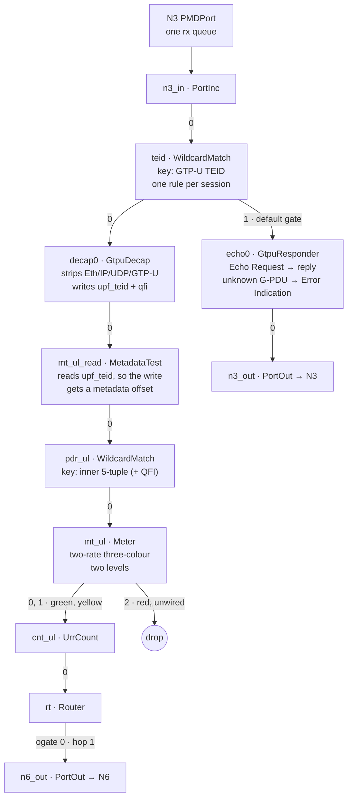
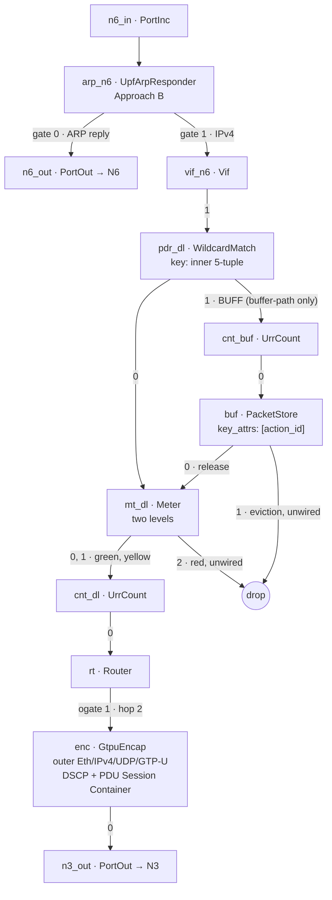
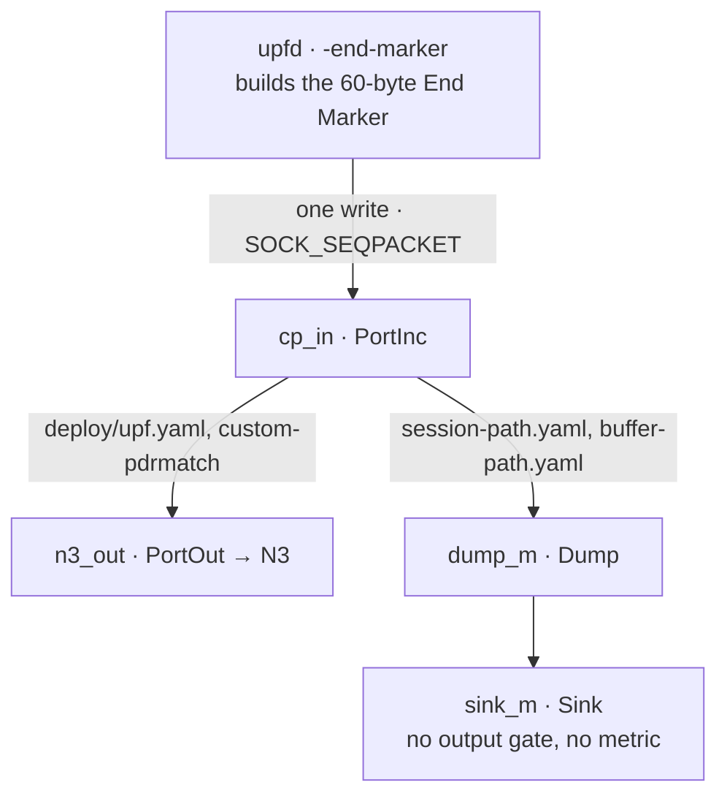

# The datapath: modules, resources and placement

Section references in this document are to the pinned 3GPP Release 16
excerpts in `docs/spec/`; the claims register names the exact version and clause
for every conformance claim.
Claims -- what is verified, and by which evidence -- live in
`docs/claims.md`; this document explains mechanisms, not status.

Engineering reference for `datapath/` (the UPF's BESS plugin) and the graphs it
plugs into. It is deliberately narrower than the other files:

| file | what it owns |
|---|---|
| `docs/design.md` | why the deployment is shaped this way: the walls, the costs, the milestones |
| **`docs/datapath.md`** (this) | what each module is, which resource it owns and under which key, what it takes from BESS, how packets and workers are placed |
| `docs/claims.md` | clause-by-clause status, the evidence that proves each entry, and the competitive scores |
| `docs/interop.md` | the real-SMF interoperability record (free5GC v4.3.0) |
| `README.md` | how to build, run and prove |

## The graph

One `bessd`, one graph, one set of workers. In the packet-path graphs an edge
label is the output gate the packet leaves by; a gate no connection wires is a
drop. `WCM` is `WildcardMatch`, and every `WCM` rule's value is
`{priority, gate, action_id}` (BESS D-141): the action id the classifier writes
is the id everything downstream is keyed by.

### Uplink



The classifier's rule result writes the action id, the two meter levels and the
next hop into metadata; the Meter and Router read them. A metadata attribute
nothing reads is never given an offset (`core/metadata.cc`), which is why
`mt_ul_read` sits after the decap.

### Downlink



The buffering branch exists only in `deploy/buffer-path.yaml` (and its
`pdrmatch` twin). Release feeds the packet back into `mt_dl`, so the SMF's new
instruction is what moves it; the store's eviction and overflow leave by gate 1,
which nothing wires — the daemon's gate counters are what see them.

### The control plane's own port



`upfd` constructs the End Marker itself and writes one whole frame per call. In
the deployment the frame leaves by N3, after the transaction that moved the
tunnel has landed; the lab graphs send it through a `Dump` to a `Sink` so the
lane can byte-check it.

| graph | used by | what differs |
|---|---|---|
| `deploy/upf.yaml` | the deployment | PMD ports `n3`/`n6` (one rx queue each), the N6 ingress' first stop (`arp_n6`: Approach B answers ARP before the Vif and forwards IPv4 on gate 1), the responder that answers for the interface's own address and every live session's UE address (`arp_n6`, our `UpfArpResponder`), the N6 interface (`vif_n6`), the Router's hop count and next-hop table, the uplink tunnel and the 5G VN re-injection as `rt` gates 2 and 4, `MetadataTest` after the decap, the marker port; **no buffering branch** |
| `deploy/iface-path.yaml` | `ci/iface-path.sh` | no NIC: Sources, Rewrites, Dumps and Sinks, one stream per interface-grammar case. Both chains, the five egress gates (`rt/next_hops` 1-5: the data network's hop with its L2 pair, the access side's, a tunnel out of an instance, the service LAN's, the 5G VN re-injection), the Approach B ARP/IPv4 split (`arp_n6`: gate 0 to the ARP dump and N6 port, gate 1 to `vif_n6`) and the re-injection (`rt` gate 4 -> `pdr_dl`). One session carries two uplink PDRs that differ only in destination -- the general port-53 filter and the specific 10.46.0.2 one -- so the same TEID's frames leave by the data network's hop and by an N9 tunnel (ULCL). One session carries *two* addresses (its downlink PDRs' hashes collide in the responder's table), both answered and both erased. Its instances are the lane's own: `internet` (plain, tunnel and service-LAN hops) and `vn` (the re-injection) |
| `deploy/session-path.yaml` | `ci/session-path.sh`, `ci/n4-path.sh`, `ci/session-report.sh` | Sources `src_up`/`src_dn`, `Rewrite`, `Dump`, `Sink`; the deployment's N6 side (`arp_n6`, `vif_n6`, `sink_other`, `merge_n6`, `dump_n6`), with ARP replies and router frames sharing the port and IPv4 routed through Vif; frames fixed so a test can byte-check them; no buffering branch |
| `deploy/route-path.yaml` | `ci/route-path.sh` | `session-path.yaml` with the Router in `ROUTE_MODE_DESTINATION`: two FIBs (uplink domain 0, the N6 Vif's domain 1), a route in each, `SetMetadata` writing the uplink's domain 0, and no `UpdateTTL` (the Router decrements). The same frames and byte checks prove the FIB chose the gate, not the action's hop |
| `deploy/buffer-path.yaml` | `ci/buffer-path.sh` | `session-path.yaml` **plus** `cnt_buf`/`buf` and the `pdr_dl` ogate-1 connection; needs a daemon with BESS's packet store key attribute |
| `deploy/pdrmatch-buffer-path.yaml` | `PROFILE=custom ci/buffer-path.sh` | `pdrmatch-path.yaml` **plus** the same buffering branch as `buffer-path.yaml`, in the same place (the placement is TS 29.244 5.2.4.2's, so both profiles share it) |
| `deploy/pdrmatch-2dn.yaml` | `ci/pdrmatch-2dn.sh` | two data networks on one UPF: one `Vif` (`dn_vif`) writes route domain 1 or 2 for the frame's destination MAC, `sel_dl` keys on **(route domain, UE address)** -- so two sessions may hold one UE address -- and `rt` carries four next hops, the second exit (`dump_n9`) on its gate 2, each naming its network's L2 pair (written into the frame by the Router, BESS D-153). The fourth hop is the N9 tunnel: the internet session's FAR adds an outer header, the G-PDU is fed back through `teid`/`decap0`, and the campus session that owns its TEID forwards the decapped packet to the campus exit -- the same daemon plays both UPFs |
| `deploy/session-live.yaml` | `ci/session-live.sh` | no packet path: the control path's tables only |
| `deploy/smoke-gtpu.yaml` | `ci/smoke-gtpu.sh` | the two datapath halves alone |

Gate numbers, in full: `0` is the chain's next module; `8192` is `DROP_GATE`
(`core/gate.h`), what a rule carries when its FAR drops or a QER's gate is
closed; `1` on `pdr_dl` is the buffering branch; `1` on the uplink's `teid`
table is the responder (echo and Error Indication); and any gate no connection
wires drops the packet,
which is why the store's evictions need no module of their own — the store
*evicts* a flow's oldest packet on gate 1 when its per-flow cap is reached, and
*frees* an expired one outright (`bess::PacketFree`, no gate, no metric) on the
owner's sweep once the packet is older than its flow's own timeout.

A buffering flow's numbers are the SMF's, not the graph's: the compiler writes
the store's `flows` entry for every buffering rule, keyed by the rule's
ActionId — `timeout_ns` from the BAR's DL Buffering Duration (8.2.29, the
infinite unit as a present zero) and `max_packets_per_flow` from its Suggested
Packet Count (8.2.30) — and leaves a field out where the SMF named none, which
is when the module's own arguments above are the flow's numbers. The store's
`StoreBatch` enforces the cap on every arrival; its timeout is honoured by the
owner's own sweep, `EvictExpiredBounded` (BESS 0bfd2783, the amendment to
D-129): 256 flows a run from where the last run stopped, so the free happens on
the store's next run after the deadline rather than on a timer the flow owns,
and a run's cost does not grow with the store's size. A store at its global
`max_packets` still runs `EvictExpired` over everything first — the pressure
path, unchanged — which is the only path an older daemon had.

## Modules we own

Six modules, one `.so` (`BESS_PLUGIN` + `ADD_MODULE`, `datapath/meson.build`),
built only against the installed `bess-dev` stage. `pdr_match_scan.cc` is the
matcher's seam, not a module class: it is the only implementation of
`pdr_match_matcher.h`, over BESS's `FirewallScan`.

| module | mclass | resource it owns (key) | state it holds | workers |
|---|---|---|---|---|
| `gtpu_decap.{h,cc}` | `gtpu_decap` | none | `port_`, two attribute ids | all |
| `gtpu_encap.{h,cc}` | `gtpu_encap` | `<module>/tunnels` (`TunnelKey{action_id}`) | `src_ip_`, `max_tunnels_` | all |
| `gtpu_responder.{h,cc}` | `gtpu_responder` | none | `port_`, a Recovery Time Stamp | all |
| `urr_count.{h,cc}` | `urr_count` | `<module>/counters` (`CounterKey{action_id}`) | per-worker cell planes, per-rule stamp pairs | all |
| `arp_responder.{h,cc}` | `upf_arp_responder` | `<module>/entries` (IPv4, host order) | the slot table's mask and its live count | all |
| `pdr_match.{h,cc}` + `pdr_match_scan.cc` | `pdr_match` | `<module>/rules` (session id → its rule list), `<module>/settings` | the key/action/QFI/steering attribute ids and the settings singleton | all |
| `atsss_steer.{h,cc}` | `AtsssSteer` | `<module>/policies` (global policy id), `<module>/health` (access) | the policy attribute id, the next-hop/tunnel/accounting attribute ids | all |

`PdrMatch` is the custom profile's matcher (`deploy/custom-pdrmatch.yaml`): the
session is the packet's key attribute (`upf_teid` on the uplink, the selector's
`action_id` on the downlink), the map holds one key per session, and a match
carries the rule's ActionId so the rest of the chain is unchanged. The default
graphs use the shared `WildcardMatch` tables instead.

Five resource kinds, then: the encap's tunnels, the counters (one instance
per direction, plus one on the buffering branch), the custom profile's PDR map,
the responder's entries, and the steering module's policies and health. The tunnels and counters are keyed by an action id
the compiler hands out; the PDR map is keyed by the session; an ARP entry's key
is the subscriber's own address, which two sessions of one deployment must not
both hold (`internal/session/arp.go` claims it like a rule key). Every one of
them is written per session at programming time — none is written by the packet
path except the counters' planes.

### `gtpu_decap` — the N3 entry

Strips Ethernet, IPv4, UDP and GTP-U (the header itself is parsed with the
installed `tunnel/tunnel.h` codec) and writes the tunnel's TEID into the
packet's `upf_teid` metadata (`be32`). It owns **no resource**: whether a TEID
belongs to a session is the `teid` `WildcardMatch`'s decision, so an unknown
TEID never reaches the module (`teid/rules` is the table the controller writes,
the sweep reads and the TEID-0 echo rule lives in). The attribute is a *write*,
so something downstream must read it or it gets no offset at all
(`core/metadata.cc`) — `MetadataTest mt_ul_read` in `upf.yaml` and the lab
graphs, and the encap further along the same chain. Attributes are laid out in
module registration order, which is why the decap is listed early everywhere.

It also writes the QFI the incoming G-PDU's PDU Session Container carried into
the one-byte `qfi` attribute — the GTP-U extension header of type 0x85
(TS 29.281 5.2.2.7), whose QFI is the low six bits of the container's second
content octet (TS 38.415 5.5.2.1). That is the QoS flow the gNB put the uplink
packet on, and it is what tells two uplink PDRs that share one F-TEID apart.
The module walks the extension header chain for it (the tunnel library reports
the chain's first type and skips the rest) and writes `255` for a G-PDU with no
container at all -- above the six-bit range, because `0` is a QFI a gNB sends
(TS 38.415 5.5.3.3 ranges 0..63 and TS 29.244 8.2.89's IE takes it), so a rule
a PDI keys on QFI 0 must not select a packet whose container is missing
(`datapath/pdu_session_qfi.h` is the shared contract; `ci/smoke-gtpu.sh` checks
both values in a metadata dump). The byte is written rather than skipped because
a packet's metadata is reused buffer space that nothing clears, so a skipped
write would let one packet's QFI reach the next packet's rule lookup. The reader is the uplink rule
table: `pdr_ul`'s match `fields` name the attribute, and a rule's mask is
`0xff` when its PDR named a QFI and `0x00` when it did not.

### `atsss_steer` — the two-access choice

A downlink PDR may name a MAR instead of a FAR (TS 29.244 7.5.2.2 and 7.5.2.8).
The compiler resolves the MAR's 3GPP and non-3GPP access actions to Router next
hops and, where an access adds an outer header, to its own GtpuEncap tunnel
records; the PDR's matcher rule carries the compiler-allocated policy id in
`steering_policy_id` (the matcher's `steering_attr`). `AtsssSteer` reads that id after the action
table, selects an access, and writes `next_hop_id`, `tunnel_id` and the optional
`accounting_id`. The encap reads `tunnel_id` when the graph declares it and
falls back to `action_id` for a packet whose value is 0 (not steered), so a
mixed deployment needs one encap module, not two.

The policy is one immutable object keyed by the compiler-allocated policy id;
the health table is keyed by access, so one access's status is shared by every policy that uses it. A
missing health record means "not monitored" and counts as available; a missing
policy, or neither access usable, drops the packet. Policy id 0 means "not
steered" and passes the packet through with the action table's own next hop and
tunnel. Only Steering Mode active/standby is applied; the other modes are
refused with cause 73 at PFCP time rather than programmed as a different
policy.

### `gtpu_encap` — the N3 exit

Writes the outer Eth/IPv4/UDP/GTP-U around a downlink packet from the tunnel
record the packet's ActionId names -- or, in an ATSSS graph, the `tunnel_id`
AtsssSteer selected, with `action_id` as the fallback for a packet that was not
steered -- `{teid, gnb_ip, ether_src, ether_dst, qfi, marking}`, copying the
inner TOS onto the outer header (the RAN's
transport is DSCP-marked; dropping it would send every downlink packet as best
effort) and recomputing lengths and checksums. One record per downlink rule: the
controller resolves the FAR once, at programming time, so the packet path does
one indexed load and chases no control-plane relation.

When the record names a Transport Level Marking (TS 29.244 8.2.12, procedure
5.4.13, from the FAR's forwarding parameters), the SMF's DSCP wins over the
inner packet's: the marking's high octet is the ToS/Traffic Class the outer
header carries and its low octet is the mask naming which of the inner header's
own class bits survive — the ECN bits, with the spec's 0xFC, which applying the
marking must not change (8.2.12's NOTE: "The original ECN bits in the IP header
of user plane packets are not changed after applying transport level marking").
`marking == 0` means the SMF asked for none and the inner TOS is copied byte for
byte, which is what a record written before the field existed reads as.

The clause marks the *transport* header, and that is why this is the encap's
job: TS 23.501 5.8.2.7 — the clause the FAR table (7.5.2.3-2) cites for the
value — defines the transport level packet marking value as "the DSCP in the
outer IP header", and the encap is the only module here that writes one (the N3
exit; a deployment with an N9 exit uses the same record, since the record's
`marking` comes from the FAR wherever a direction names a tunnel resource). A
packet that leaves with no outer header — an uplink FAR to N6, where the packet
is the UE's own — has nothing for the clause to mark, and rewriting the
subscriber's DSCP there would be a defect rather than a missing feature.

A record naming a QFI also gets a PDU Session Container after the GTP-U header
(TS 29.281 5.2.2.7; the content is TS 38.415's): the E flag set, the 4-octet
optional tail whose last octet names the extension header, and one 4-octet
unit of container — length 1, the DL PDU session information content (PDU type
0 in the high nibble of its first octet, the QFI in the low six bits of its
second), and no further extension header. That is 8 bytes of the packet's
headroom, sized before the prepend; a record with `qfi == 0` writes none of it,
so the wire is byte for byte what it was before the field existed.

### `gtpu_responder` — path management, and the tunnels that are gone

Answers the two GTP-U messages a UPF sees on a TEID that names no session:

* an **Echo Request** (type 1, always TEID 0) with the reply TS 29.281 7.2.2
  prescribes -- the S-flag field, the Recovery IE with a zero restart counter,
  and this node's Recovery Time Stamp;
* a **G-PDU** (type 255) on any other unnamed TEID with an **Error Indication**
  (type 26) carrying the TEID the peer used (7.3.1: a node that has retired a
  tunnel answers so the peer stops sending into it). S is clear, the header's
  TEID is 0 (the peer knows no tunnel toward this node), and the tail is the
  TEID IE alone.

Both are the request rewritten in place (addresses swapped, type replaced,
lengths recomputed) and reach it through the TEID table's *default* gate; it
sits outside the session path entirely, reads no session state and allocates
nothing. Any other message type it is handed is dropped.

### `urr_count` — usage, and the buffering signal

Counts packets and octets per rule (the *IP packet's* octets, not the frame's)
and stamps each rule's first and last counted packet. The `<module>/counters`
entry's existence is the whole test — a rule with no entry is counted by nobody,
which keeps a session without a URR off the module's cost (one lookup) — and one
instance serves two purposes in two places: a direction's counters for URRs, and
the arrival signal the Downlink Data Report is decided from on the BUFF branch.

* **Locality.** Cells are worker-local: one plane per worker, whole cache lines
  apart, written with a relaxed load-add-store and never a locked instruction
  (`stats/worker_slots.h`'s rule). A reading sums the planes, so it is exact per
  cell, not one global instant; the memory is `capacity × 2 × 8 B × workers`.
* **The one shared write.** A rule's stamp pair is the rule's own fact, not a
  worker's, so it is shared and written once per batch that counted a packet —
  never once per packet, and by design a store lost to a concurrent reader costs
  one packet's stamp rather than a count (`urr_count.h`).
* **The responder's own reading** is `get_errors` on the `GtpuResponder`
  (`upf.pb.GtpuResponderCommandGetErrorsArg` → `…Response`): the Error
  Indications the peer sent, one count per TEID it named, with the names it was
  asked for or the whole table when it was asked for none. The counts only grow
  — nothing clears them, and a read races no packet — so the reporting side
  keeps its own high-water mark per session (`internal/session/erir.go`) and
  one reading serves every session of a tick (`-gtpu-errors`).
* **Reads** are the `get_counts` command
  (`upf.pb.UrrCountCommandGetCountsArg` → `…Response`), which is also how the
  control side asks for a *window*: with `restart_window` the module clears each
  rule's first stamp, so the next reading's stamp means "a packet arrived since".
  The URR path uses that to open its next window; the DDN path reads with
  `restart_window: false` and clears only once the SMF has taken the report
  (`bess.Client.{RuleCounts,PeekRuleCounts}`). An argument that names **no**
  rule is the module's whole table — `get_counts` enumerates every entry it
  holds — which is the reading a usage tick makes: one call per counter module
  rather than one per session, and the only read that carries counts at all
  (the `<module>/counters` resource value is empty by design: a resource value
  is copied on every publish, so a count kept in it would be zeroed by a
  handover).

### `upf_arp_responder` — the interface's addresses, answered while the session lives

The fork's `ArpResponder` keeps its table in a `std::map` whose resource
*requires paused workers* (`core/modules/arp_responder.cc`: "Workers read the
map without synchronization, so this runs with them paused"), and so does every
other per-address identity in a graph (`Vif`'s `interfaces`, `Rewrite`'s
`templates`). A UPF provisions a subscriber's address when the session is
established, with the dataplane running: a module that refuses that write cannot
answer for a subscriber at all. This module keeps the fork's wire shape -- the
same `entries` map resource, keyed by the address as a string, valued by
`mac_addr` -- and makes it live: an open-addressed slot table whose slots are
atomic, a worker's lookup one acquire load, a transaction claiming its slot
under the engine's lock, and a replaced entry retired, not freed, while a reader
may still hold it (`arp_responder_resource.h` carries the reasoning; the idiom
is `pdr_match_resource.h`'s).

* **The packet path** passes IPv4 frames out `ip_gate`. On gate 0, an ARP
  request for a held address is rewritten in place into the reply (the fork's
  own, `core/modules/arp_responder.cc`): the opcode flips, the Ethernet
  addresses swap, the requester's hardware address and address become the
  reply's target, and the entry's become its sender. ARP replies, unknown ARP
  requests, and other packet types are dropped; the module sits before the Vif
  on N6 ingress, not on an ARP-only branch.
* **The entries** are the deployment's own address (one resource line in the
  graph) and one per live session per UE address, written and erased in the
  session's own transaction (`internal/session/arp.go`), so a refused message
  leaves no entry and a deleted session's address stops being answered. The key
  is claimed against a live session's, like a rule key: two sessions cannot
  answer for one address.
* **Capacity** is the module's argument (`max_entries`, default 65536; the
  table is sized at construction, at twice the entries asked for). A write that
  finds no room is refused with nothing visible, not grown under a running
  packet path.
* **The publish phase claims each key again**, and every upsert reserves room
  for one replacement. One session's change carries one entry per downlink
  PDR's address (two addresses of one session are two ops of one transaction,
  and their hashes can land in one probe slot): an op that publishes into the
  slot it claimed at Reserve would write both into that slot -- losing one, with
  the establishment still answered as accepted -- and would retire one entry
  more than it declared, which the engine treats as a fatal footprint violation
  (`dataplane/resource.h`), from an ordinary session message. Re-claiming by key
  at publish is what the resource this was modelled on does
  (`pdr_match_resource.h`), and it is what makes the pair safe. The table also
  frees the entries its slots still hold when the module goes away: a table
  destroyed with live entries is the teardown path, not an error.

## Modules and drivers we take from BESS

Used as they are; the configuration is ours and is what the compiler assumes.

| module | where | the configuration that matters |
|---|---|---|
| `WildcardMatch` | both PDR tables, the TEID table | `action_resource: <at_*/actions>` (D-141: the rule's action id goes to the packet's `action_id`), `fields` = the graph's key in the order the compiler's `PDRFields` names, `max_tuples` |
| `WildcardMatch` result | one per PDR table | `result_fields` writes the action id, the two meter levels and the next hop from the rule's `result`; the Meter and Router read them |
| `Router` | one, both directions | hop mode (the default): `<module>/next_hops`, the egress gate an action names; destination mode (`ROUTE_MODE_DESTINATION`, `-route-mode=destination`): `<module>/routes`, `<module>/groups` and the packet's own `route_domain`. Both modes write a resolved hop's `dst_mac`/`src_mac` (BESS D-153) and the IPv4 hop count: one decrement each way, the checksum kept right, a packet arriving with TTL 1 dropped. The drop is silent -- no ICMP Time Exceeded; the Router's `ttl_expired` counter records it. In unconstrained carrier deployments, outer transport routing occurs post-encapsulation (`enc -> Router`) on the outer gNB/peer destination IP, allowing dynamic ARP resolution and preserving inner subscriber TTL across multi-hop backhaul. `deploy/upf.yaml` wires gate 2 to the encap for an uplink tunnel and gate 4 back into `pdr_dl` for the 5G VN re-injection, supporting all 6 canonical 3GPP modes simultaneously |
| `SetMetadata` | the uplink of `route-path.yaml` | writes `route_domain: 0` after the decap. The Router reads the domain on both directions, and BESS marks a read attribute with an unwritten upstream path unreadable; the downlink's `Vif` writes domain 1 |
| `PMDPort` | `n3`, `n6`, and `upf_port` (a veth) | `num_rx_queues: 1` each in the deployment's graph; RSS and one worker per queue are the scale path. The one-port split (per-pattern RSS, `L3_SRC_ONLY` uplink / `L3_DST_ONLY` downlink) is designed in `docs/design.md`, "N3, N6, N9": `deploy/veth-port.yaml` wires it over a software device (one PMD port, four queues, a `Vif` with the three interfaces) and `ci/veth-port.sh` proves what a veth can prove of it, while the placement measurement is what a NIC is still needed for (`docs/datapath.md`) |
| `UnixSocketPort` | `cp_marker` | `SOCK_SEQPACKET`: one write from `upfd` is one End Marker frame |
| `PortInc`/`PortOut`, `Sink`, `Source`, `Rewrite`, `Dump`, `MetadataTest` | graphs | plumbing and lab only; a `Sink` has no output gate, so it appears in no metric — the counters that prove behaviour sit on modules' *output* gates |
| `deploy/meter-compose.yaml` / `ci/meter-compose.sh` | the composition probe: `classifier -> mt (levels: 2)`, two meter ids in one result record, proving that the stack polices the flow's bucket then the session's |
| `Meter` | one per direction | `<module>/meters`, the QER's committed and peak rate; a closed gate compiles to the drop gate. The model is a two-rate three-colour meter: `committed_rate`/`peak_rate` are the QER's GBR/MBR and the bursts its Averaging Window, and the packet leaves on the gate that is its colour — 0 green, 1 yellow (between the guarantee and the ceiling), 2 red. The graphs connect 0 and 1 to the chain and leave 2 unwired, which is the drop; an unwired gate has no Track hook, so red's drops are read from the module's own state rather than `bess_gate_packets_total` |
| `PacketStore` | the buffering branch (`buffer-path.yaml`) | `key_attrs: ["action_id"]`, `max_packets`, `max_packets_per_flow`, `timeout_ms`; one owner task, any number of workers. `release`/`drop`/`clear` are commands that enqueue into the store's own request ring (`Command::THREAD_SAFE` since BESS `cdeb4e77`), and its `flows` table is live configuration (`requires_paused_workers: false`), so neither a command nor a flow write is refused with EBUSY or RESOURCE_BUSY and nothing stops the datapath; a command is **accepted, not completed** -- the store's owner task applies it on a later run -- so a caller that needs the effect reads it back (`ps/flows`, the drop and release counters, `GetDesc`). A flow the store holds nothing for is a no-op (ENOENT is gone; the only refusal left is ENOSPC, a full request ring), an upsert or an erase moves no packet, and an erase removes configuration only -- `drop` is what frees what a flow holds (BESS's note: `packet_store: the flow key is a configured attribute, not a fixed pair`, 96d22a8f). The `flows` entries are the SMF's own numbers: `internal/session` writes one per buffering rule (`writeFlowEntry`), keyed by the rule's ActionId, with `timeout_ns` from 8.2.29's DL Buffering Duration and `max_packets_per_flow` from 8.2.30's Suggested Packet Count, each left out where the SMF named none; a modification's Update BAR rewrites it, a deletion erases it, and the startup sweep names the table. BESS's `LimitsFor` resolves it per flow; the store then enforces the cap on every arrival (`StoreBatch`) and, when `total_packets_` reaches `max_packets`, ages each flow's packets past its `timeout_ns` out with `bess::PacketFree` in `EvictExpired` -- a silent discard (no gate, no metric; only `GetDesc`'s stored count falls), distinct from the `drop` command's counted free and from the gate-1 eviction the cap uses |
| `Vif` | `deploy/upf.yaml` (the N6 interface), `deploy/veth-port.yaml` | the module that splits one port into the reference points: an interface per reference point (`(VLAN, destination MAC)`, ARP answered for its address), each writing `vif_id`/`route_domain` into the packet and sending it out its own gate, so a PDR key can carry the domain the frame arrived with (`docs/design.md`, "N3, N6, N9"; `ci/veth-port.sh` proves the split and the rule selected by it). In the UPF graph, `arp_n6` handles ARP before `vif_n6`, so Vif receives IPv4 on gate 1 and writes the interface metadata; its own ARP answer remains used by graphs that put Vif first |

## Framework and library surface we use

| surface | where we use it |
|---|---|
| control_v2, one transaction per session change | `internal/session` writes a session's rules, actions, meters, counters and tunnels together or not at all, with a request id that survives retries |
| resources and codecs (D-129) | the tables above: configuration written in a transaction, a codec that validates the key, and a readback the startup sweep uses. The store's `flows` is one of them (one entry per flow id, each field optional, absent meaning the module-wide argument), written by the session compiler with the SMF's own numbers (8.2.29's duration as `timeout_ns`, 8.2.30's count as `max_packets_per_flow`) in the same transaction as the rule: an upsert or an erase moves no packet and stops no worker, and an erase is configuration only — `drop` is what frees what a flow holds |
| module commands | `get_counts` (counters), `get_errors` (the responder's Error Indication table: monotonic counts, no clear, read by the report tick), `release`/`drop`/`clear` (the store's *held packets* — commands act on state, resources on configuration) |
| metadata attributes | `action_id` (written by `WildcardMatch`, read by counters, the encap and the store), `upf_teid` (written by the decap), `qfi` (written by the decap, one byte: the uplink PDU Session Container's QoS flow, read by `pdr_ul`'s match fields), `route_domain`/`vif_id` (written by the `Vif`, and read by `deploy/veth-port.yaml`'s tables -- which is what gives them an offset at all) |
| slot tables (`dataplane/slot_table.h`) | every per-rule table: ids are 1..capacity, an erased key retires for a grace period, and publishing into a retiring slot is refused — which is why released ids wait their walk (`docs/design.md`, the id pool) |
| packet ownership | `bess::PacketRef` and the store's explicit free/release path; our modules copy no packet and allocate none |
| tasks (`RegisterTask`/`RunTask`) | BESS's store drains released packets from a task; **none of our modules has one** — nothing in our packet path runs between packets |
| `GetSchema`/descriptor set | the controller builds every message from the daemon's own schema, so a field this plugin does not have fails loudly instead of silently |
| `ListMetrics` (D-116) | per-gate counters: how an unwired gate's drops (store eviction, overflow) and a chain's throughput are read. What it does *not* show is a command's effect on the packets a module holds: `packet_store`'s `drop` frees them with `bess::PacketFree` and only decrements `total_packets_` (visible in `GetDesc`, not in metrics), `EvictExpired` (and the owner's per-run sweep, `EvictExpiredBounded`) frees an aged flow's packets the same way (its own timeout, no counter at all), while `release` moves them to the release queue, which does reach a gate — and only once the store's owner task has applied the request, since the command is *accepted* when the call returns. That is why the session layer counts the *accepted* commands it issued (`Stats.BuffersReleased`/`BuffersDropped`/`BufferFailures`) rather than reading drops back out of the daemon |
| `tunnel/tunnel.h`, `conntrack/packet_parse.h` | header-only, experimental: the GTP-U codec and the parse types, installed by `bess-dev` |
| `utils/{ip,ether,checksum,endian,time,logging}.h`, `dataplane/action_id.h`, `framework/{resource_codec,resource_registry,resource_bindings}.h`, `commands.h`, `pb/module_msg.pb.h` | the rest of the plugin's includes; no module reaches past these into BESS internals |

## Placement, queues and state locality

* **One daemon, one graph, one writer.** `upfd` is the only writer of session
  state; the graph's own resources (next hops, module arguments) are the
  deployment's.
* **Workers: who may run where, and what stops.** Each module declares both how
  many workers it tolerates and whether writing its resources needs the workers
  stopped. Ours declare *all* workers (`max_allowed_workers_ =
  Worker::kMaxWorkers`) and no pause: `urr_count`'s cells are one plane per
  worker, so two workers never touch a line, and its two resources behave like
  the daemon's own concurrent ones.
* **Which part of this graph needs paused workers: none of it — and no caller
  stops anything for the store.** A resource whose codec declares
  `requires_paused_workers` is **refused** with `RESOURCE_BUSY` while a worker
  runs its module ("nothing was tried", the SDK's `Resource` comment), and a
  command declared `THREAD_UNSAFE` is **refused** with `EBUSY` ("There is a
  running worker and command '%s' is not MT safe", `core/module.cc`); in both
  cases the daemon leaves the stopping to whoever is writing. The modules that
  declare the flag are `arp_responder` (`entries`), `bridge` (`statics`),
  `flowgen` and `vif` (`interfaces`) — none of them written as a resource while
  a worker runs (the port arm's `deploy/veth-port.yaml` sets the `Vif`'s
  interfaces in the module's argument, which belongs to the apply that pauses
  the workers, not to a write into a running one); every
  resource the session path writes is a concurrent slot-table resource applied
  live (`WildcardMatch`'s rules, the result fields, `Meter`'s meters,
  `Router`'s next hops, `enc/tunnels`, `cnt_*/counters`).

  The store was the one exception, and BESS `cdeb4e77` removed it: the module
  has one owner task, `release`/`drop`/`clear` are `Command::THREAD_SAFE` and
  enqueue a request into the store's SPSC request ring (the owner applies it on
  a later task run), and its `flows` table is live -- an upsert or an erase does
  not stop the datapath -- so `requires_paused_workers` is false. So
  there is nothing to pause around and nothing that answers `EBUSY`:
  `internal/bess` calls `InvokeAction` directly from `ReleaseFlow`/`DropFlow`/
  `ClearStore`, and the `storeCommand` wrapper that used to try, stop the
  workers on a refusal, retry and start them again — with
  `TestStoreCommandStopsTheWorkersOnlyWhenTheDaemonRefuses` pinning its
  orderings — is gone with the refusal it handled. A command there is
  *accepted*, not completed: the caller that needs the effect reads it back
  (`ps/flows`, the drop and release counters, `GetDesc`), which is also why a
  successful call is not evidence that packets moved.

  ```
  what stops, and who stops it

  (A) session state -- rules, actions, meters, next hops, tunnels, counters,
      and the store's live `flows` table
      upfd --commit--> daemon --publish--> concurrent resource
      workers ............................ running throughout: nothing stops

  (B) the store's own commands -- release, drop, clear
      upfd --invoke--> daemon: enqueue into the store's request ring
      workers ............................ running throughout: nothing stops
      the store's owner task applies the request on its next run
  ```

  A stop is still the shape for a `THREAD_UNSAFE` command or a paused-worker
  resource, and BESS's own modules are where either could appear again:
  `upfd --PauseWorkers--> invoke/commit --> ResumeWorkers`, bounded by one
  command or one commit and at signalling rate — a BAR arriving, a DDN answer
  releasing packets — never per packet. The SDK stays explicit (`InvokeAction`,
  `PauseWorkers`, `ResumeWorkers`) and D-146 keeps the three SDKs' surfaces
  alike, so such a loop would be this layer's policy rather than the SDK's
  method. The in-process tests cover a refusal's consequences as well
  (`TestAReleaseTheStoreRefusesIsCountedNotFatal` and the sweep's tests).
* **Where state lives.** Per-worker: the counters' planes. Shared, atomic,
  written once per batch: the counters' stamps. Per-rule, indexed by the
  ActionId the classifier wrote: the tunnel records and the counter entries.
  Per-packet: metadata. Behind a lock, control-plane only: the session model,
  the rule-ownership table, the id pools.
* **What the packet path never does**: allocate (except inside the store's own
  queue), take a lock, read a control-plane structure, or look a rule up twice —
  the classifier's result is the id everything downstream is keyed by.

## What we would fuse, and what decides it

The chain is split into the modules above because each one has a single job and its
state is owned at one layer. Fusion is available to us — our modules can hold a
table, and BESS's own primitives (the wildcard matcher, the meter's token bucket)
are ordinary C++ we can call — but a fusion *costs* a lookup's worth of state
ownership and gains a dispatch and a table lookup per packet. The measured arms are
what decide it (`docs/design.md`'s table, taken with `ci/bench-modules.sh`): the
front end is 8.09 ns/pkt, `gtpu_decap` +13.4 ns and 612 instructions over its
control, `gtpu_encap` +18.1 ns and 414 instructions, `urr_count` +4.19 ns for a
counted rule and +1.34 ns for a miss.

| fusion | what it removes per packet | what it costs |
|---|---|---|
| `teid` ⊕ `gtpu_decap` | one wildcard lookup and one batch dispatch — the decap already parses the header the lookup keys on | the decap would own a rule table and its TEID id space; today it owns none (its header comment says so) |
| ~~`pdr_ul` ⊕ `at_ul`~~ | ~~one ActionTable lookup~~ | removed: the classifier's result writes the downstream fields directly, so there is no action table to fuse |
| `mt_ul` ⊕ `cnt_ul` | one lookup and one dispatch | one module holding both the policer's bucket and the counter cells; both primitives are available to us (BESS's meter, our counters), and the cells' per-worker planes are the thing that must survive |
| `rt` ⊕ `enc` | the router's lookup on the downlink | the encap gains the route table; on a single-port N3/N6/N9 deployment (docs/design.md's port section) the next hop is a queue rather than a port, which is exactly the case where this fusion starts to look right |

None of these is done. Two things decide it, and neither is taste.

**The measurement.** `docs/design.md`'s "measure before any placement change" and
its "per feature, per packet" obligation mean an arm in `ci/bench-modules.sh` that
measures the fused module against the same work split, on the frames
`smoke-gtpu.sh` uses. The first such obligation is already owed by a feature in
this tree: the decap now parses the 0x85 PDU Session Container and writes `qfi`
unconditionally, and `pdr_ul`'s key grows by a field with its own mask, so the
decap arm must be re-taken against the 2026-10-16 baseline (+13.4 ns/pkt, 612
instructions over its control) on **both** frame kinds -- a G-PDU with a container
and one without -- and the rule table's tuple budget reported with it. That same
pair of numbers is what decides `teid` ⊕ `gtpu_decap`: a fusion has to beat the
lookup and dispatch it removes, and the decap's own arm is the upper bound on what
there is to win.

**The taps.** A split is also the place where the transformation is *observed*:
`smoke-gtpu.yaml` dumps the frame after the decap and after the encap, and
`ci/smoke-gtpu.sh` byte-checks both against the log, which is how a wrong header
length or a dropped option is caught at the stage that wrote it. Fusing two
modules removes that boundary: a tcpdump between them is no longer possible, and
"did the decap strip it or did the encap write it wrong" stops being answerable
from the wire. The tap that does not cost anything to have *off* is the daemon's
own: `core/gate_hooks/tcpdump.cc` and `pcapng.cc` are gate hooks switched at
runtime through control_v2's `SetCapture` (`core/control/admin_v2.cc:138`, a
direction of INPUT or OUTPUT, `FORMAT_PCAP` or `FORMAT_PCAPNG` to a fifo, one
gate or every gate of a module). No module is in the graph and the base path pays
nothing while the capture is off, which is what makes it usable as the evidence
for a stage -- and `pcapng` writes the metadata block, so a capture on `decap0`'s
output gate shows each packet's `qfi` and `action_id` next to its bytes, which is
how the QFI slice's own live check is taken (the Go SDK exposes it:
`sdk/go/bess/client.go:866`). So a fusion is acceptable only if the fused stage
stays observable through that surface or a per-gate tap of its own; the `Dump`
modules in `smoke-gtpu.yaml` are the same idea at fixed points, with a per-packet
copy that a measured graph should not carry. That is the ergonomic half of the
evidence, and it is a criterion, not a preference: what we would lose is exactly
the class of mistake the smoke test exists to catch.

**The fused module's table, decided before it is written.** `teid` ⊕
`gtpu_decap` needs a table keyed by TEID, and the primitive decides the cost the
fusion exists to win. It is not the one our other resources use: the tunnels and
the counters are `SlotTable<ActionId, …>` behind `SlotResource`, and that header
describes itself as "ObjectTable (K2) **without the rebuild**" — a change is one
pointer store and the object it replaced is retired through RCU. That fits dense
ids, and a TEID is a sparse `uint32` the *SMF* usually chooses (it sends the
F-TEID; we allocate only when it asks with CHOOSE/CHID, FTUP). So the dense
encoding — pool index plus a generation prefix — would serve only the TEIDs we
allocate and die on the case that matters, and a translation table for the SMF's
own TEIDs is a second lookup, i.e. no win.

The table is the daemon's own concurrent exact table, the one its match modules
use: `bess::classifier::ConcurrentExactTable`
(`core/classifier/concurrent_exact.h`), keyed on the four bytes of the TEID and
held behind `bess::rcu::RcuPtr<Generation>`, published through the runtime's
`RcuDomain` exactly as `ExactMatch` holds its table
(`core/modules/exact_match.h:259-269`: one acquire load per batch on the data
path, serialized rebuilds off it, the retired generation destroyed by a control
thread). It is rte_hash underneath — CRC32C over the key, a fixed capacity
(`CapacityFor(rules)`: three quarters of a power of two), per-key upsert and
remove with headroom for the deletes still waiting out a grace period, and a
deliberate rebuild only when it runs out of room. A session change is therefore
one upsert, not a rebuild of the whole table: O(1) per establish is what
`docs/design.md`'s `update_scale_bench` exists to hold at 10^5–10^6 sessions, and
a map rebuilt per transaction is precisely what it would catch. Per packet the
cost is one hash probe and one key compare — no masks, no key construction —
against `WildcardMatch`'s tuple-plus-masks path in the split chain.

**Status: deferred behind the feature list.** The fusion is a performance
experiment, not a capability — nothing in `docs/claims.md`'s gaps or the
roadmap waits on it, and `docs/design.md`'s "measure before any placement change"
makes the module and its arm the price of an *answer*, not of a feature. The
design work above is the part that was expensive to derive, and it is recorded
here so the deferral costs nothing later. The module and the arm pair stay
unwritten until something needs the number — the single-port N3/N6/N9 placement
work is the first thing that will.

When it resumes, the first step is not the module but a control that needs no new
code: stock `ExactMatch` uses the same `ConcurrentExactTable`, so `teid` as an
`ExactMatch` (`fields: [{offset: 46, num_bytes: 4}]`, `default_gate: 1`) followed
by `decap0` is *unfused but already exact-table*. Three points then read cleanly
— split `WildcardMatch` (today), split `ExactMatch`, fused — and the middle one
separates the two wins: how much is the lookup kind (available with no module at
all) and how much is the dispatch the fusion removes. If `ExactMatch` closes most
of the gap, the fusion is not worth losing the tap and the module is never
written. That arm belongs in the same request as the fused pair.

A downlink selector in front of `PdrMatch` (stock `ExactMatch` on the destination
address, its `action_resource` naming the session, then `PdrMatch` with
`key_attr: action_id`, which it accepts since `a17b623`) is now wired into the
compiler as the custom profile's downlink (`internal/session/selector.go`,
`deploy/custom-pdrmatch.yaml`, live in `ci/pdrmatch-path.sh`). The graph's
`ExactMatch` is what a packet from N6 is named by; a deployment with one network
instance and IPv4 keys on the address alone (`-select-fields-dl dst_ip`), and
one with several instances adds `route_domain`, which the graph's interface
writes. The LPM the earlier design expected is needed only for an IPv6 UE
*prefix* or a framed route (8.2.62), neither of which this UP serves yet.

## Where a run's scratch goes

Nothing a lane or the interop rig runs writes into the checkout's own tree. A
lane renders what it must change (a socket path, a graph's port names) into its
run directory, `build/run/<lane>-XXXXXX`, and removes it on success; the
interop rig keeps its state, logs and rendered graph under `build/run/interop`
and starts every process it detaches with that directory as the cwd, so a path a
script gets wrong lands there rather than beside the sources. Both directories
are gitignored. One-off, hand-made artifacts -- a scratch note, a throwaway
script -- belong in `.scratch/`, also gitignored; the repository root holds only
tracked files.

That rule has a scar: an argument list that slipped one position handed bessd a
*MAC address* where a socket path belongs, and a root-run daemon bound a unix
socket named `02:7f:00:00:06:02` in the repository root. The graph builder now
refuses a relative path ("marker must be an absolute path, got ...", with the
argument order in the message) and the rig's daemons run inside their own
directory, so the same mistake fails loudly instead of littering the tree.

## Building and loading it

```sh
PKG_CONFIG="pkg-config --define-prefix" \
  PKG_CONFIG_PATH=<stage>/lib/pkgconfig meson setup datapath/build
ninja -C datapath/build
bessd -modules=<dir with libupf_datapath.so> -f        # plus a graph
```

The plugin's wire types are `datapath/upf_datapath.proto`: `protoc` emits the
C++ and `.desc` during the build, and the descriptor set is installed next to
the `.so` so a controller can build the messages without generated Go code.
BESS's own `packet_store` needs no plugin; its flow key became configurable in
96d22a8f (`packet_store: the flow key is a configured attribute, not a fixed
pair`), which the buffering branch needs and no other graph does.

---

## Ports

How a UPF graph gets its ports, what the port exposes to the graph, and what is
proven about it where. `docs/design.md`'s port section ("N3, N6, N9: one port,
three interfaces") is the argument; this section is the surface: the manifest
fields, the drivers in use, the queue model, and the recipe for the one port
this repo can measure without a NIC.

### A port is declared in the manifest, not on the command line

`bessd` has no DPDK-args passthrough: it builds its own EAL argv
(`core/runtime/dpdk.cc`), and a port a manifest declares is hot-plugged by
`rte_dev_probe` (`core/drivers/pmd.cc`). So a port is a graph's business:

```yaml
ports:
  - name: n3                      # the name the graph uses: PortInc/PortOut/
    driver: PMDPort               #   QueueInc/QueueOut name this, not the
    num_rx_queues: 1              #   driver's device
    num_tx_queues: 1
    arg: {port_id: 0}             # or {vdev: "..."} for a software device
```

- `name` is the manifest's; the driver's device is named by `arg` (`port_id`
  for a bound PCI device, `vdev` for a software PMD such as `net_af_packet`).
- `num_rx_queues`/`num_tx_queues` are what the graph gets. For a PMD the
  *device's* queue count is the driver's (`net_af_packet`'s comes from
  `qpairs=` in the vdev string, **not** from the veth's `numrxqueues`), so the
  two are stated separately and checked separately.
- `driver: PMDPort` takes a DPDK device; `driver: UnixSocketPort` is the
  control plane's End Marker socket (no PMD, no NIC); the deployment
  (`deploy/upf.yaml`) uses both.

`deploy/upf.yaml` binds two PMD ports (N3, N6) bound with `dpdk-devbind` before
`bessd` starts; `deploy/veth-port.yaml` is the same declaration over a software
device, which is what this repo can run on a host with no NIC to spare.

### Queues: one task per qid, and the workers start paused

`Num_rx_queues` receive queues are read by `num_rx_queues` `QueueInc` modules,
one per `qid`, each its own task; the transmit side is `QueueOut` per `qid` (or
`PortOut`, which uses queue 0). `PortInc` is the single-queue shorthand.

Two things about this tree that bite an arm:

- **`bessctl resume` is mandatory.** The workers a pipeline creates start
  paused, so a port's rx counter stands at 0 while the interface's own kernel
  counters climb: the frames are in the ring, not in the datapath.
- **The kernel buffers what arrived before the PMD started.** Frames that
  reached the interface before the port was probing are read later, so a
  counter read immediately after `resume` is not yet "this run's traffic".

RSS and one worker per queue are the scale path (`docs/design.md`, the
placement policy; BESS `docs/decisions.md` D-097 and its performance contract),
and the measurement that needs a NIC is the one below.

### One port, three interfaces

The UPF's three reference points are IP-level interfaces, so one port can carry
all three: a `Vif` (`core/modules/vif.{h,cc}`) matches a frame by `(VLAN,
destination MAC)` -- and answers ARP for an interface's address -- and sends it
out that interface's output gate, writing `vif_id` and `route_domain` into the
packet's metadata on the way. The three interfaces are the manifest's, each
with its own MAC, address, route domain and gate; the deployment's own graph
uses one for its single N6 port (`deploy/upf.yaml`'s `vif_n6`: the data
network's frames are the interface's) with `arp_n6` before it: the responder
answers ARP to gate 0 (the N6 port) and passes IPv4 to gate 1 (the Vif), so
Vif's own ARP answer is bypassed and no ARP reply enters the downlink chain.

Two facts a graph must respect:

- **A metadata attribute with no reader gets no offset at all**
  (`core/metadata.cc`, `FillOffsetArrays`), and the `Vif` writes `route_domain`
  only when *both* of its attributes have one (`vif.cc`'s `write_metadata`
  guard). A graph that wants the domain must therefore have a module that reads
  it -- a PDR table declaring `{attr_name: route_domain, num_bytes: 4}` among
  its `fields` does -- and, because the guard covers `vif_id` too, a reader for
  that as well.
- **A router's domains are created eagerly.** `Router` builds every domain's FIB
  in `Init` (`router.cc`'s `CreateDomain` loop), and on this box a `max_domains`
  in the tens fails to build ("route table is full"). A deployment's domain ids
  are small and `max_domains` is just above them; `upfd -max-domains` must
  agree with the graph's.

### What is proven where

**On a veth (`ci/veth-port.sh`, `deploy/veth-port.yaml`; no NIC needed).** The
arm declares one PMD port over a kernel veth (`net_af_packet0`, `qpairs=4`,
`fanout_mode=hash`) with four `QueueInc`s into a three-interface `Vif`
(N3/N6/N9, each with its own address and route domain), applies the graph,
resumes, sends real frames from the peer end, and checks:

| what | how it is checked |
|---|---|
| the port's queue count | `bessctl status` (runtime PortInfo) **and** the active pipeline (`bessctl get -o json`), **and** DPDK's own device telemetry (`/ethdev/info`): four rx/tx queues, all four started |
| real L2 | a frame addressed to an interface's MAC crosses the veth, is read by the port and lands on that interface's gate -- the three gates' counts are exactly the frames sent |
| the vif split with route domains | the domain the port wrote is what the compiler's (`upfd`, over N4) downlink rule is keyed on, and the frame carrying it is selected by that rule and crosses the chain to the encap -- the same frame with no rule yet written is dropped |
| the per-queue spread | `fanout_mode=hash` places a flow on one queue; all four `QueueInc`s move under many flows |

The kernel side of the recipe is part of the arm: the veth is created with
`numrxqueues`/`numtxqueues` (four each) if it is not already there, given an
address on one end so frames have a source, and sent to with **permanent
neighbours** -- the host treats an address local to an interface as its own and
routes it to `lo`, so a ping to the port's own address never leaves the host;
the destinations must be non-local with a neighbour entry naming the interface
MAC the frame should carry. IPv6 on both ends is turned off before they come up
(duplicate address detection and router solicitations are multicast and land on
the `Vif`'s default gate), and the pair is deleted when the run ends.

**On a NIC (not reproducible on a veth).** The placement measurement
`docs/design.md` describes needs a device with an RSS engine: the af_packet PMD
advertises none (`ethdev_rss_hf=0x0`, no hash key, no RETA, no per-queue hash
function), so `RTE_ETH_RSS_LEVEL_INNERMOST` with `L3_SRC_ONLY`/`L3_DST_ONLY`
(as a per-pattern `rte_flow` RSS action, since the two L3 bits are mutually
exclusive in one `rss_hf`) cannot be configured on it, let alone measured at
line rate. On a veth the flows are spread by the kernel's AF_PACKET fanout
hash, which is a flow-to-queue placement but not a NIC's. What a NIC is also
needed for, and what a veth cannot show: driver offloads, descriptor and DMA
behaviour, and absolute throughput or latency -- every packet on a veth crosses
the kernel's veth path and the PMD's mmap rings. Queue count is a further
example of the limit: on a veth it is whatever `qpairs=` says, so it does not
validate that a NIC's advertised queue count was honoured.

**Multi-queue RSS, per-worker tables, RCU rule updates, no locks or allocations
in the packet path** are the engine's, not this repo's: BESS
`docs/decisions.md` and `docs/performance-contract.md` are the sources, and the
placement policy in `docs/design.md` is what a deployment turns into a
port-and-worker layout.
