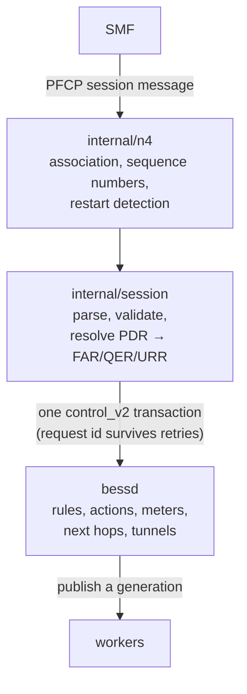
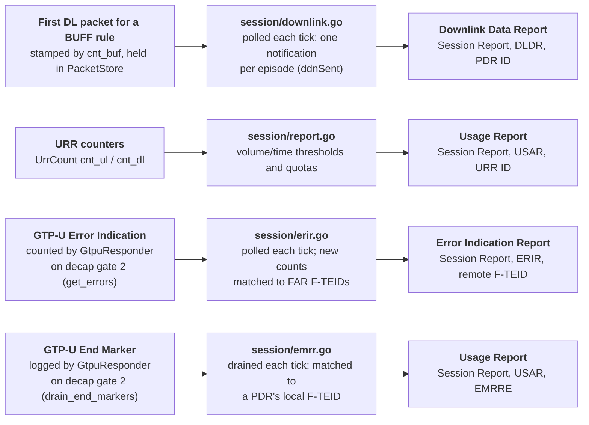
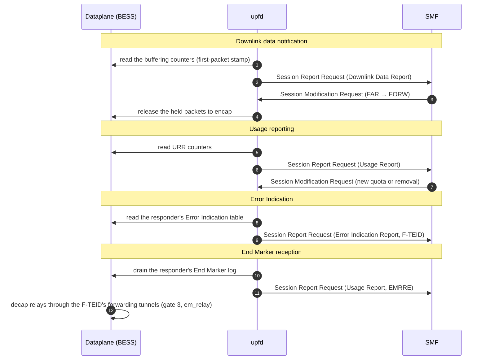
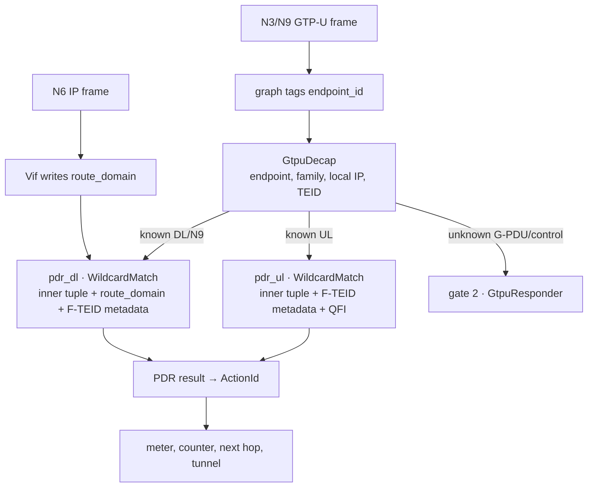

# Design

Section references in this document are to the pinned 3GPP Release 16
excerpts in `docs/spec/`; the claims register names the exact version and clause
for every conformance claim.
Claims -- what is verified, and by which evidence -- live in
`docs/claims.md`; this document explains mechanisms, not status.

The architecture, the walls and the costs. The datapath's own engineering
reference -- module by module, resources and keys, what it takes from BESS,
placement and state locality -- is `docs/datapath.md`.

## Deployment shape (fixed by the deployment decision)

- **One `upfd` process.** It terminates PFCP/N4 (UDP 8805 server), owns the
  session store, and is the *only* writer of BESS state. No second controller,
  no per-session workers, no sidecar.
- **One `bessd` process**, with the UPF datapath loaded as a plugin
  (`datapath/`, built against the installed `bess-dev` stage, loaded with
  `--modules=`). One graph, one set of workers, one packet path. Bess has no
  supported hook for compiling extra sources into the daemon (no meson option
  does it; D-008 puts UPF-specific code in a plugin), and a
  plugin may use only the installed headers, of which the GTP-U codec and the
  packet parse types (`packet_parse.h`) are experimental.
- The controller is stateless with respect to the dataplane: it can restart and
  rebuild everything from BESS's own state (pipeline + resources) plus the
  PFCP sessions the SMF replays.

## The control path in one sentence

A PFCP session change becomes **one control_v2 transaction**: the session's
PDR rules, its action, its meters, its next hop and its route go in together or
not at all, with a request id that survives retries, and no other writer exists
to race.

## Mapping PFCP → BESS

| PFCP | BESS |
|---|---|
| PDR (Precedence, PDI: Source Interface, F-TEID, Network Instance, UE IP, SDF filters, QFI) | one or more rules in the direction's `WildcardMatch`; keys combine the inner flow/QFI and endpoint-scoped F-TEID metadata, plus `route_domain` on the downlink table. Results carry the ActionId, meter IDs and next hop |
| F-TEID the CP function asks the UP function to choose (8.2.3: CH and CHID) | one exact `<decap>/fteids` entry per distinct `{endpoint_id, family, local_address, teid}`; its value selects UL gate 0 or DL gate 1. CHOOSE/CHID reuse is scoped to one PFCP session: PDRs in that session that name one CHID share its F-TEID, while separate N4 sessions keep separate F-SEIDs and ownership |
| FAR (Apply Action, Forwarding Parameters: Destination Interface, Network Instance, Outer Header Creation) | a *treatment* resource the action references (forward / drop / buffer / notify) plus the next hop and GTP-U encap parameters |
| QER (Gate Status, MBR, GBR, Averaging Window, QFI) | the PDR result carries the selected flow-meter ID first and the session-shared meter ID second; `Meter(levels: 2)` processes them in order, so a red first level does not charge the second. GBR/MBR map to committed/peak rate, Averaging Window to burst, and QFI goes into tunnel records. Gate status from every named QER is folded; see `ci/meter-compose.sh` and claims status-20/35 |
| URR (Measurement Method, Reporting Triggers, thresholds, period) | per-rule counters in the `UrrCount` module, one entry per rule a URR's PDRs name, keyed by the rule's ActionId, plus the decision in `session.EvaluateAll` -- one reading per counter module per tick, naming every measured rule in chunks of 65,536 ActionIds, every session judged in memory against it -- and `session.Evaluate`, the single-session reading that names its own rules: it reads the module's counters, reports the period, a threshold or a quota, and stops the traffic of a spent quota. Every limit and the period are measured over the usage since the URR's last report (a report opens the next window), which is the window the report itself carries; the alternative -- accumulate from provisioning and compare the running total -- needs a second base per URR, and the SMF's lever (an Update URR that provisions a new quota, which clears the flag) is the same either way. Time is the dataplane's own fact: the counting module stamps a rule's first packet of a reading and the last one it counted (one stamp pair per rule, shared and stored once per counted batch -- a timestamp is the rule's, not a worker's), the reading carries the wall clock it took them at, and the controller places them on the clock an SMF reads; a reading the reporting side makes closes the window and the next packet opens the next one, while a diagnostic read of the same command leaves it alone. A time threshold and a time quota are then measured against the time the *window's* traffic ran -- the window's own first packet to the reading's last -- which is the base the volume limits use too, with the idle gaps taken out of it. A graph whose counters carry no stamps falls back to the window's length, the same number while the traffic is continuous. Sending the report as a PFCP Session Report Request is `internal/n4`'s `Report` (the one exchange this node initiates, with retries and the Session Report Response routed back to the caller), driven by `upfd -urr-interval`; a report the SMF does not answer is held by the loop (a bounded per-session queue, the oldest report first, so the UR-SEQNs the SMF reads stay in order, retried with a doubling backoff and at most one attempt per tick, since each attempt costs the n4 layer's whole retry budget) rather than dropped, because an unanswered send leaves the outcome unknown while a refusal is an answer. Two facts hold the counters together: a rule's entry exists exactly while a URR measures it (a rule that drops keeps it, so an erase always finds it), and the first reading of a URR is the window's baseline (the cells outlive an erased entry and the id pool reissues ActionIds, so a fresh rule's first reading may hold the previous holder's totals) |
| Error Indication Report (ERIR: a tunnel this UPF sends into that the peer's GTP-U reports unreachable, 5.10) | `GtpuDecap` sends unknown G-PDUs and control to gate 2; `GtpuResponder` answers unknown G-PDUs with Error Indications and counts peer Error Indications per TEID for `-gtpu-errors` |
| End Marker Reception Report (a URR's REEMR, 8.2.19; the Usage Report Trigger's EMRRE, 8.2.41) | `GtpuResponder` records each End Marker that reaches decap gate 2 as an (endpoint_id, local TEID) event in a per-worker ring (`track_end_markers`); the tick drains it once (`-gtpu-end-markers`) and each REEMR URR measuring a PDR on that F-TEID is reported with EMRRE. The relay through every PDR on that F-TEID whose FAR forwards into a GTP-U tunnel is decap's own, in the packet path (gate 3, the relays the compiler writes with the `<decap>/fteids` entry) |
| Session (CP F-SEID, UP F-SEID) | one transaction's worth of resources, all named `<session-id>/…` |
| Network Instance (N3/N6/N9) | a route domain; overlapping subscriber prefixes never collide because each domain has its own table |
| Outer Header Creation (TEID, peer address) | the tunnel encap parameters of the treatment |
| BAR (DL Buffering Duration, DL Buffering Suggested Packet Count) and the BUFF Apply Action | the deployment's own packet store (BESS's `packet_store`) on a branch the BUFF rule delivers to, keyed by the rule's ActionId; the first buffered packet is reported to the SMF as a Downlink Data Report, and the SMF's next instruction releases what is held. Two facts to know: the store's caps and timeout are the SMF's own per-flow numbers where its BAR gives them -- the compiler writes a `flows` entry per buffering rule, `timeout_ns` from 8.2.29 and `max_packets_per_flow` from 8.2.30, each left out where the SMF named none, so a flow without an instruction of its own falls back to the module's arguments (`requires_paused_workers: false`; the store enforces the cap on every arrival and frees a flow's packets past its timeout on the owner's own sweep — `EvictExpiredBounded`, 256 flows a run, since BESS 0bfd2783; an older daemon freed only at its global `max_packets`), and the DDN trigger is a *poll* -- the branch's counters read once per `-urr-interval` tick, so the report's latency is up to that tick and a deployment that wants DDN must set the interval; BESS's bounded dataplane->control event channel (G1.4) is what replaces the counter hop |
| Path management: Echo Request and End Marker | `GtpuDecap` sends control and admission misses to gate 2, and a received End Marker's relays to gate 3; `GtpuResponder` handles Echo and Error Indication traffic. `upfd` builds the old tunnel's End Marker on SNDEM from its local/peer addresses and TEID, then writes it to the Unix socket at `<base>.<transport_route_domain>` |

The datapath therefore never chases relations: the PFCP side resolves
`PDR → QER/FAR` once, at programming time, and the packet carries an
`ActionId` that names the resolved object graph.

### Control and Reporting Pipeline: Dataplane ──▶ Controller ──▶ SMF

Dataplane events, the `upfd` code that reads them, and the PFCP report each becomes (TS 29.244 7.5.8). `upfd` sends four kinds of report:

Not implemented: User Plane Path Failure Node Reports, and forwarding to the
CP function (Destination Interface 3 is refused, cause 73; see
`docs/compliance.md`). End Marker *construction* on SNDEM is implemented
(`session/endmarker.go`); it is a message this node sends, not a report.

## The packet path, and how its cost is proven

The mapping above is a claim about *structure*. This section is the claim about
*cost*, and it is the one that has to be measured.

**Work per packet, in order:** parse up to the key (fixed offsets, no branches on
well-formed input) → one classifier lookup → one action-record read → the treatment
the record names → egress (route lookup, or the tunnel header the record carries).
One lookup and one record read, whatever the session contains: a session with a QER,
a URR and a BAR costs the same steps as one with none. The compiler resolves
PDR → QER/FAR/URR at install time; the packet path never chases a relation.

**The key and admission.** `GtpuDecap` owns `<module>/fteids`, keyed by the
complete ingress identity: endpoint ID, outer address family, local outer
destination address and TEID. The graph writes the nonzero endpoint ID before
decap; a Vif does this for port traffic, and a `SetMetadata` module does it for
single-endpoint test graphs. Transport route domain is separate: it selects the
post-encap FIB and is not part of the ingress key.

The internal key is fixed-width and exact: `endpoint_id` (BE32), family (4 or
6), a 16-byte address slot, and `teid` (BE32). The local address is 4 or 16 raw
bytes; IPv4 occupies the final four bytes of the slot. A `FteidEntry` carries
direction 0 (UL) or 1 (DL) and a nonzero compiler-allocated `context_id`. The
compiler gives every (session, direction, endpoint, TEID) its own context; the
IPv4 and IPv6 keys of one dual-stack F-TEID share it. It reuses the corresponding
endpoint/family key for PDIs in one session that share a chosen F-TEID; the
same TEID at another endpoint or local address is a different key. A different
session cannot claim an already-owned complete key.

For each packet, the module parses the outer Ethernet/IP/UDP/GTP-U headers,
builds the key from the endpoint tag and parsed outer destination, then performs
one batched exact-index lookup. An admitted UL packet leaves gate 0 and an
admitted DL packet leaves gate 1, decapsulated to an inner Ethernet frame.
Unknown G-PDUs and packets the parser classifies as GTP-U control leave gate 2
whole, for the responder. Malformed outer/GTP-U packets and non-IP inner
payloads drop. Decap reads `endpoint_id` and writes `fteid_context` (the
entry's `context_id`) and QFI metadata; PDR tables key on them after decap
(7 fields UL, 8 DL with `route_domain`). BESS allocates offsets only for attributes with readers, so
each graph must keep the readers declared for those fields.

`GtpuResponder` answers Echo Requests and returns an Error Indication for an
unknown G-PDU; it records peer Error Indications for the report tick. A received
End Marker remains control traffic and does not enter a PDR chain: decap
relays it in the packet path, through each GTP-U tunnel a PDR on its F-TEID
forwards into (TS 29.244 Table 8.2.64-1 NOTE 2), with that tunnel's TEID, via
a `Queue` that releases it on the worker's next round, behind the G-PDUs ahead
of it.

The PDR keys still include the inner UE address and the SDF tuple. A PDR that
names only an F-TEID has no UE address for the classifier key and is refused;
F-TEID admission does not replace the session's inner-packet match.

**Framing.** The graph carries Ethernet frames: BESS's core modules read IPv4
behind Ethernet (`core/modules/ip_lookup.cc` reads `eth + 1`). Decap writes an
inner Ethernet header from the outer frame's MAC addresses and the inner IP
version, using the headroom freed by the outer headers. Encap removes that
inner Ethernet header, places the inner IP packet in the G-PDU, and writes
outer IPv4/IPv6 addresses from the tunnel record. It leaves outer Ethernet
addresses unresolved; the post-encap Router resolves the next hop with
ARP/ND and writes its MAC pair (BESS D-153). Neither direction copies a payload
byte. The Router decrements the outer hop count, so it does not change the
subscriber packet's inner TTL after encapsulation.

**Two chains, one per direction.** A module has one output gate per path: the
uplink's meter feeds the router toward N6 and the downlink's feeds the tunnel
toward N3. A rule's result is one record the classifier writes -- the action id,
the two meter levels and the Router next hop -- so no action table sits between
the classifier and the meter. The graph has `pdr_ul → mt_ul → rt` and
`pdr_dl → mt_dl → enc`; each PDR table declares the same result fields.
`deploy/session-live.yaml` is that graph (module names: the session layer's
`Config`).

Both results — the gate and the classifier's result record — come from one lookup
(`{gate, ActionId}`, the BESS-side item *Classifier result model*).

**What the key cannot carry is refused.** A 4-byte masked key has no form for
a prefix that is not IPv4, so the compiler refuses those PDRs with cause 73
rather than widening the rule (`internal/session`, `matchValue`; claims
status-7). An SDF port **range** is carried: WildcardMatch checks inclusive
per-field ranges after the masked key hits (BESS D-186), so the compiler masks
the port out and names the bounds in the key's `ranges` (`portMatch`; claims
status-6).

**The action record** (one cache line, read once, never written by a worker):

| offset | contents | written by |
|---|---|---|
| 0 | treatment (forward / drop / buffer / notify) and the next-hop id | FAR |
| 8 | route domain and the outer-header template (TEID, peer address, ports) | FAR, Network Instance |
| 24 | meter id, the QER's gate state, QFI | QER |
| 32 | counter ids (bytes UL/DL, packets UL/DL) | URR |
| 48 | buffer class, the BAR's duration, suggested packet count | BAR |
| 60 | flags: which of the above are present, so an absent feature is a branch not taken | compiler |

**Per feature, per packet** — the "the base path does not move" obligation, as the
costs the arms below are expected to confirm:

| provisioned | extra work on a packet that uses it | on one that does not |
|---|---|---|
| FAR forward | none beyond the record read; the next hop is in the record | — |
| outer header creation (GTP-U) | header write and the tunnel-table lookup: measured +63 cycles/pkt (below); outer UDP checksum 0, so no recompute | — |
| QER MBR | token-bucket update | 0 |
| QER gate closed | drop | 0 |
| URR volume and time | two additions into worker-local counters (relaxed), plus the rule's stamp pair written once per batch that counted it (shared) | 0 |
| BAR | a slot write, only on a buffered packet | 0 |
| ULCL / branching | one route-domain select from the record | 0 |
| echo (TS 29.281 path management) | one parse and a 67-byte reply, on a message no session's rule matched | 0 |

**State policy (the path to 400G).** What the *controller* writes is shared and read,
never written, by the packet path: one classifier table and its result fields per
direction (`classifier::ConcurrentMaskedTable`, `dataplane::SlotTable` -- a rule or a
record exists once for every worker, and a configuration change is published as a new
generation), so a session's rules cost memory once rather than once per worker. What
the *packet path* writes is per-worker: URR counters are worker-local and summed by the
reporting task (no atomics in the path). Policing is the one state that has to be shared
at the point of decision, because it cannot be summed after the fact: a counter's read
is order-free and can be taken later, but a rate's decision -- the colour *this* packet
gets -- is this packet's. MBR policing goes through the `Meter` module, which creates
every controller-written meter as `kShared` (`core/modules/meter.cc:158`;
`Reconfigure` keeps the mode, so it is `kShared` for the meter's life): one token
bucket, each check under the meter's own spinlock. The rate is therefore enforced
*once* regardless of how many workers a session's flow reaches; the cost is
serialization on one cache line, not N times the rate. `kWorkerExclusive` would remove
the lock but requires the flow to be pinned to one worker, and no control-plane path
selects it today (`datapath/` and `internal/` name no sharing mode, and the graph's
`Meter` takes none).

The counterpoint is NAT, where a shared table is the multi-worker mode by *decision*
rather than by default: a binding cannot be partitioned at all -- the rewrite changes
the tuple, so the two directions hash differently, and endpoint-independent mapping
needs every flow of an internal endpoint on one worker -- so a shared multi-writer
table is the only mode above one worker (BESS's design scratch,
`.scratch/design/table_policy.md`, §5.1; its decision 6: NAT never uses rte_flow
steering, `SHARED` is the multi-worker mode). The URR counter plane is priced by that
plan's own table rather than by a new one: `table_policy.md`'s benchmark plan, its
Usage counters (G5) row in §7a -- per-packet cost of NoUsage vs InlineUsage vs
AtomicUsage vs PerWorkerUsage at 1-8 workers, NoUsage's disassembly identical and the
costs reported.

**Install order, one transaction.** Resources first (meters, counters, next hops,
routes), then the action record, then the rule that names it. A worker that wins the
lookup can then never read a record whose resources are missing — publication is the
classifier hit. Removal is the reverse, and the record goes after a grace period
longer than a worker's longest batch.

**Modification.** A QER or FAR parameter change rewrites the record in place (one
cache line under RCU): no rule change, no classifier touch, no worker pause. A PDR key
change adds the new rule before removing the old one. Only a graph change (modules,
ports, workers) goes through `ApplyPipeline`.

**How it is measured** (`tests/perf/live_perf.cc`, the instrument CI runs):

- Every `M.*` test is a chain with a control arm: `M.base/<frame>` is the same chain
  with `Bypass` in the module's slot, so a test's number is that module's cost *in
  composition*, not in isolation. A module that needs a different frame (a tunnel)
  must bring its own control arm, or the frame's size leaks into the delta.
- `--counters` adds instructions and cycles per packet for the window (`perf stat`).
  The table above is filled from those arms, same burst size, isolated core.
- The obligation in one line: the base-path arm and the arm with the feature
  provisioned must agree to within the feature's own arm. A run where they do not is a
  design bug, not a number to explain away.
- The plugin's own arms (`GtpuDecap`, `GtpuEncap`) run the same tool with
  `--plugin <plugin dir>`, which appends `--modules=` to the daemon command: that is
  the UPF's perf run, not BESS's, because those modules are not in BESS's tree.
  `M.urr_count.base`/`M.urr_count`/`M.urr_count.empty` are the counting module's
  three arms -- its control, a counted rule, and the module with no entry (the
  one-lookup path a graph that charges nothing pays). Their numbers are in the
  run recorded below: the arms exist so the stamps' per-batch cost is measured
  rather than claimed.
- `ci/bench-modules.sh` is the thin wrapper: it records the stage and plugin build the
  numbers came from and prints each arm against its control.

**Taken 2026-10-16** on this host (P-cores, performance governor), release daemon and
release plugin, four rounds on one isolated CPU with the control thread on another:

| arm | ns/pkt (above `M.base`) | instructions/pkt | cycles/pkt | over its control |
|---|---|---|---|---|
| `M.base` (the front end) | 8.09 | 119.8 | 25.5 | -- |
| `M.gtpu_decap.base` | 15.52 | 368.6 | 75.1 | -- |
| `M.gtpu_decap` | 28.89 | 612.4 | 119.3 | **+13.4 ns, +244 instructions, +44 cycles** |
| `M.gtpu_encap.base` | 1.19 | 133.8 | 31.9 | -- |
| `M.gtpu_encap` | 19.32 | 414.5 | 94.9 | **+18.1 ns, +281 instructions, +63 cycles** |

Both instruments agree (44 cycles at ~3.3 GHz is 13.3 ns, 63 is 19.1 ns), which is what
makes a pair reading trustworthy. The frames are the smoke test's, byte for byte: the
decap's number is the uplink's F-TEID path, the encap's is the downlink's outer header.

Reproduced the same night by a second `ci/bench-modules.sh` run: delta +13.54 ns and
+244.1 instructions for the decap, +18.21 ns and +280.9 instructions for the encap
(+46.1 and +64.4 cycles). The instruction counts reproduce to 0.2, which is what a
publishable module cost looks like.

**The counting arms, and the owed re-run (2026-10-17).** The three `M.urr_count`
arms were taken by `ci/bench-modules.sh` inside the host's perf slot --
`WRAP="taskset -c 2,4" ROUNDS=4 slot perf ci/bench-modules.sh`, so no build ran
while the window was open -- pinned to CPUs 2,4, the governor as found (`powersave`
on the measured CPU, `no_turbo=0`, i.e. turbo on: `slot perf` changes neither, and
`perf stat` needs `perf_event_paranoid <= 0`, which this host sets to 2), plugin
519584 bytes of 2026-10-17 (the DSCP copy is in), the daemon and the tool from
`build/fast`:

| arm | ns/pkt (above `M.base`) | over its control |
|---|---|---|
| `M.urr_count.base` | 1.21 | -- |
| `M.urr_count` | 5.40 | **+4.19 ns for a counted rule** |
| `M.urr_count.empty` | 2.55 | **+1.34 ns with no entry** |

The four rounds' paired deltas: a counted rule 3.69-4.46 ns, no entry 1.09-1.64 ns.
From the same run, the module arms: decap +12.45 ns (paired rounds 12.20, 12.35,
15.09, 12.30 -- round 3 sampled 39.7 ns against its own 24.7 ns control) and encap
+17.77 ns (17.49-18.03 paired) -- the encap's cost *with* the DSCP copy, which is the
re-run the section owed. An earlier run of the same arms with `taskset` alone gave
+3.88 and +1.56 ns, within 0.3 ns of these: the shape was right, and these are the
figures. There is no instruction column, so the 2026-10-16 run's instructions/pkt
remain the only ones on record, and the two runs' conditions differ (that one on an
isolated CPU at the performance governor).

**After that measurement** the encap learned to copy the inner packet's TOS to the
outer header (the DSCP copy; `ci/session-path.sh` checks the outer header carries the
inner class). Its re-run is the 2026-10-17 run above (+17.77 ns over its control; an
unisolated cross-check had put it at +16.88 ns against the +18.1 here, which is the
between-run spread an unpaired run can see). The bench wrapper fails loudly on
an empty report now: it used to `sed` nothing and exit 0. (On this host its
`omarchy-benchmark --cpu`/`--isolate` forms exit without running the command;
that is a tooling fact, not a measurement.)

**Fusion decision from these numbers.** The decap is 44 cycles, the encap 63, and the
classifier in front of the decap is ~49 (its control above `M.base`, including its rule,
the attribute reader and two hops). Fusing parse-and-classify would save the hop between
them (2-4 cycles) and the metadata write (one store): under 10% of what the pair costs,
in exchange for a forked classifier that would have to carry every future WildcardMatch
change. They stay two modules.

**The composition's rate**, for the shape the lab can offer -- this is
`deploy/session-path.yaml`, the bench graph, not a claim about a deployment
graph (whose module count, ports and NIC decide its own number): the whole
graph (both chains, the plugin's decap and encap, one session programmed over
N4) carries 7.25 Mpps per direction and 14.5 Mpps together on one worker core
-- three rounds of `ci/bench-graph.sh`, 7.254/7.273/7.254 Mpps. That is
the ceiling of the graph's own generator, whose `Source` bursts at most 32 packets
(about 227K scheduler iterations a second), so it is a floor for the chains rather
than their limit; the per-packet numbers above are what bound them. The same run
shows the meter working: the session's QER MBR (1000 kbit/s, from `cmd/n4bench`'s
message) lets 0.003 Mpps of the uplink's 7.25 through to N6, which is the 0.0025 Mpps
that MBR allows for 51-byte packets plus a token bucket's slack.

## What is deliberately not copied from OMEC

| OMEC pattern | Why it is unnecessary here | What this repo does instead |
|---|---|---|
| A goroutine and a `ModuleCommand` per PDR/FAR/QER, unordered; `SendMsgToUPFWithCompletion` per session | BESS's transaction engine orders, validates and rolls back server-side; a client that orders internals has to reimplement all of it | one `Transaction` per session change, `WithExpectedGeneration` when the caller has a generation in hand |
| Cartesian expansion of port ranges into many rules | a range as masked values is a set **per field** (an n-bit field decomposes into at most 2n-2 masked entries), and a rule whose masks cover several fields matches the *product* of those per-field sets: a two-port range is up to 30x30 entries. BESS's WildcardMatch checks inclusive per-field ranges after its masked key hits (D-186), so a range costs no mask and no tuple | one rule per PDR with a masked key; a port range is a WildcardMatch range on its field, the field's mask zero (claims status-6) |
| Client-side establishment, then a second pass to modify | desired state is the model: `ApplyPipeline` diffs and plans, and resource contents ride along in the same call | `Pipeline` + `PlanPipeline` before a change, `ApplyPipeline` for topology |
| Retries, idempotency and "did it apply?" reinvented in the client | the SDK owns it: one request id per logical transaction, `GetTransaction` after an unanswered send, `DaemonRestartedError` when the epoch moved | `internal/bess` wraps exactly that and nothing else |
| State in the controller that the dataplane also holds (and they drift) | the dataplane is the state of record; sessions are reconstructible | the controller keeps only what PFCP needs (session ids, SEIDs, the last reported counters) |

## PFCP on the wire

The codec is [`github.com/wmnsk/go-pfcp`](https://github.com/wmnsk/go-pfcp),
pinned to our fork at `v0.0.25-upf.4`: upstream main (typed IE types and
readable names) plus the parser bounds and nesting limits this tree needs. It
is pure Go, MIT, and the implementation the surrounding ecosystem builds on:
OMEC's UPF and its many
forks depend on it, while free5GC's SMF uses its own `free5gc/pfcp` +
`free5gc/tlv` stack. We carry one codec, not two — a second one would be a
second thing to get wrong on the interface that faces another vendor's SMF.
What the library deliberately leaves out is what `internal/n4` adds:
association and session management, sequence numbers, restart detection, and
the state machine.

Facts about the pinned version, read in its source rather than assumed:

- The header's flag bits are S = bit 0, MP = bit 1, FO = bit 2, and the version
  is bits 7-5 (`message/header.go`), as in TS 29.244 figure 7.2.2-1.
- `Header.SetMP` sets bit 2, which is FO, while `HasMP` reads bit 1: do not
  call it. Messages are built with the `message.NewXRequest`/`NewXResponse`
  constructors, which set the bits correctly.
- `message.Parse` falls back to `Generic` for a message type it does not know,
  so a type a later release adds arrives without an error and is ignored here,
  as TS 29.244 7.2 requires.
- `IE.ReportingTriggers()` requires **two** octets (`len(Payload) < 2` is an
  error) while the IE's own octets 6 and 7 are present only when the SMF sets a
  bit in them (8.2.19): a periodic-only URR is a one-octet IE, and the accessor
  reads it as malformed. The compiler reads the IE's payload itself
  (`internal/session/compile.go`, `parseURR`), which is also what lets it name
  the trigger bit it refuses.
- `message.NewSessionEstablishmentRequest` (and its siblings) sorts each IE into
  the field it belongs to (`CreatePDRs`, `CreateURR`, …), so `IEs` then holds only
  the ones it does not recognize. A test that wants a different URR must replace
  `req.CreateURR`, not append to `req.IEs`: an IE appended there is never read.
- The `Message` interface has no `Marshal`: sending means `MarshalLen` plus
  `MarshalTo` into a buffer the caller owns.

Moving the pin is a decision, not a `go get`: read the diff of `message/` and
`ie/`, and re-check these facts.

## Restart and failure semantics

- The compiler's id spaces (actions, meters, TEIDs) are bounded by
  `upfd -capacity`, and the graph's tables must be at least that wide: the
  Meter takes `capacity`, the GtpuEncap takes `max_tunnels`
  (and the decap's session table its own default), and a module refuses an id
  beyond its limit as invalid -- a mismatch is a session the SMF sees refused,
  not a slow path.
- Two sessions cannot hold one rule. The PDR tables are shared by every
  session and one key is one rule, so a graph whose key is the tuple alone makes
  two sessions whose keys agree -- one UE address, or one SDF prefix -- compile
  to the same key: the second would take the first's packets, and its own
  deletion would erase the rule the first still holds. `compile` keeps the owner
  of every key a live session holds and refuses the second claimant with a rule
  failure; the check and the claim are one critical section under `compile`'s
  lock, so two sessions cannot both find a key free. A claim goes at exactly two
  points, both after a transaction has landed -- `settle` releases the keys a
  transaction erased, `releaseSession` the keys of a session that has been
  deleted -- because a refused transaction leaves the old rules programmed: a
  claim dropped while a transaction is in the air would let another session
  write a rule this one's retry then erases. A compile that fails gives up only
  the keys it was the first to claim; the keys the session already held stay,
  their rules being in the dataplane, and an Apply whose answer never came keeps
  them too (its transaction may have committed). The keys are listed on the
  session itself, so a release frees its own rules rather than walking every live
  key under the lock -- at the million-session target that walk is the difference
  between a release and a stall. What makes the key's contents a statement
  is the same fact from the other side: the tunnel on the uplink (`fteid_context`)
  and the route domain where a graph writes one are why two instances serving
  one subscriber prefix are two rules rather than a collision.
- A released id is not handed out again until the pool's walk of its space has
  come round (and then only once it has aged): a transaction that removes a
  record leaves its slot retiring for a grace period, and publishing into a
  retiring slot is refused (`slot_table.h`: `CanPublish`). The walk starts at a
  random point with a random stride, so a controller that restarts and replays
  what the SMF sends does not walk its predecessor's order -- which is the case
  that found this: a session established right after a deletion was answered
  `73` with "the meter is still retiring (removed less than a grace period
  ago)".
- A refused modification is not undone: `merge` has already taken the ids and
  registered the objects the request named, and only a *definite* refusal of an
  establishment (`compile.go`, the Establish path) or a deletion frees a
  session's ids. That is the safe direction -- a live session's records may
  already name them, and the SMF's retry is what reconciles the model with the
  dataplane -- but it has a bound worth stating: every refused modification that
  introduces a *new* CHOOSE ID reserves one more TEID for that session, and each
  such reservation lasts until a transaction settles (which drops a CHOOSE ID no
  PDR names) or the session ends. A session therefore cannot run the pool dry
  through refusals alone: what it can do is hold as many TEIDs as it has PDRs
  with distinct CHOOSE IDs, plus the ones a refused request reserved that no PDR
  names yet. Releasing those exactly (provenance for what a failed transaction
  allocated) is the design's own future item, not a property of today's code.
- `bessd` restarts: every handle goes stale (`StaleResourceError`), the
  controller re-reads `Capabilities`/`Pipeline`/`Resources`, reapplies the
  graph, and re-programs sessions from its own PFCP state; PFCP peers see
  `Association Release`/`Heartbeat` timeouts meanwhile.
- `upfd` restarts: its PFCP state (CP F-SEIDs, session identity, URR
  configuration) is in memory only, and its id pools start empty while BESS
  still holds the previous incarnation's records -- the pools hand out the
  same ids, and an action's object is changed id by id
  (`core/modules/action_table.h`: immutable, one id at a time), so a write to
  an occupied id replaces it: a rule that outlives its controller can come to
  name another session's action, and on the downlink another session's tunnel.
  There is no checkpoint and no replay path yet, so a restart is followed by
  emptying the session tables -- the controller does it itself, before its PFCP
  socket opens (`session.Compiler.Sweep`), and leaves the graph's own resources
  alone. The maps the compiler owns are emptied in the daemon with
  `Control.ResetResources`: one request names them, the daemon converges each
  to no entries and applies the erases in batches, so no session key is read
  over the wire and the 64 MiB message limit no longer bounds a table. One
  resource is not a whole-table clear.
  An ARP responder table holds the interface's own entry beside the subscribers'
  -- the one table with two writers -- so the sweep reads it with
  `ReadResource`'s pages and erases only the addresses inside the interface's
  declared pools, which is exactly what the compiler writes; an interface that
  declares no pool gets a warning and the table is left as it was. The selective
  erases go out in transactions of at most 1000 changes each (`sweepBatch`), in
  sequence, and the sweep stops at the first transaction the daemon refuses: a
  partial sweep leaves the tables half-empty, so `upfd` treats any sweep error
  as fatal rather than serving PFCP beside one (a few hundred entries are still
  one transaction). A reset refused after some of its batches are applied is the
  same partial state. What is still missing is the replay path that
  would keep the sessions across a restart instead of emptying them: Wall 4
  below is that work.
- Either restart must be a *reapply*, never a trust fall: the controller
  verifies by reading back what it wrote (the SDK's readback and
  `ReadBackDiffers`-style comparison exist for this).

## Milestones

1. **N4 node** — the PFCP socket, the association with one CP function, its
   liveness in both directions, and the dispatch to the session layer.
   *Proof:* an SMF associates, heartbeats, and is detected restarting; a
   session request it sends is answered with a Cause, never dropped.
2. **Graph** — the UPF pipeline as manifests plus the datapath modules:
   `deploy/smoke-gtpu.yaml` (the two datapath halves, byte-checked) and
   `deploy/session-live.yaml` (the two chains the compiler writes into), with
   `upfd`'s `-bess` wiring the session layer to a running daemon. The graph
   with real N3/N6 ports is the deployment's, and its proof needs the NIC the
   hardware items in the roadmap are waiting for.
   *Proof:* a packet on N3 decapsulates, matches a PDR, takes its action and
   leaves on N6 -- `ci/smoke-gtpu.sh` for the two halves, `ci/session-live.sh`
   for what the compiler wrote.
3. **Session transaction** — PDR/action/meter/route in one transaction;
   establishment, modification, deletion. *Proof:* a session is programmed and
   erased atomically; killing `upfd` mid-change leaves no half-session.
4. **Routing** — N3/N6/N9 domains, next hops, UE IP pools, SDF filters with
   port ranges. *Proof:* two subscribers with overlapping private prefixes in
   different network instances route independently.
   *In:* `internal/routing` holds the deployment's interfaces -- each a network
   instance name (8.2.4), a route domain, the next hop a forward out of it takes,
   and the subscriber prefixes it serves -- with two instances allowed to serve
   one prefix and one interface not; `upfd -instances`/`-max-domains` configure
   them; the compiler reads the Network Instance of a PDI *and* of a FAR's
   forwarding parameters, resolves each against them, refuses a name the
   deployment does not serve (cause 73, naming what it does) and an address
   outside the interface's pool, puts the interface's domain in the rule's key
   wherever the graph declares it (`domain` in `-pdr-fields-*`), and sends a
   forward out by the FAR's instance (or the PDI's) rather than by the
   direction's. An SDF port range is a WildcardMatch range on its field
   (BESS D-186): the key masks the port out and names the inclusive bounds.
   *Out:* the vif wiring's hardware half (the section above: a real port's
   interface writes `route_domain`, and the software half of that is proven on
   a veth by `ci/veth-port.sh` -- what is left is the packet-placement
   measurement a NIC's RSS engine is needed for, and a graph whose key leaves
   the domain out still keys the uplink on the tunnel it arrived on, which is
   what tells two instances' sessions with one UE address apart), and N9's
   real peer UPF, which needs a deployment with a second UPF to name.
   *Proof:* `internal/session`'s TestTwoInstancesRouteIndependently (two
   sessions, one address, two instances, two rule keys and two next hops) and
   `ci/session-instances.sh`'s TestLiveTwoInstancesRouteIndependently -- its own
   manifest, `deploy/session-instances.yaml`, because the shared one's figures
   are recorded and an arm may not move a baseline it never measured. The live
   arm ran on 2026-10-17: both sessions for 10.45.0.2 established, and in a 2 s
   window taken once both exits were moving, gate 0 carried 16,524,544 packets
   against gate 2's 2,065,620 -- ratio 8.00, the streams' own burst ratio (32
   against 4; the same 8.00 in three runs), with both tunnels visible in the
   G-PDU dump. A snapshot at the instant the second stream starts says nothing:
   an earlier look caught 1600 against 728 and the window is what settled it.
5. **Usage** — URR counters, reporting triggers, session reports. *Proof:* a
   report matches the packets a source produced, within a known bound.

Each milestone lands with its tests and a run that shows it, not with a
scaffold for the next one.

## N3, N6, N9: all PMD partitions

The reference points are logical IP-level interfaces. 3GPP does not prescribe
their L2 attachment or the number of PMD ports. For one interface each and one
to three PMD ports there are five distinct physical-port partitions: one shared
port (`{N3, N6, N9}`), the three two-port pairings (`{N3, N9} | {N6}`,
`{N3, N6} | {N9}`, `{N6, N9} | {N3}`), and three separate ports. A shared port
needs a discriminator such as Vif's `(VLAN, destination MAC)`; a port-specific
ingress path can write the endpoint tag directly. VLAN/MAC choices within a
partition are deployment details.

BESS `Vif` (`core/modules/vif.{h,cc}`) matches and strips 802.1Q, looks up
`(VLAN, destination MAC)`, writes `vif_id` and `route_domain`, and selects the
configured output gate. The interface's IP is used for its ARP/ND responses.
Different MACs can distinguish interfaces on one VLAN; a shared MAC can
distinguish them on different VLANs. The Vif is configured by `VifArg` and
`VifCommandAddArg` (`protobuf/module_msg.proto`).

`ci/veth-layouts.sh` exercises these port partitions as nine attachment
cases. The five partitions are complete for one interface each and one to
three PMDs; the remaining rows vary how a shared port tags the logical
interface or whether a three-port graph uses Vif, and one attaches every
logical endpoint to two of four ports:

| PMDs | test case | ingress discriminator |
|---:|---|---|
| 1 | `one-mac` | one Vif, three untagged MACs |
| 1 | `one-vlan` | one MAC on three VLANs; N3/N9 reuse the local IPv4 address and TEID |
| 1 | `one-hybrid` | N3/N9 use distinct untagged MACs; N6 shares N3's MAC on a VLAN |
| 2 | `two-n3n9-n6` | N3/N9 share one Vif; N6 has its own PMD |
| 2 | `two-n3n6-n9` | N3/N6 share one Vif; N9 has its own PMD |
| 2 | `two-n6n9-n3` | N6/N9 share one Vif; N3 has its own PMD |
| 3 | `three-vif` | one Vif per PMD |
| 3 | `three-direct` | one destination-MAC filter and endpoint tag per PMD path; no Vif |
| 4 | `four-fanin` | every logical endpoint on two ports; two ports shared by two endpoints |

Every case is the production-shaped graph (decap, both PDR chains, `rt`, `enc`
and `rt_transport`, each Router interface on its own attachment) programmed by
one compiler that holds the sessions of every permitted scenario -- Modes 1
to 6 and the N19 group-level session, set up over N4 -- before any packet is sent. Each scenario's real
G-PDUs or N6 IP traffic go out on every attachment of their endpoint, and the
arm checks the route-domain split, the endpoint/F-TEID admission gates, the
exact decap/`rt`/`enc` gates each scenario names, the egress attachment, and
the unknown-TEID path; every phase is replayed after Mode 6's forwarding,
switch and release.
Each logical endpoint has one local address across its attachments, the
compiler's one per endpoint and family. `ci/iface-path.sh` covers the
Source/Destination Interface grammar, and `ci/veth-port.sh` covers `upfd` on
a real port. Other VLAN/MAC assignments are deployment values within the
same partition classes, not additional PMD topologies.

For a shared local transport IP, the attachment discriminator is still
required before decap. `one-vlan` proves the configured N3/N9 endpoints remain
distinct when both use the same local IPv4 address and TEID, because the Vif's
VLAN and the graph's endpoint tag carry the difference.

`Vif` writes the attachment's `vif_id` and
`route_domain`. A PDR table reads `route_domain` only when its configured key
declares that field; `deploy/veth-port.yaml` and `deploy/upf.yaml`'s `pdr_dl`
do. The compiler resolves each PFCP Network Instance against
`internal/routing`, refuses an instance the deployment does not serve, and
writes the resolved domain into the rule result where the graph has a reader.
The N6 graph puts `UpfArpResponder` before `vif_n6`: it answers ARP for the
interface and active UE addresses, then the Vif classifies IPv4/IPv6 data
traffic and supplies the attachment's domain.

The control-plane concepts stay separate from this attachment metadata:
Source Interface identifies the logical side a PDR applies to, not packet
direction or a PMD port; the FAR's Destination Interface selects an egress role.
For GTP-U ingress, the graph tags `endpoint_id` before decap, and
`GtpuDecap` admits the composite endpoint/family/local-address/TEID key. Its
known-UL and known-DL outputs select the PDR chain. A tunneled egress gets
per-session parameters from the direction's `GtpuEncap` module; an egress that
needs a tunnel but has no configured encap module is refused rather than
compiled into a path that would drop it.

The two Router lookups are also distinct. `rt` normally executes the
`next_hop_id` the PDR result writes. `rt_transport` uses a destination FIB
keyed by `transport_route_domain` after encapsulation. Deployment-owned
resources configure these routes and their resolver next hops; PFCP Network
Instance names do not populate the transport FIB. See [Router behavior](router.md)
for the route and neighbor contract.

### Scenario Scope and Controller Ownership

The six labels in [the Release 16 role matrix](compliance.md#project-scenarios-and-release-16-role-scope) are project traffic scenarios, not a 3GPP taxonomy. TS 23.501 §6.2.3 allows some or all UPF functionalities in one UPF instance. That permits function co-residence; it does not combine separate PDU sessions, create a group-level N4 session, or make every labeled topology procedure-backed.

The matrix records the exact session, group, peer-UPF and temporary-tunnel scope. In brief: Mode 5 local switching uses separate member PDU-session N4 contexts under one SMF and common PSA; N19 between different PSAs uses a group-level N4 session beside the members (TS 23.502 §4.13.8.2.2). Mode 4 is an UL CL behind an existing I-UPF or a Source UL CL holding an N9 forwarding tunnel (TS 23.502 §§4.3.5.4 step 6, 4.3.5.7): both legs are N9, chosen by the 3GPP Interface Type. Mode 6 is temporary handover state; the lanes drive its N4 steps (TS 23.502 §4.9.1.3), not N2 signalling. Received End Markers are relayed through transit and forwarding tunnels by decap in the packet path, on the worker's next scheduler round and behind the G-PDUs ahead of them.

One `upfd` owns one `bessd` graph and accepts one CP-function association at a time. That association may control many independent PDU-session contexts. `internal/n4` rejects a second CP function; running a second `upfd` against the same `bessd` is unsupported because each startup sweep clears session-owned resources and compiler IDs are process-local. These are runtime ownership constraints, not limits imposed by the 3GPP role model.

### Outer Transport Routing After Encapsulation

The deployed path separates the session's forwarding decision from outer transport. A PDR/FAR selects the egress role and session tunnel record. `GtpuEncap` writes the outer IPv4 or IPv6 header, GTP-U header, local/peer addresses, and transport route domain. `rt_transport` then routes on the outer destination within that domain, resolves the neighbor with ARP or IPv6 Neighbor Discovery, rewrites the L2 header, and decrements the outer TTL or hop limit. The inner packet keeps its own routed hop count.

The route table, resolver interfaces, and neighbor bindings belong to the deployment; PFCP Network Instance names do not install transport routes. `deploy/upf.yaml` declares separate N3 and N9 transport domains, each with IPv4 and IPv6 routes, while both logical endpoints share the N3 PMD port in that graph. A deployment can instead bind reference points to separate PMD ports or share a port through Vif demultiplexing. The Router fails closed on a missing route, expired hop count, or unresolved neighbor. It has no routing protocol or RIB, and the UPF does not claim arbitrary dynamic carrier routing; see [Router behavior](router.md).

The graph does not require one physical port per 3GPP reference point. A shared PMD port needs an ingress discriminator that can identify the logical endpoint before GTP-U admission: Vif's `(VLAN, destination MAC)` key, or a distinct physical-port path that writes the endpoint ID. If two logical endpoints arrive on the same attachment with identical discriminator fields, the graph cannot tell them apart. Packet direction is separate again: the admitted endpoint/F-TEID selects the compiler's known-UL or known-DL path; Source Interface is not a physical port or a universal direction bit.

For the complete placement limitation, the RSS discussion below remains separate from topology: a veth can prove software demultiplexing and route-domain selection, but its AF_PACKET fanout is not NIC RSS.
**A plain NIC cannot put both halves of a session on one worker, and the port
count is not the reason.** The uplink arrives as GTP-U and the downlink as the
UE's own flow; outer-header hashing sees two unrelated tuples, because the inner
one is not in the outer header. Three ports hash the same way. N3/N6 (and N9)
sessions therefore take the shared tables of the placement policy, with
per-worker cells for what the packet path writes, while per-flow sharding stays
for what does have one worker across both directions.

That is a statement about outer-header hashing, not about the protocol, and the
difference matters enough to measure rather than assume. The knobs are in our
DPDK (`lib/ethdev/rte_ethdev.h`): `RTE_ETH_RSS_LEVEL_INNERMOST` with
`RTE_ETH_RSS_L3_SRC_ONLY` for the uplink -- the inner source is the UE address --
and `RTE_ETH_RSS_L3_DST_ONLY` for the downlink, where the inner destination is.
`RTE_ETH_RSS_GTPU` (bit 23) is not that: it hashes at the tunnel level, and the
two halves a session really has are a GTP-U packet carrying a per-direction TEID
and a plain-IP packet carrying no GTP-U header at all. The two L3 bits are also
mutually exclusive inside one `rss_hf` (the header clears both when both are
set), so a single port carrying both directions needs per-pattern RSS -- an
`rte_flow` RSS action -- rather than one port-level setting. Driver support for
GTP-U exists in both engines we build (mlx5's flow steering, and ice's
`drivers/net/intel/ice/base/ice_flow.c`), which is what makes this worth
measuring. Whether this box's NIC and DPDK can do it belongs on the hardware
list, not in the basis of the placement policy.

**What a veth proves, and what it cannot.** `ci/veth-port.sh` deploys the
single-PMD graph, programs a downlink PDR over N4, and checks the Vif's
route-domain match, post-encap Router, outer L2 rewrite and queue spread.
`ci/veth-layouts.sh` generates the nine production-shaped attachment graphs in
the matrix above and drives every permitted scenario's sessions through them:
real N3/N9 G-PDUs and N6 traffic on every attachment, endpoint/F-TEID
admission, the exact Router and encap gates, and the unknown-TEID path. Both
lanes create isolated veth pairs and remove only their
own interfaces.

What the veth cannot do is the measurement this section is about. The af_packet
PMD advertises no RSS offload at all -- the telemetry's `ethdev_rss_hf` is `0x0`,
and there is no hash key, no RETA and no per-queue hash function to program -- so
the Innermost/L3-only RSS pattern above cannot be configured on it, let alone
measured at line rate: what spreads flows over the four queues above is the
kernel's AF_PACKET fanout hash, not a NIC's. The knobs the measurement needs
(`RTE_ETH_RSS_LEVEL_INNERMOST` with `L3_SRC_ONLY`/`L3_DST_ONLY` as a per-pattern
`rte_flow` RSS action, on a driver with GTP-U flow steering) and the rate it is
measured at therefore stay on the hardware list. Nothing above weakens that: the
veth arm is why the *software* half of the port work is not blocked on hardware,
and it is checked as a NIC-independent claim (`docs/datapath.md` says which).

What `upfd` owns, then: the ports and their vifs, the graph, the routes per
instance (the UE pool's next hop out of N6, the peer UPF for N9, the data
network's default), and the management surface OMEC scattered across flags and
scripts -- metrics, echo and end-marker handling, DDN/BAR, and the checkpoint a
restart replays from. `internal/routing` holds the interfaces the route domains
above are made of. Of the management surface, the numbers are in: `upfd
-metrics host:port` serves the session layer's own counters (sessions held,
establishments, modifications, deletions, refusals), the reporting loop's
(reports sent, refused, held, dropped) and whether a CP function is associated,
in the Prometheus text format -- the facts this node measured, at the node that
measured them, with no screen between. Echo and the end marker are the
dataplane's (a G-PDU's peer-speaks-GTP-U half, and the TS 29.281 packet that
tells a gNB to switch paths), DDN/BAR is the buffering OMEC never had, and the
checkpoint is the restart wall below.

### Which session a packet belongs to, and which of its rules matches it

The datapath makes two decisions in order: endpoint-scoped ingress admission,
then the PDR match on the decapsulated packet.

1. **Ingress admission.** The graph writes a nonzero `endpoint_id` before
   `GtpuDecap`. Its exact `<module>/fteids` key is
   `{endpoint_id, address_family, local_address, teid}`; IPv4 and IPv6 local
   addresses are separate keys. The entry's direction selects UL gate 0 or DL
   gate 1. A miss or pending reservation sends a valid G-PDU to gate 2; parsed
   control traffic also uses gate 2, and malformed packets drop. The table
   distinguishes equal TEIDs at different endpoints or local addresses, and a
   second PFCP session cannot claim the same complete key.

2. **PDR match.** `pdr_ul` and `pdr_dl` are shared `WildcardMatch` tables. They
   match inner IP/flow fields and the endpoint metadata written by decap; the
   downlink table also carries `route_domain`. `qfi` distinguishes PDRs for
   named QoS flows, while a PDR without a QFI leaves that field masked out.
   The compiler requires an inner UE address for the rule key. The current
   default PDR fields carry IPv4 addresses; outer GTP-U admission, encapsulation
   and routing support IPv4 and IPv6.

3. **Treatment and egress.** The matching rule writes its ActionId, meter IDs,
   next hop and route domain. `GtpuEncap` reads the tunnel record selected by
   the action and writes outer IP/UDP/GTP-U; `rt_transport` routes that outer
   packet by `transport_route_domain` and resolves its neighbor with ARP/ND.

CHOOSE/CHID allocations are scoped to one PFCP session. PDRs in that session
that reuse a CHID share the selected TEID; separate N4 sessions retain separate
F-SEIDs and admission-key ownership. This does not create a group-level N4
session.

For GTP-U sessions, the shipped `pdr_ul` and `pdr_dl` stages are shared
`WildcardMatch` tables; there is no separate per-session selector. The compiler
writes composite admission keys to `GtpuDecap`. Endpoint metadata and
`route_domain` also form part of the downlink PDR key.

## Where a table lives: shared, per-worker, or behind a ring

The default is **shared**: a table a controller writes and workers read (the
classifier rules and their PDR result records, tunnel records, F-TEID admission entries,
and next hops) is shared across workers. PFCP session life arrives out of band,
one message at a time, and BESS's contract prices the shared read path.
Partitioning a controller-written table multiplies its memory by the worker
count and buys nothing: the writer is not the packet path.

**Per-worker state is for writes the packet path makes.** A table whose entries
change because packets flow -- a NAT binding learned on the wire, a flow's usage
counters, a forwarding entry learned from traffic -- cannot take a shared write
per packet. It gets one of two shapes:

- *per-worker tables*, when the flow's owner is knowable: every packet of the
  session reaches one worker. D-097 and `update_scale_bench` E2 measure 3.4x for
  sharding by flow owner over one shared table at 3% new flows.
- *per-worker cells inside a shared table* (the `CounterSet` usage-plane shape),
  when the owner is not knowable or the reads are control-side: the packet path
  writes its own slot with no atomic, and a control read sums the planes.

The first shape has an assumption that is easy to miss, and it is a property of
the *port*, not of the module: **symmetric RSS**. When the two directions of a
flow hash to different workers -- asymmetric RSS, or a rewrite in the path (NAT
does this by construction) -- no worker owns a session, so per-worker tables
cannot hold its state and shared (or the ring below) is the only option. The
UPF must therefore know the RSS behaviour of its ports instead of assuming it;
the deployment decides which shape the N3 and N6 sides get.

**A ring to an owner is the third shape**, for when the state must live with a
specific worker but the packets do not arrive there: a bounded SPSC/MPSC ring
hands the work, or the record, to the owner core -- the same mechanism as BESS's
handoff/punt channel. It costs a queue operation per handoff and needs
back-pressure, so it is for per-flow events and control-side records, not for
the per-packet path.

**What it costs is measured, not argued.** Each placement above is priced by the
performance contract (the shared read/write under transactions, per-worker
tables under `update_scale_bench` E2, counter planes under the G5 row of
`table_policy.md`'s benchmark plan -- the plan wall 2 names), and a placement that
only "feels" right does not move the design.
The one case with no measurement yet is a session's state under asymmetric RSS,
which the G5 plan wall 2 names is to settle.

## Session scale: 10^6 sessions, dimensioned by PDR/FAR/QER/URR/MAR

The target is a million sessions on one box, with the packet path unchanged
while they are programmed. The BESS performance contract already measures every
structure this design uses, so the arithmetic below is that table at this shape
(4 PDR, 4 FAR, 2 QER, 2 URR, 1 MAR per session).

| per session | state in BESS | measured bytes | at 10^6 sessions |
|---|---|---|---|
| 4 PDR | WildcardMatch rule (one masked table, shared by the workers) | not measured: 16-byte key, mask, value, priority, result, cuckoo body | about 360 MB (2.9 GB only if the table were copied per worker, which it is not) |
| 4 FAR | classifier result record (the action id, two meter ids, the next hop) | 16 B/rule | 64 MB |
| 2 QER | `MeterSet` | 64 B state + 8 B pointer | 144 MB (1,048,576 meters measure 64 MiB) |
| 2 URR | `CounterSet` block | 4 KiB for three counters (each slot per worker: 64 slots) | the wall: 8 GB if each URR owns a full per-worker block |
| 1 MAR (ATSSS, P1) | per-session record | not measured, small | about 64 MB |
| 1 distinct F-TEID | `GtpuDecap/<module>/fteids` exact key plus direction record | not measured: fixed-width key and shared exact-index overhead | capacity must be measured at target scale |

The table is not the whole footprint. This capacity model assumes one distinct
F-TEID per session: at 10^6 sessions, it therefore needs 1M exact F-TEID keys,
4M PDR rules, 4M FAR records, 2M meters, 2M URR entries, and 1M MAR records.
Route/FIB entry count is deployment-specific; FIBs are per route domain, not
per session.

The low-hundreds-of-bytes/session target is not yet demonstrated. F-TEID index
overhead is not measured. The table's 4 KiB per URR figure implies 8 KiB/session
for two URRs if each owns a full per-worker block; the actual counter placement
and target worker count must be measured before claiming the memory budget.

There is one downlink LPM per route domain, not per session, because `rte_lpm`'s
`tbl24` costs 64 MiB fixed per table (the arithmetic is in "N3, N6, N9"). LPM
instances are bounded by the domain count, so the number of domains must stay
small. The fixed cost and realistic prefix distribution are measurements to
make; what is settled is the shape.

**The control plane has two O(total sessions) operations**, and they fail
before the dataplane footprint above becomes the limit. They are both ours, and
the 1M target is a claim about the whole system, so both have to be
addressed:

1. **`Compiler.Sweep`.** The sweep no longer reads session tables key by key:
   the maps are emptied in the daemon with `ResetResources`, and only the ARP
   responder tables (filtered by the interface's pools) are read, through
   `ReadResource`'s bounded pages. The readback that used to be one message --
   and so bounded by the 64 MiB limit at roughly 510K entries at 131 B each --
   is gone from the sweep's path; the remaining per-key work is the ARP
   subscribers', whose number is the interfaces' pools, not the sessions'. See
   "Restart and failure semantics".
2. **The URR report loop's read path.** `upfd` calls `Compiler.EvaluateAll` once
   per `-urr-interval` tick (`cmd/upfd/main.go`), which walks every session, and
   each session's `Evaluate` makes its **own** `reader.RuleCounts` RPC per
   counter module (`internal/session/report.go`) -- at 1M sessions that is one to
   two million gRPC round trips per tick, one after another, so a tick lasts
   minutes, longer than any sensible interval. The cost was the read path, not
   the loop, and the fix is **one bulk read per counter module per tick**
   covering all sessions, evaluated in memory afterwards: one or two round trips
   instead of one to two million. **This tree does that now** (`EvaluateAll`
   reads each counter module for every session at once, naming the rules in
   chunks of 65,536 ActionIds, and judges every session against what was read;
   `Evaluate` stays as the single-session reading, which names its own rules.
   `internal/session/report_test.go`'s `TestATickReadsEachCounterModuleOnce`
   pins the call count: one read per module per chunk, never one per session,
   and the reports it decides are compared element by element against the
   per-session path's). The reading itself is the module's `get_counts`. **That
   is not a
   preference, it is the only read that carries counts:** the counter *resource*
   (`<module>/counters`) is the existence of an entry, keyed by ActionId, with
   an **empty value** -- `datapath/upf_datapath.proto` says why ("the counts are
   not here: they are the module's per-worker planes, because a resource value
   is copied on every publish and the controller rewrites a session's records on
   every modification -- a number kept in the value would be zeroed by a
   handover") -- so an entry is 90 B (two `Any` envelopes, the key and the empty
   value, each with its own type URL; measured the same way, at the daemon's own
   encoding) *without* a single count. A tick built on the pipeline's resource
   readback would therefore read 90 B per counted rule and decide **every
   report from zeros**; the numbers are the module's per-worker planes, and the
   module's own command (`datapath/urr_count.cc`) is what enumerates them -- the
   whole module's, when the argument names no rule. At the interval an operator
   sets (`-urr-interval` has no default; the flag is what turns reporting on at
   all) the cost of one tick is **one call per counter module, and 27 B per
   counted rule** -- measured by marshalling the module's own response with its
   descriptor (`datapath/upf_datapath.desc`): an ActionId up to 1M, a
   thousand-odd packets, a megabyte-odd of octets and two ~10^12 ns stamps
   encode to 27.0 B per rule, 34.0 B with a 4M-wide ActionId space, 4 GiB counts
   and day-old stamps. So 1M sessions at one counted PDR per module is 1M rules,
   25.7 MiB in one response (32.4 MiB at the widest encoding), and two of them
   -- uplink and downlink -- are ~52 MiB per tick,
   some 1.8 MB/s at a 30 s interval and 0.9 MB/s at 60 s. The daemon refuses
   any response over 64 MiB (`kMaxMessageBytes`), which at the measured 27 B
   lands on **~2.5M rules in one module** (1.97M at the widest encoding): 1M
   sessions at one counted PDR per module fit, and a deployment that measures
   2-4 PDRs per session crosses it at ~620K-1.2M sessions (earlier with the
   widest encoding). Past that the read has to be split, and the split is by
   **ActionId**: the module's `get_counts` takes an explicit id list, so a shard
   is a slice of the rules, not a resource name (naming fewer *resources* splits
   between tables and cannot split the one table that holds a rule each way:
   `Sweep`'s item 1 above) -- names cannot split one table, ids can, so past the
   ceiling the answer is **fewer rules per read and not a bigger message**.
   **This tree splits it so:** `EvaluateAll` names at most `countChunk` =
   65,536 ActionIds per call (≤ 3.3 MiB even at a rule's widest 52 B), decodes
   each reply off the wire (`bess.decodeCounts`) and lands the answers in one
   slice indexed by ActionId that the report loop keeps from tick to tick;
   `TestATickReadsEveryRuleUnderTheMessageBound` reads 2.1M rules behind a fake
   that refuses any reply over 64 MiB, where the whole-module read was refused
   every tick. Nothing about the loop is O(sessions) in round trips. The
   remaining
   O(all sessions) is the bytes: every tick still reads every counted rule (the
   restart wall's sweep has the same read, once). Beside it, as the
   design-level improvement that removes the per-tick O(all sessions) read
   entirely -- and that is where this ends up -- the counter module could report
   threshold crossings itself (a dataplane that flags "this rule crossed X"),
   and the tick would read only what was flagged. **That mechanism is mostly
   already built, so the target is an event type and a
   consumer, not a transport:** `core/stats/event_hub.h` has the shape (a module
   registers an event type in `Init`, a worker posts with
   `Post(ctx->wid, WorkerEvent{...})` and never blocks -- a full per-worker ring
   refuses the event and counts it, and the maintenance loop's `DrainWorkers`
   moves what was posted into the log the `WatchEvents` stream reads: bounded,
   per worker, drop-and-count), and `core/stats/event_throttle.h` is the piece
   for this use case -- at most one event per second per worker, **carrying the
   count**, called on the failure path only, so what the control plane reads is
   "this worker crossed this threshold, N times" and never one event per
   crossing. What is left to design is the **composition**, not the channel:
   which crossings are worth a report, and how the pushed crossings and the
   pulled counts compose so that a session is **never double-reported** -- a
   crossing that already produced a report must not be reported again by the
   next tick's read of the same window -- with the pull staying the fallback for
   whatever the channel drops (a full ring, a ring lost across a restart),
   which is the path the bulk read above already carries to 1M on its own. One
   constraint follows from the traps above: a pushed crossing and a pulled count
   have to come from the **same per-worker planes**, or the two disagree -- the
   empty-value trap seen from the other end, a report whose trigger came from
   the channel and whose window came from a resource-shaped read. The reason
   this is the target is *latency*, not volume: a pulled quota or threshold is
   enforced no sooner than the tick, so a 60 s interval lets a quota overrun for
   up to 60 s before anything notices, while a pushed crossing is enforced when
   it happens. "Incremental evaluation" is not
   that fix and does not fit the code: a session cannot be skipped for a volume
   threshold or a quota without reading its counters first, so the information
   that would justify skipping arrives only after the read.

**`upfd`'s own memory and establishment rate**, measured with `n4bench`
(sessions of 2 PDRs, 2 FARs and 1 QER; 16 requests in flight) against a bessd
with the meter set as a transactional resource (BESS D-199). Each PDR table
holds 2N+16 entries, and UrrCount holds 64K because the sessions carry no URR.

- **Live heap: 3.0-3.1 KB per session**, 2.97 GiB at 1M. Most of it is the
  model itself: the `pdr` structs (~500 B each), the `Session` with its maps,
  and the FAR and QER entries.
- **Garbage: 70 KB per establishment.** Building the dataplane messages
  (dynamicpb) and parsing PFCP account for most of it.
- **Rate with one worker: 1,450/s at 100K and 1,220/s at 1M.** bessd's Apply
  takes 0.63-0.75 ms and is 91% of the load wall time.
  `-session-workers 8` overlaps those transactions: 2,140/s at 100K and 1,425/s
  at 1M.
- **GOMEMLIMIT.** `upfd` sets it from the smallest cgroup v2 `memory.max` on
  its path, minus max(32 MiB, 10%); a GOMEMLIMIT in the environment wins. At 1M
  in a 4000 MiB scope (limit 3600 MiB), RSS settles at 3.5 GiB and GC takes
  14-17% of `upfd`'s CPU.
- **Budget.** Without a limit, RSS ≈ 30 MiB + N × 3.1 KB × (1 + GOGC/100).
  With the limit, the floor is about 30 MiB + N × 3.1 KB, plus ~15% for the
  collector to keep pace.
- **Pod fits (measured).** bessd's default 1 GiB packet pool is the largest
  fixed term.
  - In 2 GiB (upfd 768 + bessd 1280 MiB), 150K sessions fit. bessd's limit
    refuses establishments from 167,678.
  - In 3 GiB (upfd 1472 + bessd 1600 MiB), 300K fit. bessd refuses from
    373,556.
  - At 1M, `upfd` alone needs ~3.5 GiB and bessd 2.1 GiB.
- **Association end.** It erases in transactions of up to 1,000 changes. 1M
  sessions leave in 488 s once BESS's RecordArena grows its retirement queue
  geometrically (krsna1729/bess#116); before that fix, it took 4,246 s.

Time is measured at scale where memory is not: the masked table looks up 32
keys in 556 ns at 10^6 rules with one mask tuple, 1,716 ns with four and
2,463 ns with eight (17 / 54 / 77 ns per key), and an add+delete costs about
1 µs up to 100K rules (performance contract row 75). The tuple count is the
graph's `max_tuples`, so it is a UPF decision, not a default.

Rates, measured (performance contract rows 66-67): one transaction per session
sustains 695K sessions/s (519K in the other profile), and with the writer flat
out at 194K sessions/s four readers still do 44.8 Mpps each, from 49.3 at rest.
A million establishments at the N4 rate measured below (1,184 a second, one
client in flight) is 845 seconds -- 14 minutes -- of control traffic; at the
transaction engine's ceiling it is 1.4 s. (The envelope table further down
reports 2,274.8/s for another run of the same script: the p50s differ, 324 vs
786 µs, so those are two runs of a quiet machine, not two paths.) Either way a
million sessions is a campaign, not a migration. And the rate is the *server's*,
not the client's: upfd's PFCP loop reads one datagram and handles it before
reading the next, so what the SMF gets is that serial path -- 522/s at one client
in flight and 534/s at eight on this machine, the same number twice, with the
eight-worker latency being the queue (13 ms p50 against 1.7 ms). Making the loop
parallel is what would raise it, and then the in-flight count and the engine's
cascade budget (`kMaxInFlight` in `internal/bess`) become the limits.

The deployment's own numbers, through the whole N4 path (a PFCP message, the
session compiler, one transaction, the daemon's answer) with one client in
flight, 64 sessions, `ci/bench-n4.sh` MODE=establish: establish 2.832 ms p50
(351/s), p95 3.977 ms, p99 4.321 ms, max 7.211 ms, on 2026-10-17 at load average
1.3 (`cbd9f53`). Earlier runs of the same script give 786 µs p50 (1,184/s) and
439 µs (2,274.8/s, the envelope below). Three samples of one path, 3.4x apart,
one of them taken on a quiet machine. Which of the two the spread belongs to is
not settled, and the load is not evidence on its own: the compile path has gained
work since the fastest sample (the key maps built for the transaction's own
duplicate checks, the removal and replacement walks). That is now checked rather
than assumed: paired against the commit before those changes (`c8814a6`), two
rounds each on this machine at load ~0.2, the old tree gave 2.439 and 1.757 ms
p50 and this one 2.552 and 2.552 -- a difference inside the old tree's own
run-to-run spread, so the compile path has not regressed and the distance from
the 786 µs sample is the machine's state, not these changes. Which machine state
is a question of its own (governor and frequency, and pinning, are open items),
so each number here is still one sample, and none of them is a ceiling.

That is the rate an SMF sees today, per session in flight rather than per core,
and the answer is in how many a client keeps in flight. The eight-in-flight
figure here used to be a stall -- 7 of 256 establishments answered inside 5 s,
with "answer to no request" -- and that line was the *bench's*, not the
daemon's: n4bench numbered its requests by session index while it registered
each waiter under a call counter, so with several workers the two orders diverge
and replies matched nothing (the daemon held all 256 sessions in its action
tables, programmed correctly). With `send` putting its own number on the
message, the same run answers all 256: 8 workers, 256 sessions, establish
13.09 ms p50 (534/s aggregate) against one worker's 1.685 ms p50 (522/s) on the
same machine -- the aggregate is flat, and the latency is the queue, which is
what one serialized control path should look like.

Where that time goes, measured by part (`go test -bench`, 2000-3000 iterations
each; `ci/session-live.sh` runs the live ones against the daemon it starts):

- The PFCP library is not what costs: parsing an establishment request is 5.9 µs
  and marshalling the response 1.5 µs, with the client's own building and
  marshalling 13.1 µs (`internal/n4sim/bench_test.go`) and the server's whole way
  through one datagram -- parse, association check, handler, reply, send --
  10.6 µs (`internal/n4/bench_test.go`).
- The compiler is 121 µs (792 allocations) per establishment and 39 µs per
  deletion (`internal/session/bench_test.go`).
- The transaction is the rest, and it is most of it. Against a running daemon an
  establishment measures about 2.1 ms, of which `Client.Apply` is 1.99 ms; the
  parts inside it are bounded from both sides: converting exactly the changes one
  real establishment produced -- eleven records, so twenty-two keys and values,
  by their own field maps -- costs 144 µs (`BenchmarkLiveChangesToMessages`), a
  single message of any type the graph declares costs 3-7 µs
  (`BenchmarkLiveMessage`, per type), and one no-op RPC to the same daemon costs
  120 µs (`BenchmarkLiveCapabilities`). What remains is about 1.7 ms per session,
  and it is the daemon.

So the lever is the daemon's transaction path, not go-pfcp and not the compiler.
The transactions themselves land between 1.0 and 2.0 ms with a tail to 3 ms (the
histogram `BenchmarkLiveEstablish` logs, bucketed by the daemon's first backoff),
and the daemon answers BUSY by sleeping 200 µs, then doubling, up to five retries
(`kBusyFirstBackoff`, `kBusyRetries`, `core/control/api_v2.*`): a retried
transaction is slow, not failed, so some of that time can be the engine waiting
for reclamation rather than working. Which part is which is not measured. The
engine's own benchmark records 695K sessions a second, but that is in-process,
with no gRPC, no lock and no plugin graph, so it bounds nothing here -- it makes
"the session's tables are what cost" a hypothesis worth testing, and the test is
the same transaction against a minimal graph.

The next measurements, in order: publish the engine's retry counter
(`busy_retried()` is counted and not in `ListMetrics`) so a run reads retries
instead of inferring them from a histogram; the minimal-graph comparison; and
`perf` on bessd under the isolate wrapper this box's paranoid setting requires --
Go's own `-cpuprofile` is killed here, and that does not say anything about
`perf`.

The walls, in order:

1. **Per-worker tables.** The tables a controller *writes* are not the subject of
   this wall: they are shared -- one copy, read by every worker, published as a
   generation -- so the state at issue is what the *packet path* writes (a usage
   count, a learned binding). Sharding that by flow owner -- the worker whose
   queue sees the session -- measures 3.4x better than one shared table at 3% new
   flows (`update_scale_bench` E2), so packet-path state is sharded by flow owner
   rather than shared. That holds only while one worker sees the whole session:
   with asymmetric RSS, or the N6 side of a rewritten flow, the two directions
   land on different workers and the sharded form cannot hold a session's state.
   Which shape this deployment gets is a property of its ports, not of the module
   (see "Where a table lives"), and that case is not measured yet.
2. **URR counters.** A counter block is priced per worker slot (`CounterSet`:
   4 KiB for three counters): right for a hot counter, wrong for a million
   mostly-idle sessions. A URR must allocate its block on the worker where the
   session is live, and a control read must sum the live copies -- which needs
   either one worker per session (symmetric RSS, wall 1) or a plane per worker
   per direction summed at the report. A hard byte quota is a budget under the
   second shape, not a gate: each worker counts the bytes it sees, and only the
   control side can add them up, so enforcing a quota exactly across workers
   means the control side pushes allowances down (a ring, per "Where a table
   lives") rather than the packet path writing a shared total. This is the one
   structure whose cost model is not in the contract, so it takes a plan from
   the table policy rather than a new one: `table_policy.md`'s benchmark plan,
   its Usage counters (G5) row in §7a -- per-packet cost of NoUsage vs
   InlineUsage vs AtomicUsage vs PerWorkerUsage at 1-8 workers, NoUsage's
   disassembly identical and the costs reported -- read back the way this one
   has to be, from the control plane, over live sessions under symmetric and
   asymmetric RSS.
3. **The transaction wire.** A typed rule is 131 B and a message is capped at
   64 MiB, about 510K rules, so bulk programming is chunked. This layer already
   programs one session per transaction, below the cap by design.
4. **Restart.** PFCP has no "give me your sessions", and BESS holds the
   *dataplane's* state (rules, actions, tunnels, counters), not the control
   plane's: a session's SEIDs, its URR configuration and its identity are
   `upfd`'s, in memory. So a restart needs a checkpoint and a replay path --
   and, until then, the controller empties the session tables itself at
   startup (`session.Compiler.Sweep`, in bounded transactions, before the PFCP
   socket opens, and fatal to the run if it cannot finish), because the previous
   incarnation's records are indistinguishable from this one's.
   The replay path is `upfd -checkpoint <path>`: an append-only journal of the
   *applied* PFCP session messages, not a serialisation of the model, because
   the messages are already the complete description of what a session is, any
   second format would be a second thing to keep in step with the first, and
   replaying messages is what an SMF does. A record is written before the SMF is
   answered, so a change it was told about is in the file and a torn last line
   belongs to a message nobody was answered for -- which its own retransmission
   puts back. A restart sweeps first -- the dataplane's records are the graph's,
   and dropping them wholesale is what makes the replay an installation rather
   than a trust fall -- and then replays the journal in order, pinning each
   session's local SEID to the value the journal recorded, so a retransmission
   of an establishment the previous incarnation accepted is answered with the
   same SEID.
   The stamp is what makes the replay coherent with the SMF rather than a trap:
   a restart that restored the journal re-advertises the *recorded* Recovery
   Time Stamp, so the SMF does not consider its sessions lost and does not
   re-establish them -- it would be re-establishing into rules the restored
   sessions still hold, and `compile` would refuse every one of them for the
   key. A restart with no usable journal mints a new stamp (and clears the file
   to begin with it), so the SMF's re-establishment is exactly what the sweep
   made room for. That is also why the association's end clears the journal: the
   CP function restarted, so the sessions it describes are void (7.4.1) and a
   later restart of ours must not hand them back.
   *Proof:* `internal/session`'s TestTheCheckpointReplaysSessions (a second
   compiler holds the same session under the SEID the SMF addresses -- a
   modification at that SEID is accepted -- with the deleted session still gone
   and the journal unchanged by the replay),
   TestTheCheckpointIgnoresATornRecord, TestTheCheckpointRefusesCorruption,
   TestTheCheckpointStampSurvivesARestart,
   TestTheAssociationEndingClearsTheCheckpoint, and
   TestTheAssociationAnswerCarriesTheConfiguredRecoveryTimeStamp in
   `internal/n4`; `ci/n4-path.sh`'s checkpoint phase does it live: a session
   established into a checkpointed `upfd`, the process killed, its successor
   logging `checkpoint replayed ... sessions=1` with the same Recovery Time
   Stamp, and the replayed rules selecting packets with no SMF message since the
   restart. The file is appended to and never rewritten by a replay, so folding
   a long session's chain into one record is compaction, and it is not a
   prerequisite for the replay being correct: a replay reads the records in the
   order they were written.
5. **Id and priority space.** uint32 throughout (PDR priority, ActionId, meter
   id): a million sessions at four PDRs is 4M rules, which fits.

What proves it, on a quiet machine: `BM_ClassifyUnderTransactions` and
`BM_LookupsUnderTransactions` at this session count, `table_scale_bench`'s
wildcard row at 10^6 rules for the per-packet cost, `update_scale_bench` E2 for
the sharding decision at 10^7 keys, a WildcardMatch bytes-per-rule measurement
to replace the one unmeasured cell above, the URR counter benchmark wall 2 names
(that plan's G5 row), and `ci/bench-n4.sh` for the N4 rate that drives all of it.

### The envelope, measured (2026-10-16)

Three regimes, three tools, one host (`bessd 612cbff1`, no hugepages). Each
number is the rate of the thing named, and they are not interchangeable:

| path | tool | result |
|---|---|---|
| the transaction engine, in process | BESS's `BM_ClassifyUnderTransactions` | 695K sessions/s (the control) |
| the live API: client, gRPC, daemon | BESS's `live_transaction_bench` | 6.0-6.4K transactions/s; p50 110 us |
| N4 end to end: PFCP, compile, one transaction, ack | `ci/bench-n4.sh` + `cmd/n4bench`, serial | establish 2,274.8/s (p50 324 us), modify 2,585.6/s, delete 5,379.0/s |

A session is one transaction of eight changes plus an N4 round trip, so 2.3K
sessions/s against 6K transactions/s is the expected cost of those two hops,
not a defect. The live rate is wire-bound before it is anything else: a
transaction's p50 is about 110 us, so one synchronous client cannot ask for much
more than 9,000/s. The 695K is the same machinery with no wire in the path --
the two numbers differ by the API, not by a hundredfold regression.

The defect is on the other side of the graph. At 6,000 transactions per second
the packet path loses 47% of its rate, and the law is linear: 1,000/s costs 8%.
The cost is about 80 us of datapath time per transaction. That is BESS's to
carry, it is written down in its performance contract's live-API section, and it
is the number a session has to be programmed against a million times over.
Finding which part of a change's publication to the workers costs those 80 us --
the generation handoff, or the reader's next-iteration check -- is the next
experiment.

Two operational findings from the same runs. `upfd` must bound how many
transactions it has in flight: 256 concurrent applies made the node answer eight
and then stall for thirty seconds at a time (reproduced twice, with the client's
own SEID bug ruled out), while one worker doing the same 16 sessions never
missed a reply. And the run that measures this must fail when answers are
missing, or a starved box and a slow UPF look alike.

## What proves it

- `ci/smoke-gtpu.sh` — the datapath, byte for byte: it builds the plugin against
  the staged `bess-dev`, loads it into the staged `bessd`, applies
  `deploy/smoke-gtpu.yaml`, and checks the decapsulated frame, the TEID in
  metadata, the drop of a TEID no rule names, and the encapsulated outer headers
  against the log's packet dumps.
- `ci/session-live.sh` — the control path against a real daemon:
  `deploy/session-live.yaml` is the graph, and the Go test it runs programs a
  whole session into the running `bessd` through the SDK (establish, retransmit,
  modify, delete, retransmit the delete). Every message is built from the
  daemon's own schema, so a key or value it does not accept fails the test with
  what it said -- the class of mistake no recorder catches, and the one this
  layer made (an F-TEID keyed as a dense id).
- `ci/bench-chain.sh` — the plugin's arms for the perf tool: a GTP-U decap or
  encap arm is not BESS's number to take.
- `ci/iface-path.sh` + `ci/ifacepath` (`deploy/iface-path.yaml`) — the interface
  grammar, one arm per case and each window sliced out of the daemon's own log:
  every Source Interface value a PDI can name and every Destination Interface
  value a FAR can name, checked against the exit its packet left by, byte for
  byte (the plain hop with its L2 pair, a tunnel out of the instance, the
  service LAN, the access side through the encap, the 5G VN re-injection into
  the subscriber-side table), and every value this UP refuses against the cause
  the SMF reads -- 73 for a value it does not serve or an egress the instance
  does not declare, 66 for the IEs Tables 7.5.2.3-1/-2 make mandatory. The same
  lane holds the subscriber ARP answer: a request for a live session's UE
  address is answered with the interface's MAC and the session's address, one
  session's two colliding addresses ride one transaction and both survive, and a
  deleted session's address stops being answered. Its `concurrent` window holds
  Modes 1 to 5, N19 and Mode 6 (between the target's downlink switch and the
  SMF's timer) at once with every stream running, each session's bytes at its
  own exit and at no other.
- `ci/veth-layouts.sh` + `ci/vethlayout` — every attachment layout as the
  production-shaped graph, with one compiler holding the sessions of Modes 1
  to 6 and N19 (`ci/scenario`) and every scenario's packets sent on every
  attachment; exact decap, Router and encap counts per phase.

---

## Routing and neighbor resolution

The BESS `Router` has next-hop and destination-routing modes. The graph
configures two instances because inner session forwarding and outer GTP-U
transport use different metadata and routes.

| module | mode | lookup | UPF role |
|---|---|---|---|
| `rt` | `ROUTE_MODE_NEXT_HOP_ID` by default | `next_hop_id` from the PDR result | Inner session forwarding. Hop 1 reaches N6, hops 2/3 reach `GtpuEncap`, and hop 5 is the optional service-LAN re-injection path. |
| `rt_transport` | `ROUTE_MODE_DESTINATION` | IPv4/IPv6 destination in `transport_route_domain` | Routes outer GTP-U packets, responses and End Markers to N3/N9. |

`upfd -route-mode=destination` changes the compiler's inner-routing result:
the action names hop 0 and the matching `rt` must use destination mode.
Destination mode performs a per-domain dual-stack longest-prefix lookup.
Next-hop mode reads the configured hop directly. Both modes rewrite Ethernet
addresses for a resolved adjacency and decrement IPv4 TTL; destination mode
also decrements IPv6 hop limit. The Router does not generate ICMP errors.

## Routes and neighbor resolution

Each Router owns `<module>/routes`, `/next_hops` and `/groups`. Routes name a
next-hop ID or group. `deploy/upf.yaml` gives `rt_transport` IPv4 and IPv6
default routes in transport domains 1 and 2. Its resolver-owned next hops pick
the N3/N9 interface and peer; `GtpuEncap` writes `transport_route_domain`.
The inner `rt` has a dynamic N6 next hop plus static gate mappings for tunnel
egress and optional reinjection.

The Router's `NeighborResolver` learns ARP and IPv6 ND state. `Vif` tags
incoming control frames with `vif_id`; Router validates and
queues them to the bounded control-side resolver path. The maintenance path
updates complete next-hop records and emits ARP/ND solicitations on the
configured gate. Neighbor updates change adjacency, not the route that names
it. Unresolved neighbors fail closed in the UPF graph.

## Remaining UPF routing limits

- The graph owns its routes. `upfd` maps PFCP Network Instances to route
  domains, but does not install FIB entries or run a routing protocol. BESS
  provides the FIB, not a RIB. `rt_transport/routes` is static graph
  configuration.
- No automatic connected or local route is derived from a Vif. The deployment
  writes prefixes explicitly; BESS has an IPv4 `ConnectedRouteFor` helper but
  does not synthesize IPv6 connected routes.
- Destination mode uses the packet's current route domain. A FAR that forwards
  into a different Network Instance requires a policy next hop; the compiler
  refuses that cross-instance FAR in destination mode.
- `UpfArpResponder` answers IPv4 ARP for N6 interface and UE addresses. `Vif`
  answers ND for its own interface address, but the graph does not proxy NDP
  for the UE pool. The default inner PDR key also uses IPv4 address fields;
  outer GTP-U transport supports IPv4 and IPv6.

`deploy/route-path.yaml` and `ci/route-path.sh` exercise destination-mode
forwarding. `docs/router.md` describes the deployed Router bindings and
neighbor-resolution behavior; the BESS tree's `docs/routing.md` and
`docs/neighbor-resolution.md` describe the library and resolver contracts.
