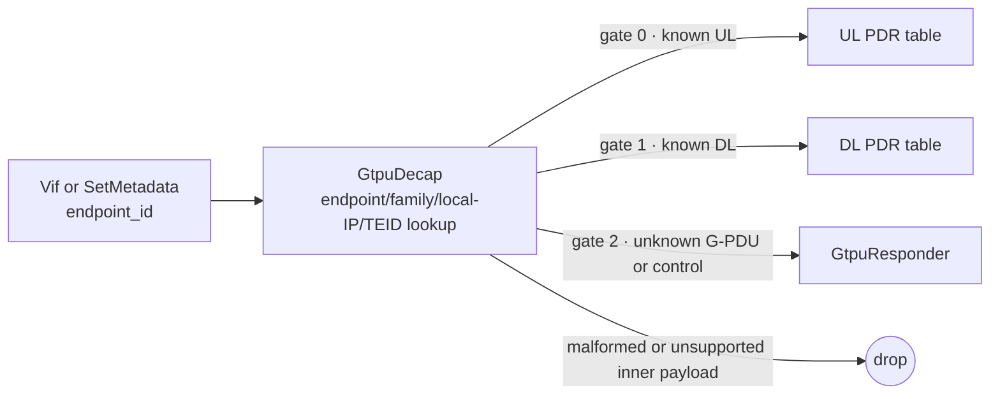

# GTP-U ingress admission

`GtpuDecap` admits packets by endpoint ID, outer address family/address and
TEID, then decapsulates known UL/DL G-PDUs. Gate 2 carries unknown G-PDUs and
control traffic to `GtpuResponder`.

## Packet path



The endpoint tag must be nonzero and must match the local endpoint identity the
controller programmed. Production graphs tag N3 and N9 traffic before they
enter `GtpuDecap`; a single-endpoint test graph can use `SetMetadata`. The
endpoint ID comes from the graph, not from the packet.

## Admission key and value

`GtpuDecap` owns `<module>/fteids`, an exact-index resource. Its protobuf key is
`FteidKey`:

| field | constraint |
|---|---|
| `endpoint_id` | nonzero endpoint ID tagged before decap |
| `address_family` | `4` or `6` |
| `local_address` | exactly 4 raw bytes for IPv4 or 16 for IPv6; the outer destination address |
| `teid` | nonzero TEID |

The internal key is 25 bytes: endpoint ID in BE32, one family byte, a 16-byte
address slot, then TEID in BE32. IPv4 occupies the final four bytes of the
address slot. `FteidEntry` is `{direction, context_id}`: `direction` is `0` for
UL or `1` for DL, and `context_id` is the nonzero compiler-allocated admission
context (`0` is refused). Admission is
exact; a pending resource reservation is not visible as an admitted tunnel.

The endpoint ID, family, local outer destination, and TEID all scope a tunnel.
The same TEID can therefore exist at a different endpoint or local address.
A second PFCP session cannot claim the same complete key. Multiple PDRs in one
session can reuse their chosen F-TEID. CHOOSE ID/CHID state is scoped to that
PFCP session; it does not create a group-level N4 session.

## Packet handling

`GtpuDecap` parses the outer Ethernet/IP/UDP/GTP-U headers, builds one key from
the endpoint tag and parsed outer destination, and performs a batched exact
lookup. A known UL G-PDU leaves gate 0; a known DL G-PDU leaves gate 1. Both are
decapsulated to an inner Ethernet frame. An unknown G-PDU leaves gate 2 whole.
A non-G-PDU frame classified by BESS as GTP-U control also leaves gate 2 whole.
Malformed outer/GTP-U frames, a zero endpoint tag, and admitted packets whose
inner payload does not start with IPv4 or IPv6 are dropped.

On successful decapsulation the module writes `fteid_context` (BE32, the
matched entry's `context_id`) and QFI (U8); it reads the input `endpoint_id`.
The QFI is taken from the PDU Session Container when present, or set to the
no-QFI marker otherwise. The PDR tables key on `fteid_context` and QFI after
decapsulation: 7 fields uplink (inner 5-tuple, `fteid_context`, QFI) and 8
downlink (adding `route_domain`). Each (session, direction, endpoint, TEID) has
its own context; the IPv4 and IPv6 keys of one dual-stack F-TEID share one, and
the same TEID on another endpoint or session gets another. BESS assigns metadata offsets only
when attributes have readers, so each graph must retain the readers for the
attributes its modules write.

Gate 2 is connected to `GtpuResponder` in the deployment graph. It answers
Echo Requests, answers unknown nonzero-TEID G-PDUs with Error Indications, and
can count peer Error Indications by TEID when `track_errors` is enabled. With
`track_end_markers` it records each received End Marker with the `endpoint_id`
it arrived on, for the End Marker Reception Report (TS 29.244 8.2.41 EMRRE).
It drops message types it does not answer.

## Controller configuration

With `-bess`, `upfd` requires at least one N3 endpoint. N9 is optional. Each
repeatable `-fteid-address` value has this form:

```text
endpoint=<id>,reference=<n3|n9>,transport-domain=<id>,source=<access|core>[,instance=<name>][,ipv4=<addr>][,ipv6=<addr>]
```

`transport-domain` is nonzero and selects the post-encap transport FIB; it is
not the ingress admission key. N3 uses `source=access`; N9 uses `source=core`.
When `-instances` is configured, endpoint mappings must name a valid instance.
At least one IP family is required. The graph's `endpoint_id` tags and local
addresses must agree with these mappings and with the Router resolver
interfaces.

For an incoming F-TEID, the compiler selects an endpoint using the PDR's source
interface, instance, and requested address families. Config order is the
CHOOSE preference. A pinned F-TEID address must match the configured local
address. For CHOOSE, PDRs in one session that reuse a CHID share one allocated
TEID and endpoint; distinct CHIDs can allocate independently. The compiler
writes one admission entry per selected address family and returns the chosen
F-TEID in Created PDR. Endpoint ownership and TEID allocation are tracked per
PFCP session; programming another session with the same complete admission key
is refused.

Admission does not replace the inner PDR match. The classifier still needs the
UE address and any SDF/QFI constraints its key represents. A session with no UE
address cannot be represented by the current classifier and is refused.

## Code and executable evidence

The implementation is in `datapath/gtpu_decap.{h,cc}` and
`datapath/gtpu_admission.h`; key/value schema is in
`datapath/upf_datapath.proto`; controller resource ownership and CHOOSE
selection are in `internal/session/compile.go` and `internal/session/transport.go`.
`datapath/gtpu_datapath_test.cc` exercises admission and packet handling.
`ci/smoke-gtpu.sh` exercises the graph-level gates and metadata with real BESS
packets.
